# الهيكل العام الموحد لشاشات التفاصيل وفلسفة تجربة الهاتف المحمول
## General Details Screen Layout Architecture & Mobile Touch-First Philosophy

> **النطاق:** مرجع معماري تأسيسي لشاشات تفاصيل الوسائط في تطبيق "مدد TV".  
> **المنصة المستهدفة:** هواتف أندرويد الذكية (Android Mobile Phones) حصراً • شاشات اللمس الرأسية (Portrait-First Touch UI).  
> **الفلسفة الأساسية:** المحتوى هو البطل • سواد OLED تام (`#000000`) • بيئة لمس تفاعلية تدعم الاستخدام بيد واحدة (One-Handed & Thumb Zone Ergonomics).

---

## 1. فلسفة التصميم لهواتف أندرويد (Touch-First & Thumb Zone Principles)

على الهواتف المحمولة، يتم التفاعل مباشرة عبر لمس الشاشة بالإبهام وأصابع اليد، في وضع الإمساك الرأسي (Portrait Mode) غالباً.

### القواعد الحاكمة لواجهة الهاتف:
1. **منطقة راحة الإبهام (The Natural Thumb Zone):**
   * وضع العناصر الحيوية وأزرار الإجراءات الرئيسية (زر التشغيل، الاستئناف، التنزيل، والقوائم السفلية) في النصف السفلي من الشاشة لسهولة الوصول إليها بإبهام يد واحدة دون الحاجة لتمديد اليد إلى أعلى الهاتف.
2. **قاعدة الارتفاع الذهبي للغلاف (Max Height 220dp):**
   * تقييد الارتفاع الأقصى للغلاف السينمائي بـ `220dp` (حوالي 30% فقط من ارتفاع الشاشة) لمنع ابتلاع واجهة الهاتف وضمان بقاء العنوان وزر التشغيل الرئيسي ظاهرين فور فتح الشاشة في الشاشة الأولى (Above the Fold).
3. **المعمارية الهجينة عند غياب الغلاف العريض (Adaptive Artwork Strategy):**
   * عند توفر غلاف عريض 16:9 (`Backdrop`): يُعرض بارتفاع 220dp متلاشياً في السواد التام.
   * عند توفر بوستر عمودي فقط 2:3 (`Poster Only`): يُمنع قص البوستر أو فرده بالعرض؛ بل تُطبق عليه ضبابية كربونية عميقة (`Gaussian Blur 50dp`) كخلفية جوية، مع وضع البوستر الأصلي الحاد بنسبته الصحيحة (`100dp x 150dp`) بجانب العنوان.
4. **شريط العنوان المتلاشي المتكيف (Collapsing Toolbar):**
   * عند التمرير الرأسي لأعلى: يتقلص الغلاف بسلاسة من `220dp` إلى شريط علوي مدمج (Pinned Toolbar) بارتفاع `56dp` يحتوي على عنوان العمل وزر الرجوع وزر المفضلة.
5. **التدرج المزدوج للحماية والاندماج (Dual Protection Scrims):**
   * تدرج علوي (`Top Scrim 48dp`): لحماية وضوح أيقونات شريط الحالة (الساعة والبطارية) وزر الرجوع.
   * تدرج سفلي (`Bottom Vignette`): يبدأ من منتصف الغلاف ويتلاشى 100% نحو السواد التام `#000000` ليسمح بدمج النصوص والشارات دون حواف حادة.
6. **أهداف اللمس القياسية (Standard Touch Targets):**
   * الالتزام بألا يقل أي عنصر تفاعلي أو زر عن قياس `48dp x 48dp` لمنع اللمسات الخاطئة أثناء المشي أو الاستخدام السريع.
7. **اللوحات السفلية التفاعلية (Modal Bottom Sheets):**
   * بدلاً من النوافذ المعقدة أو الحوارات المنبثقة، يتم استعراض مسارات الترجمة، اللغات الصوتية، الفصول، وتفاصيل الحلقات عبر لوحات سفلية تسحبها الأصابع بسلاسة من الأسفل للأعلى (Draggable Bottom Sheets).

---

## 2. التقسيم الهيكلي الرأسي لشاشة الهاتف

```mermaid
flowchart TD
    PhoneScreen["شاشة تفاصيل الهاتف (Mobile Portrait Screen)"] --> TopArea["1. المنطقة العلوية: الغلاف السينمائي المتلاشي (Collapsing Backdrop)"]
    PhoneScreen --> MiddleArea["2. المنطقة الوسطى: بطاقة الهوية والأختام (Title & Badges)"]
    PhoneScreen --> ActionArea["3. منطقة التفاعل والإجراءات الرئيسية (Thumb Action Area)"]
    PhoneScreen --> ContentArea["4. منطقة المحتوى الديناميكي والتمرير (Scrollable Dynamic Body)"]

    TopArea --> T1["صورة الغلاف العريضة 16:9 مع تدرج متلاشي في السواد"]
    TopArea --> T2["شريط علوي شفاف: زر الرجوع وزر المشاركة"]

    MiddleArea --> M1["عنوان العمل والاسم الأصلي"]
    MiddleArea --> M2["سنة الإنتاج، التقييم، والمدة الزمنية"]
    MiddleArea --> M3["شريط الأختام المونوكرومية (4K, HDR, 5.1, ترجمة)"]

    ActionArea --> A1["زر التشغيل العريض أو استئناف المشاهدة (مع شريط التقدم)"]
    ActionArea --> A2["أزرار الوصول السريع: تنزيل، مفضلة، مقطع دعائي"]

    ContentArea --> C1["ملخص القصة مع التوسيع السريع"]
    ContentArea --> C2["الأفلام: فصول العمل، طاقم التمثيل، مقترحات المشاهدة"]
    ContentArea --> C3["المسلسلات: محدد المواسم، وقائمة الحلقات التفاعلية"]
    ContentArea --> C4["الموسيقى: تراكليست مرقم، ومشغل مصغر في الأسفل"]
```



---

## 3. المخطط الهيكلي القياسي لهاتف أندرويد (Mobile Wireframe)

```text
┌────────────────────────────────────────┐
│ [<- رجوع]                 [مشاركة] [*] │
├────────────────────────────────────────┤
│                                        │
│   [غلاف سينمائي عريض Backdrop 16:9]    │
│   [تدرج ناعم متلاشي في السواد #000000] │
│                                        │
│ Interstellar (2014)                    │
│ * 8.7 · ساعتان و 49 دقيقة · +13        │
│ [4K UHD] [HDR10] [صوت محيطي] [ترجمة]   │
│                                        │
│ ┌────────────────────────────────────┐ │
│ │ [>] استئناف المشاهدة (متبقي 42 د) │ │ <-- منطقة راحة الإبهام
│ │ [══════════ شريط التقدم ═════════] │ │
│ └────────────────────────────────────┘ │
│                                        │
│ ┌──────────┐ ┌──────────┐ ┌──────────┐ │
│ │  تنزيل   │ │  تريلر   │ │  المفضلة │ │
│ └──────────┘ └──────────┘ └──────────┘ │
│                                        │
│ القصة:                                 │
│ فريق من رواد الفضاء يسافر عبر ثقب دودي │
│ في محاولة لإنقاذ البشرية... [المزيد]   │
│                                        │
│ ═══════ طاقم التمثيل (سحب أفقي) ══════ │
│ (ماثيو ماكونهي) (آن هاثاواي) (جيسيكا)  │
│                                        │
│ ═══════ المحتوى التخصصي السفلي ═══════ │
│ [أفلام: فصول ومواد إضافية]            │
│ [مسلسلات: تبويب مواسم وقائمة حلقات]   │
└────────────────────────────────────────┘
```

---

## 4. إيماءات وتفاعلات اللمس المعتمدة (Touch Gestures)

1. **السحب الرأسي (Vertical Scroll):** تمرير مرن وسريع لقراءة القصة وتصفح الحلقات أو المسارات.
2. **السحب الأفقي (Horizontal Swipe):** تصفح طاقم الممثلين، فصول الفيلم، أو الأعمال المقترحة دون مغادرة الصفحة.
3. **الضغط المطول (Long Press):** على أي حلقة أو فيلم لعرض قائمة خيارات سريعة (تنزيل فوري، تحديد كمشاهد، أو إضافة لقائمة التشغيل).
4. **السحب لأسفل (Pull to Dismiss / Drag Down):** إغلاق القوائم واللوحات السفلية (Bottom Sheets) بسلاسة.
