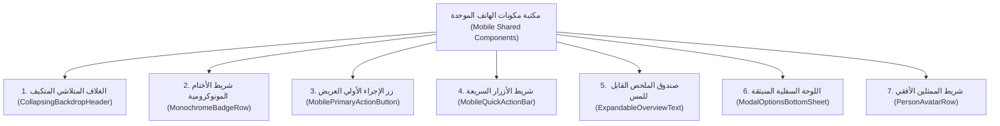

# المكونات المشتركة القابلة لإعادة الاستخدام لهواتف أندرويد
## Reusable Mobile Components & Touch Design Philosophy

> **النطاق:** مكتبة المكونات التفاعلية الموحدة لشاشات التفاصيل في تطبيق "مدد TV" لهواتف أندرويد.  
> **التقنية:** Jetpack Compose Mobile • نظام رموز الأوبسيديان (`Obsidian Design Tokens`).  
> **ميثاق الجودة:** استجابة لمسية فورية • أهداف لمس قياسية (`48dp+`) • منع الإيموجيات والهالات الصاخبة.

---

## 1. فهرس المكونات المشتركة للهاتف

---

## 2. مواصفات وفلسفة تصميم كل مكون

### المكون 1: الغلاف المتلاشي المتكيف (`CollapsingBackdropHeader`)
* **الفلسفة والمعمارية:**
  * **تقييد الارتفاع الذهبي:** يُحدد أقصى ارتفاع بـ `220dp` بنسبة 16:9 قياسية لضمان ظهور العنوان وشريط الأختام وزر التشغيل الأولي فوق خط الطي (Above the Fold) فور فتح الصفحة.
  * **المعمارية الهجينة (Adaptive Artwork):**
    * إذا توفر غلاف عريض (`backdropUrl != null`): يعرض الغلاف العريض ممتداً بعرض الشاشة.
    * إذا لم يتوفر غلاف عريض وكان المتوفر بوستر عمودي (`posterUrl != null`): يتم عرض البوستر نفسه كخلفية علوية بتطبيق ضبابية كربونية عميقة (`Modifier.blur(50.dp)`) مع تعتيم داكن 80%، وتوضع صورة البوستر الحادة بنسبتها الأصلية 2:3 بجانب العنوان لإنهاء مشكلة التشويه والقص القسري.
  * **نظام التدرج المزدوج (Dual Scrim System):**
    * `Top Status Bar Scrim`: تدرج كربوني بارتفاع `48dp` في أعلى الشاشة يضمن وضوح أيقونات الساعة والبطارية وزر الرجوع.
    * `Bottom Vignette`: تدرج متلاشي يبدأ من منتصف الغلاف ويصل لنسبة 100% سواد تام `#000000` عند حافة الغلاف السفلية.
* **سلوك التمرير (Scroll Behavior):**
  * يتقلص الغلاف مع التمرير الرأسي لأعلى ليتحول عند نقطة الانكماش الكامل إلى شريط أدوات علوي مدمج (Pinned Toolbar) بارتفاع `56dp` أسفل شريط الحالة.
* **المدخلات البرمجية المقترحة (Compose Props):**
  * `backdropUrl: String?`
  * `posterUrl: String?`
  * `maxHeight: Dp = 220.dp`
  * `minHeight: Dp = 56.dp`
  * `scrollProgress: Float` (من 0.0 ممتد إلى 1.0 منكمش)

---

### المكون 2: شريط الأختام المونوكرومية (`MonochromeBadgeRow`)
* **الفلسفة:** أختام مستطيلة محفورة بخط مونوكرومي أحادي المسافة (`11sp`) بحدود رمادية ناعمة (`Slate700`).
* **البيانات المعروضة:** `[4K UHD]`, `[HDR10]`, `[صوت محيطي]`, `[ترجمة عربية]`, `[+16]`.
* **هندسة اللمس:** شريط غير قابل للنقر التشتيتي، يُعرض كمعلومات صامتة ومريحة للعين فوق أزرار الإجراءات.

---

### المكون 3: زر الإجراء الأولي العريض (`MobilePrimaryActionButton`)
* **الفلسفة:** العنصر الأهم للمشاهد، مصمم بارتفاع كامل `56dp` ليكون سهل النقر بإبهام اليد الواحدة.
  * لون السطح: أبيض عاجي ناصع (`Ivory50`) أو ذهبي سينمائي دافئ (`GoldCinema`) بنص أسود صلب عريض.
  * شريط التقدم: في حال وجود مشاهدة مسبقة، يظهر شريط تقدم أحمر أو رمادي رفيع في أسفل الزر مع توضيح الدقائق المتبقية.
* **الخصائص:**
  * `text: String` (مثل: "استئناف المشاهدة (متبقي 35 دقيقة)" أو "تشغيل الآن")
  * `progress: Float?` (من 0.0 إلى 1.0)
  * `onClick: () -> Unit`

---

### المكون 4: شريط الأزرار السريعة (`MobileQuickActionBar`)
* **الفلسفة:** صف أفقي من الأزرار الكربونية المريحة بأهداف لمس قياسية (`48dp x 48dp` على الأقل) تتيح التفاعل بلمسة واحدة:
  * زر التنزيل للمشاهدة لاحقاً دون إنترنت (مع حالة تقدم التنزيل).
  * زر حفظ في المفضلة.
  * زر المقطع الدعائي (Trailer).
  * زر اللوحة السفلية (المزيد من الخيارات).

---

### المكون 5: صندوق الملخص القابل للمس (`ExpandableOverviewText`)
* **الفلسفة:** عرض قصة العمل بخط عربي واضح (`15sp`) مقيد بثلاثة أسطر. لمس النص يوسعه بانسيابية لعرض النص كاملاً مع حركة فيزيائية ناعمة دون وميض.

---

### المكون 6: اللوحة السفلية المنبثقة (`ModalOptionsBottomSheet`)
* **الفلسفة:** المكون المعتمد في هواتف أندرويد لعرض القوائم الإضافية دون مغادرة الشاشة.
* **استخداماته:**
  * اختيار مسارات الصوت المتوفرة واللغات.
  * اختيار ملفات الترجمة وحجم الخط وتوقيت المزامنة.
  * خيارات الجودة وسرعة البث.
* **التفاعل:** تسحبها الأصابع من أسفل الشاشة وتُغلق بالسحب لأسفل.

---

### المكون 7: شريط الممثلين الأفقي (`PersonAvatarRow`)
* **الفلسفة:** شريط أفقي يدعم التمرير السريع بالسحب (Horizontal Swipe)، يعرض صور الممثلين الدائرية بقطر `56dp` يعلوها الاسم الحقيقي واسم الشخصية الملعوبة.
