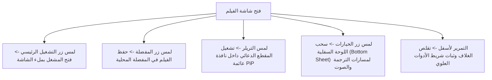

# شاشة تفاصيل الأفلام السينمائية للهاتف المحمول
## Screen Specification: Mobile Movie Details Screen

> **النوع المستهدف:** `BaseItemKind.Movie`  
> **المنصة:** هاتف أندرويد الذكي (Android Mobile Phone) • تفاعل لمسي رأسي (Portrait Touch UI).  
> **المرجع المعماري:** [00_general_layout_architecture.md](./00_general_layout_architecture.md)  
> **المكونات المشتركة:** [01_shared_components_and_philosophy.md](./01_shared_components_and_philosophy.md)

---

## 1. الهوية البصرية ومحاور تجربة الهاتف

صُممت شاشة الفيلم لتوفر تجربة سينمائية غامرة على شاشة الهاتف، مع إمكانية بدء المشاهدة الفورية بلمسة واحدة بالإبهام:

### المحاور الأساسية:
1. **شريط الغلاف العلوي المتكيف:** بانر عريض 16:9 يتلاشى في السواد، ويتحول إلى شريط علوي صغير مثبت عند التمرير لأسفل الصفحة.
2. **زر الإجراء الرئيسي في متناول الإبهام:** زر عريض أسفل البانر يتيح "استئناف المشاهدة" مع شريط تقدم أحمر مدمج، أو "تشغيل الفيلم" من البداية.
3. **التنزيل السريع للمشاهدة بدون إنترنت:** زر بارز يتيح حفظ الفيلم في الذاكرة المحلية للجهاز بضغطة واحدة، مع مؤشر دائري لنسبة التنزيل.
4. **لوحة خيارات الصوت والترجمة السفلية (Bottom Sheet):** ضغط زر الخيارات يفتح لوحة سفلية لاختيار لغة الصوت (مثل الإنجليزية 5.1 أو الدبلجة) وملفات الترجمة العربية المدمجة أو الخارجية.
5. **الفصول والمواد الإضافية بالسحب الأفقي:** استعراض فصول الفيلم المصورة وكواليس التصوير بالسحب السريع لليسار واليمين.

---

## 2. المخطط الهيكلي لهاتف أندرويد (Mobile Portrait Wireframe)

```text
┌────────────────────────────────────────┐
│ [<- رجوع]                 [مشاركة] [*] │
├────────────────────────────────────────┤
│                                        │
│   [غلاف الفيلم السينمائي العريض 16:9]  │
│   [تدرج ناعم متلاشي في السواد #000000] │
│                                        │
│ Inception (2010)                       │
│ * 8.8 · ساعتان و 28 دقيقة · PG-13      │
│ [4K UHD] [HDR10] [صوت محيطي 5.1] [ترجمة│
│                                        │
│ ┌────────────────────────────────────┐ │
│ │ [>] استئناف الفيلم (متبقي 45 دقيقة)│ │ <-- زر عريض بارتفاع 56dp
│ │ [══════════ شريط التقدم ═════════] │ │
│ └────────────────────────────────────┘ │
│                                        │
│ ┌──────────┐ ┌──────────┐ ┌──────────┐ │
│ │  تنزيل   │ │  تريلر   │ │  المفضلة │ │
│ └──────────┘ └──────────┘ └──────────┘ │
│                                        │
│ القصة:                                 │
│ لص محترف يدخل عقول الناس لسرقة أسرارهم │
│ يُكلف بمهمة شبه مستحيلة لزرع فكرة...   │
│ [قراءة المزيد...]                      │
│                                        │
│ ══════ طاقم العمل والتمثيل (سحب) ═════ │
│ (دي كابريو) (جوزيف غوردون) (توم هاردي) │
│                                        │
│ ══════ فصول الفيلم المصورة (سحب) ═════ │
│ ┌──────────┐ ┌──────────┐ ┌──────────┐ │
│ │ فصل 1    │ │ فصل 2    │ │ فصل 3    │ │
│ │ 00:00    │ │ 18:20    │ │ 45:10    │ │
│ └──────────┘ └──────────┘ └──────────┘ │
│                                        │
│ ══════ المواد الإضافية والكواليس ═════ │
│ [كواليس تصوير مشهد الممر] [مشاهد محذوفة│
└────────────────────────────────────────┘
```

---

## 3. تدفق تفاعلات اللمس على الهاتف



---

## 4. الحقول المستلمة من السيرفر ومعالجة النقص

* **جلب تفاصيل الفيلم:** `GET /Items/{itemId}?userId={userId}`
* **حالات النقص على الهاتف:**
  * إذا لم تتوفر فصول للفيلم (`Chapters` فارغة): يتم إخفاء قسم الفصول والتمرير مباشرة إلى طاقم التمثيل ثم الأفلام المقترحة.
  * إذا لم تتوفر مقاطع كواليس (`SpecialFeatures` فارغة): يتم إخفاء قسم المواد الإضافية بالكامل.
  * إذا غاب الغلاف العريض: يتم استخدام بوستر الفيلم مع تمويه كربوني ناعم.
