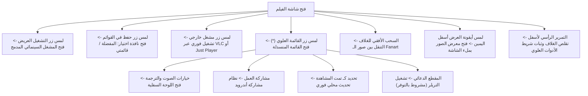

# شاشة تفاصيل الأفلام السينمائية للهاتف المحمول
## Screen Specification: Mobile Movie Details Screen (Final Redesign Specification)

> **النوع المستهدف:** `BaseItemKind.Movie`  
> **المنصة المستهدفة:** هاتف أندرويد الذكي (Android Mobile Phone) • تفاعل لمسي رأسي (Portrait-First Touch UI).  
> **المرجع المعماري الأساسي:** [00_general_layout_architecture.md](./00_general_layout_architecture.md)  
> **مكتبة المكونات المشتركة:** [01_shared_components_and_philosophy.md](./01_shared_components_and_philosophy.md)  
> **القرارات المعمارية الحاكمة:** [ADR 0004: نظام OLED True Black](../../adr/0004_oled_true_black_design_system.md) • [ADR 0005: تأجيل واستئصال التنزيلات](../../adr/0005_deferring_offline_downloads.md)

---

## 1. الهوية البصرية وفلسفة التصميم النهائي

تمت إعادة هيكلة شاشة الفيلم بالكامل وفق مبدأ "النقاء البصري والتركيز السينمائي التام" (Extreme Visual Purity & Cinematic Focus) للتخلص من أي ازدحام للأزرار، وضمان وصول إبهام اليد الواحدة لكافة الوظائف الحيوية فور فتح الشاشة:

### المبادئ التصميمية المعتمدة:
1. **غلاف البطل السينمائي بنصف ارتفاع الشاشة (50% Hero Canvas):**
   * الغلاف يستحوذ ديناميكياً على 50% من الارتفاع الكلي لشاشة الهاتف (`Modifier.fillMaxHeight(0.5f)`).
   * تدرج علوي خفيف لحماية أزرار شريط الحالة والتحكم، مع تدرج كربوني سفلي متلاشٍ بنسبة 100% في سواد OLED التام `#000000`.
   * يتقلص الغلاف بسلاسة فيزيائية عند التمرير الرأسي لأعلى ليتحول إلى شريط علوي مدمج مثبت بارتفاع `56dp`.
2. **شريط الأدوات العلوي المقتضب والقائمة المنبثقة الشاملة (Minimalist Top Bar):**
   * زر الرجوع في جانب، وزر قائمة منسدلة ثلاثي النقاط (`MoreVert` / `...`) في الجانب المقابل يفتح قائمة أوبسيديان (`Graphite900`) تضم:
     * **خيارات الصوت والترجمة والمشغل الخارجي:** تفتح اللوحة السفلية لمسارات الصوت والترجمة.
     * **مشاركة الفيلم:** استدعاء نافذة المشاركة القياسية في نظام أندرويد.
     * **تحديد كـ تمت المشاهدة:** تبديل حالة المشاهدة محلياً في Room DB.
     * **المقطع الدعائي (Trailer):** مشروط قطعياً بتوفر رابط فيديو في السيرفر (`if (!trailerUrl.isNullOrBlank())`)، ويختفي تلقائياً عند غيابه.
3. **أدوات الغلاف السينمائي الخالية تماماً من الكبسولات والحدود (Borderless Pure Icons):**
   * **أسهم التنقل الجانبية:** أسهم رقيقة عائمة على طرفي الغلاف تظهر فقط إذا احتوى الفيلم على أكثر من غلاف خلفي في السيرفر (`backdrops.size > 1`)، مع دعم السحب الأفقي المباشر (Horizontal Pager).
   * **زر المعاينة بملء الشاشة:** أيقونة عرض مفرغة ونقية أسفل يمين الغلاف بدون أي إطارات أو كبسولات، تفتح معرض الأغلفة بدقته الأصلية (4K) للتكبير والتأمل.
4. **المعالجة الهندسية لغياب الغلاف (Fallback Artwork Architecture):**
   * **توفر بوستر عمودي 2:3 فقط:** خلفية ضبابية كربونية عميقة (`Modifier.blur(50.dp)`) للبوستر، مع طفو أيقونة التطبيق المونوكرومية في المنتصف.
   * **غياب كافة الصور تماماً:** خلفية سواد OLED تام `#000000` مع هالة إشعاعية دائرية خافتة جداً، وفي المنتصف تطفو أيقونة التطبيق الرسمية المفرغة (`ic_launcher_monochrome`) بمقاس `76dp` بلون عاجي خافت (`Ivory50` بشفافية 35%) بدون أي كبسولات أو إطارات.
5. **هندسة منطقة الإبهام (Thumb Action Zone):**
   * **الصف الأول (زر التشغيل المنفرد):** زر عريض بكامل العرض بارتفاع `54dp` بلون أبيض عاجي ناصع (`Ivory50`) بكلمة واحدة مباشرة: **"تشغيل"** أو **"استئناف"** (مع شريط تقدم خفيف مدمج بسماكة `3dp` في أسفل الزر للمشاهدة السابقة).
   * **الصف الثاني (الثنائي المتناظر 48dp):** زر كربوني لـ **"حفظ في القوائم"** (يفتح نافذة صغيرة لاختيار: المفضلة / قائمة المشاهدة)، وبجانبه زر لـ **"مشغل خارجي"** لإطلاق VLC أو Just Player مباشرة.

---

## 2. المخطط الهيكلي المعتمد لهاتف أندرويد (Mobile Portrait Wireframe)

```text
┌────────────────────────────────────────────────────────┐
│ [<- رجوع]                                          [*] │  <-- زر القائمة المنسدلة الشاملة
├────────────────────────────────────────────────────────┤
│                                                        │
│       [غلاف سينمائي عريض يستحوذ على 50% من الشاشة]     │
│                                                        │
│ [<]                                                [>] │  <-- أسهم تنقل رقيقة بدون كبسولات (إن تعددت الصور)
│                                                        │
│                                            [أيقونة عرض]│  <-- زر معاينة الغلاف أسفل اليمين بدون كبسولة
│   [تلاشي كربوني سفلي ناعم 100% في سواد OLED #000000]   │
├────────────────────────────────────────────────────────┤
│ Inception (2010)                                       │
│ * 8.8 IMDb · ساعتان و 28 دقيقة · PG-13                 │
│ [أكشن] [خيال علمي] [إثارة]                             │  <-- كبسولات تصنيف تفاعلية
│ [4K UHD] [HDR10] [Direct Play] [صوت 5.1] [ترجمة عربية] │  <-- أختام Infuse المونوكرومية
│                                                        │
│ ┌────────────────────────────────────────────────────┐ │
│ │                      [>] تشغيل                     │ │  <-- زر التشغيل المنفرد العريض (أبيض عاجي 54dp)
│ └────────────────────────────────────────────────────┘ │
│                                                        │
│ ┌──────────────────────────┐┌────────────────────────┐ │
│ │    [+] حفظ في القوائم    ││     [->] مشغل خارجي    │ │  <-- ثنائي متناظر ومريح لراحة الإبهام (48dp)
│ └──────────────────────────┘└────────────────────────┘ │
│                                                        │
│ القصة:                                                 │
│ لص محترف يدخل عقول الناس لسرقة أسرارهم التجارية...    │
│ [قراءة المزيد...]                                      │
│                                                        │
│ ═════════ طاقم التمثيل وصناع العمل (سحب أفقي) ════════ │
│ (دي كابريو)   (جوزيف غوردون)   (توم هاردي)   (إليوت)   │  <-- تقديم الممثلين قبل الفصول
│                                                        │
│ ═════════ فصول الفيلم المصورة (إن وجدت) ══════════════ │
│ [فصل 1: البداية]  [فصل 2: المقهى]  [فصل 3: القطار]     │  <-- مخفية تلقائياً إذا كانت فارغة
│                                                        │
│ ═════════ أعمال مشابهة ومقترحة (سحب أفقي) ════════════ │
│ [بوستر فيلم 1]   [بوستر فيلم 2]   [بوستر فيلم 3]        │
└────────────────────────────────────────────────────────┘
```

---

## 3. تدفق تفاعلات اللمس على الهاتف (Touch Interaction Flow)



---

## 4. مواصفات النوافذ التفاعلية واللوحات السفلية (Modals & Sheets)

### 1. نافذة الحفظ في القوائم المنبثقة (`Compact Save Modal`)
* تُفتح عند الضغط على زر "حفظ في القوائم".
* تصميم نافذة سفلية مقتضبة بزوايا ناعمة (`16dp`) وخلفية `Graphite900`:
  * **خيار المفضلة:** مربع اختيار (Checkbox) لتمييز الفيلم كمفضل محلياً.
  * **خيار قائمتي (Watchlist):** مربع اختيار لإضافة العمل لقائمة المشاهدة لاحقاً.
* الأيقونة الخارجية على الزر تتلون باللون الذهبي (`RatingGold`) وتتحول لشكل ممتلئ في حال تفعيل أي من الخيارين.

### 2. لوحة مسارات الصوت والترجمة السفلية (`Playback Options Sheet`)
* تُفتح من القائمة العلوية (`Top Actions Menu`):
  * **قسم مسارات الصوت:** لغات الصوت، قنوات الصوت (Stereo / 5.1 / 7.1)، ونوع الترميز.
  * **قسم ملفات الترجمة:** اختيار ملف الترجمة المدمج أو الخارجي، أو تعطيل الترجمة.
  * **محاذاة الوقت:** خيار ضبط تأخير أو تقديم توقيت الترجمة.

---

## 5. الحقول المستلمة من السيرفر واستراتيجية معالجة النقص

* **جلب بيانات الفيلم:** `GET /Items/{itemId}?userId={userId}`
* **استراتيجية معالجة النقص:**
  * **الأغلفة المتعددة (`BackdropImageTags`):** إذا كان الحجم = 1 تختفي أسهم التنقل، وإذا كان فارغاً يتم التبديل التلقائي لنموذج أيقونة التطبيق المفرغة.
  * **التريلر:** فحص `RemoteTrailers` أو المسارات المحلية؛ إذا انعدمت يتم إخفاء الخيار تماماً من القائمة العلوية.
  * **الفصول والمواد الإضافية:** إخفاء كامل للقسم عند غياب البيانات لمنع المساحات البيضاء أو الرسائل السلبية.
