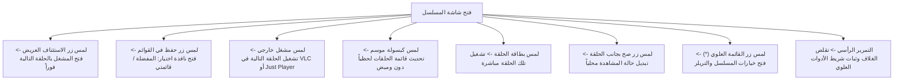

# شاشة تفاصيل المسلسلات والمواسم للهاتف المحمول
## Screen Specification: Mobile Series, Seasons & Episodes Screen (Inherited Redesign)

> **النوع المستهدف:** `BaseItemKind.Series`, `Season`, `Episode`  
> **المنصة المستهدفة:** هاتف أندرويد الذكي (Android Mobile Phone) • تفاعل لمسي رأسي (Portrait-First Touch UI).  
> **المرجع المعماري الأساسي:** [00_general_layout_architecture.md](./00_general_layout_architecture.md)  
> **مكتبة المكونات المشتركة:** [01_shared_components_and_philosophy.md](./01_shared_components_and_philosophy.md)  
> **القرارات المعمارية الحاكمة:** [ADR 0004: نظام OLED True Black](../../adr/0004_oled_true_black_design_system.md) • [ADR 0005: تأجيل واستئصال التنزيلات](../../adr/0005_deferring_offline_downloads.md)

---

## 1. الهوية البصرية وميثاق التوريث

ترث شاشة المسلسلات القالب العام الموحد لتطبيق "مدد TV" وتطبق الفروق الوظيفية الحصرية لتصفح المواسم واستئناف الحلقات بسلاسة:

### العناصر الموروثة من القالب الموحد:
1. **غلاف البطل السينمائي بنصف ارتفاع الشاشة (50% Hero Canvas):**
   * يستحوذ على 50% من الشاشة مع تلاشٍ كربوني متدرج 100% في سواد OLED التام `#000000`.
   * أسهم تنقل جانبية رقيقة بدون كبسولات تظهر فقط إن تعددت الأغلفة، مع زر المعاينة بملء الشاشة أسفل اليمين بدون حدود.
   * طفو أيقونة التطبيق المفرغة (`ic_launcher_monochrome`) بنعومة في المنتصف في حالة غياب الغلاف.
2. **الشريط العلوي المقتضب والقائمة المنبثقة الشاملة:**
   * زر الرجوع في جانب، وزر القائمة المنسدلة الثلاثي (`MoreVert`) في الجانب المقابل (خيارات الصوت والترجمة، مشاركة المسلسل، تحديد كامل المسلسل كمشاهد، والمقطع الدعائي المشروط بالتوفر).
3. **صف الإجراءات الثانوي المتناظر (48dp):**
   * زر **"حفظ في القوائم"** (يفتح نافذة صغيرة لاختيار: المفضلة / قائمتي).
   * زر **"مشغل خارجي"** (لتشغيل الحلقة التالية في مشغل خارجي مثل VLC أو Just Player).

---

## 2. الفروق التخصصية الحصرية لشاشة المسلسلات

1. **زر التشغيل الذكي للحلقة التالية (Next Up Hero Button - 54dp):**
   * يتموضع كزر عريض منفرد بالأبيض العاجي الناصع (`Ivory50`) بكلمات محددة وصريحة:
     * **في حال توفر حلقة للاستئناف:** يُكتب عليه: **"استئناف: ح X · م Y"** (مع شريط التقدم الخفيف `3dp` في أسفل الزر في حال بدأت الحلقة مسبقاً).
     * **إذا لم يبدأ المسلسل بعد:** يُكتب عليه: **"بدء الحلقة الأولى"**.
     * **إذا شاهد المستخدم كافة الحلقات:** يتحول إلى: **"إعادة من الحلقة الأولى"**.
2. **محدد المواسم الهجين (Season Selector):**
   * يجمع بين الكبسولات الأفقية والقائمة المنسدلة لتوفير أقصى قدر من المرونة:
     * **كبسولات المواسم الأفقية (`Horizontal Tabs`):** تتيح التبديل الفوري بالسحب والنقر بين المواسم الأولى دون حجب الرؤية.
     * **زر القائمة المنسدلة الجانبي (`Dropdown Picker`):** زر مدمج لاختيار الموسم مباشرة والقفز للمواسم البعيدة دون الحاجة للتمرير الطويل.
3. **قائمة الحلقات الرأسية التفاعلية (`Vertical Episode List`):**
   * بطاقات أفقية أنيقة لكل حلقة بنظام الكرت الكربوني المدخن:
     * **صورة مصغرة 16:9:** مع شريط تقدم المشاهدة وشارة المشاهدة المكتملة. في حال غياب الصورة، تظهر بطاقة كربونية بديلة برقم الحلقة واضحاً.
     * **بيانات الحلقة:** رقم الحلقة واسمها ومدتها (مثل: `ح 03 · القط والعلبة · 48 دقيقة`).
     * **زر تمييز المشاهدة الفردي للحلقة:** مربع اختيار (Checkbox) مستقل بمقاس لمس قياسي `48dp` على طرف البطاقة لتعليم الحلقة كمشاهدة محلياً دون فتحها.
     * **ملخص مقتضب للحلقة:** يتمدد بلمسة واحدة لعرض تفاصيل أحداث الحلقة.
4. **الترتيب الهرمي للمحتوى:**
   * يبدأ بملخص قصة المسلسل، يليه مباشرة محدد المواسم وقائمة الحلقات (لأنها الأولوية الأولى للمشاهد)، ثم طاقم الممثلين في الأسفل.

---

## 3. المخطط الهيكلي لهاتف أندرويد (Mobile Portrait Wireframe)

```text
┌────────────────────────────────────────────────────────┐
│ [<- رجوع]                                          [*] │  <-- زر القائمة المنسدلة الشاملة
├────────────────────────────────────────────────────────┤
│                                                        │
│       [غلاف المسلسل السينمائي العريض بنسبة 50%]        │
│                                                        │
│ [<]                                                [>] │  <-- أسهم تنقل رقيقة بدون كبسولات (إن تعددت الصور)
│                                                        │
│                                            [أيقونة عرض]│  <-- زر معاينة الغلاف أسفل اليمين بدون كبسولة
│   [تلاشي كربوني سفلي ناعم 100% في سواد OLED #000000]   │
├────────────────────────────────────────────────────────┤
│ Breaking Bad (2008 - 2013)                             │
│ * 9.5 IMDb · 5 مواسم (62 حلقة) · TV-MA                 │
│ [جريمة] [دراما] [إثارة]                                │  <-- كبسولات تصنيف تفاعلية
│ [4K UHD] [HDR10] [Direct Play] [صوت 5.1] [ترجمة عربية] │  <-- أختام Infuse المونوكرومية
│                                                        │
│ ┌────────────────────────────────────────────────────┐ │
│ │              [>] استئناف: ح 4 · م 1                │ │  <-- زر الاستئناف الذكي المنفرد (أبيض عاجي 54dp)
│ │ [═════════════════ شريط التقدم ══════════════════] │ │
│ └────────────────────────────────────────────────────┘ │
│                                                        │
│ ┌──────────────────────────┐┌────────────────────────┐ │
│ │    [+] حفظ في القوائم    ││     [->] مشغل خارجي    │ │  <-- ثنائي متناظر لراحة الإبهام (48dp)
│ └──────────────────────────┘└────────────────────────┘ │
│                                                        │
│ القصة:                                                 │
│ مدرس كيمياء يُشخص بمرض عضال، فيقرر تأمين عائلته...     │
│ [قراءة المزيد...]                                      │
│                                                        │
│ ═════════════════ محدد المواسم ═══════════════════════ │
│ [الموسم 1]   [الموسم 2]   [الموسم 3]   [كل المواسم v]  │  <-- كبسولات أفقية + قائمة منسدلة
│                                                        │
│ ═════════════ قائمة حلقات الموسم الرأسية ═════════════ │
│ ┌────────────────────────────────────────────────────┐ │
│ │ ┌────────────┐ ح 01 · البداية                      │ │
│ │ │صورة مصغرة  │ 58 دقيقة                            │ │
│ │ │[تمت]       │ [ملخص الحلقة يتمدد بالنقر...]       │ │
│ │ └────────────┘                             [صح]    │ │  <-- زر تمييز المشاهدة للحلقة (48dp)
│ └────────────────────────────────────────────────────┘ │
│ ┌────────────────────────────────────────────────────┐ │
│ │ ┌────────────┐ ح 02 · القط في العلبة               │ │
│ │ │صورة مصغرة  │ 48 دقيقة · متبقي 15 دقيقة           │ │
│ │ │[تقدم 65%]  │ [ملخص الحلقة...]                    │ │
│ │ └────────────┘                             [ ]     │ │
│ └────────────────────────────────────────────────────┘ │
│                                                        │
│ ═════════ طاقم التمثيل وصناع العمل (سحب أفقي) ════════ │
│ (برايان كرانستون)     (آرون بول)     (آنا غان)         │
└────────────────────────────────────────────────────────┘
```

---

## 4. تدفق تفاعلات اللمس على الهاتف (Touch Interaction Flow)



---

## 5. الحقول المستلمة من السيرفر واستراتيجية معالجة النقص

* **جلب بيانات المسلسل:** `GET /Items/{seriesId}?userId={userId}`
* **جلب الحلقة التالية للاستئناف:** `GET /Shows/NextUp?SeriesId={seriesId}&UserId={userId}`
* **جلب حلقات الموسم المختار:** `GET /Shows/{seriesId}/Episodes?seasonId={seasonId}&userId={userId}`
* **استراتيجية معالجة النقص:**
  * **غياب صورة الحلقة:** عرض بطاقة بديلة بلون كربوني داكن تحتوي على رقم الحلقة وعنوانها بوضوح تام.
  * **حالة اكتمال كافة الحلقات:** يتحول زر الاستئناف العلوي تلقائياً إلى نص "إعادة من الحلقة الأولى".
  * **غياب الأغلفة والتريلر:** ينطبق عليها نفس السلوك المحكوم في القالب الموحد دون أي أزرار صامتة.
