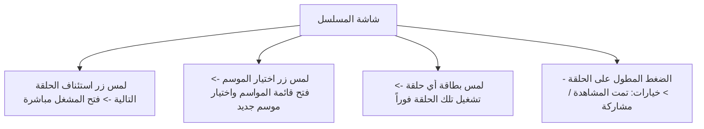

# شاشة تفاصيل المسلسلات والمواسم للهاتف المحمول
## Screen Specification: Mobile Series, Seasons & Episodes Screen

> **النوع المستهدف:** `BaseItemKind.Series`, `Season`, `Episode`  
> **المنصة:** هاتف أندرويد الذكي (Android Mobile Phone) • تفاعل لمسي رأسي (Portrait Touch UI).  
> **المرجع المعماري:** [00_general_layout_architecture.md](./00_general_layout_architecture.md)  
> **المكونات المشتركة:** [01_shared_components_and_philosophy.md](./01_shared_components_and_philosophy.md)

---

## 1. الهوية البصرية ومحاور تجربة الهاتف

تعتبر شاشة المسلسلات على الهاتف تجربة قائمة على التصفح الرأسي السلس، مع التركيز على استئناف المشاهدة بلمسة واحدة وسهولة تنزيل الحلقات الفردية.

### المحاور الأساسية:
1. **بطاقة استئناف الحلقة التالية (Next Up Hero Button):**
   * زر عريض رئيسي في متناول الإبهام يوضح الحلقة التالية التي ينتظرها المستخدم (مثل: "استئناف: حلقة 4 - موسم 1") مع شريط تقدم المشاهدة.
2. **قائمة اختيار المواسم المنسدلة أو الأفقية:**
   * كبسولة أنيقة قابلة للمس تفتح قائمة اختيار الموسم (`[الموسم 1]`, `[الموسم 2]`, `[الحلقات الخاصة]`) مع تحديث قائمة الحلقات لحظياً دون وميض.
3. **قائمة الحلقات الرأسية التفاعلية (Vertical Episode List):**
   * كل حلقة تظهر في بطاقة أفقية مدمجة:
     * لقطة مصغرة 16:9 مع شريط تقدم المشاهدة وعلامة اكتمال المشاهدة.
     * رقم الحلقة وعنوانها ومدتها بالدقائق.
     * ملخص مقتضب للحلقة يتمدد بلمسة واحدة.

---

## 2. المخطط الهيكلي لهاتف أندرويد (Mobile Portrait Wireframe)

```text
┌────────────────────────────────────────┐
│ [<- رجوع]                 [مشاركة] [*] │
├────────────────────────────────────────┤
│                                        │
│   [غلاف المسلسل العريض Backdrop 16:9]  │
│   [تدرج ناعم متلاشي في السواد #000000] │
│                                        │
│ Breaking Bad (2008 - 2013)             │
│ * 9.5 · 5 مواسم (62 حلقة) · TV-MA      │
│ [حالة العرض: منتهي] [صوت محيطي] [ترجمة]│
│                                        │
│ ┌────────────────────────────────────┐ │
│ │ [>] استئناف: ح 4 - م 1 (متبقي 20 د)│ │ <-- زر الاستئناف الفوري
│ │ [══════════ شريط التقدم ═════════] │ │
│ └────────────────────────────────────┘ │
│                                        │
│ ┌──────────┐ ┌──────────┐ ┌──────────┐ │
│ │  تريلر   │ │  المفضلة │ │  مشاركة  │ │
│ └──────────┘ └──────────┘ └──────────┘ │
│                                        │
│ ══════════ اختيار الموسم ═════════════ │
│ [الموسم 1 (7 حلقات) v]                 │
│                                        │
│ ══════ قائمة حلقات الموسم الرأسية ════ │
│ ┌────────────────────────────────────┐ │
│ │ ┌────────────┐ حلقة 1: البداية     │ │
│ │ │صورة مصغرة  │ 58 دقيقة            │ │
│ │ │[تمت]       │                     │ │
│ │ └────────────┘                     │ │
│ └────────────────────────────────────┘ │
│ ┌────────────────────────────────────┐ │
│ │ ┌────────────┐ حلقة 2: القط بالحيبة│ │
│ │ │صورة مصغرة  │ 48 دقيقة · [تقدم 60%]│
│ │ │[شريط تقدم] │                     │ │
│ │ └────────────┘                     │ │
│ └────────────────────────────────────┘ │
│                                        │
│ ══════ طاقم العمل والتمثيل (سحب) ═════ │
│ (برايان كرانستون) (آرون بول) (آنا غان) │
└────────────────────────────────────────┘
```

---

## 3. تدفق تفاعلات اللمس على الهاتف



---

## 4. الحقول المستلمة من السيرفر ومعالجة النقص

* **جلب بيانات المسلسل:** `GET /Items/{seriesId}?userId={userId}`
* **جلب الحلقة التالية للاستئناف:** `GET /Shows/NextUp?SeriesId={seriesId}&UserId={userId}`
* **جلب حلقات الموسم:** `GET /Shows/{seriesId}/Episodes?seasonId={seasonId}&userId={userId}`
* **معالجة النقص على الهاتف:**
  * إذا لم تتوفر لقطة مصغرة للحلقة: عرض بطاقة بلون كربوني مدخن تحتوي على رقم الحلقة وعنوانها بخط واضح.
  * في حال اكتمال كافة الحلقات: يتحول الزر الرئيسي إلى "إعادة المشاهدة من الحلقة الأولى".
