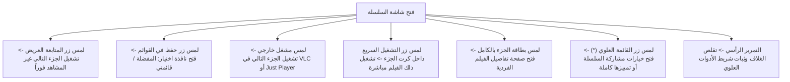

# شاشة تفاصيل المجموعات والسلاسل السينمائية للهاتف المحمول
## Screen Specification: Mobile BoxSets & Collections Screen (Inherited Redesign)

> **النوع المستهدف:** `BaseItemKind.BoxSet`  
> **المنصة المستهدفة:** هاتف أندرويد الذكي (Android Mobile Phone) • تفاعل لمسي رأسي (Portrait-First Touch UI).  
> **المرجع المعماري الأساسي:** [00_general_layout_architecture.md](./00_general_layout_architecture.md)  
> **مكتبة المكونات المشتركة:** [01_shared_components_and_philosophy.md](./01_shared_components_and_philosophy.md)  
> **القرارات المعمارية الحاكمة:** [ADR 0004: نظام OLED True Black](../../../adr/0004_oled_true_black_design_system.md) • [ADR 0005: تأجيل واستئصال التنزيلات](../../../adr/0005_deferring_offline_downloads.md)

---

## 1. الهوية البصرية وميثاق التوريث

ترث شاشة السلاسل والمجموعات السينمائية القالب العام الموحد لتطبيق "مدد TV" وتطبق الفروق الوظيفية الخاصة بتجميع ومتابعة الأجزاء السينمائية المترابطة:

### العناصر الموروثة من القالب الموحد:
1. **غلاف البطل السينمائي بنصف ارتفاع الشاشة (50% Hero Canvas):**
   * يستحوذ على 50% من الارتفاع الكلي للشاشة مع تلاشٍ كربوني 100% في سواد OLED التام `#000000`.
   * أسهم تنقل جانبية رقيقة بدون كبسولات تظهر فقط إن تعددت صور الغلاف، وزر المعاينة بملء الشاشة أسفل اليمين بدون حدود.
   * طفو أيقونة التطبيق المفرغة (`ic_launcher_monochrome`) بنعومة في المنتصف في حالة غياب الغلاف.
2. **الشريط العلوي المقتضب والقائمة المنبثقة الشاملة:**
   * زر الرجوع في جانب، وزر القائمة المنسدلة الثلاثي (`MoreVert`) في الجانب المقابل (مشاركة السلسلة، تحديد كامل السلسلة كمشاهدة، والتريلر المشروط بالتوفر).
3. **صف الإجراءات الثانوي المتناظر (48dp):**
   * زر **"حفظ في القوائم"** (يفتح نافذة صغيرة لاختيار: المفضلة / قائمتي).
   * زر **"مشغل خارجي"** (لتشغيل الجزء التالي غير المشاهد في مشغل خارجي مثل VLC أو Just Player).

---

## 2. الفروق التخصصية الحصرية لشاشة السلاسل (BoxSet)

1. **سطر الإحصائيات التراكمية للسلسلة:**
   * يعرض بدلاً من بيانات الفيلم الفردي:
     * إجمالي عدد الأجزاء: مثل `3 أجزاء سينمائية`.
     * إجمالي مدة المشاهدة للسلسلة: مثل `إجمالي 7 ساعات و 36 دقيقة`.
     * شارة نسبة الإنجاز التراكمية: توضح عدد الأفلام المشاهدة من إجمالي السلسلة.
2. **زر المتابعة الذكي المنفرد (Smart Franchise Play Button - 54dp):**
   * زر عريض منفرد بالأبيض العاجي الناصع (`Ivory50`) يفحص حالة أجزاء السلسلة تلقائياً:
     * **في حال توفر جزء تالٍ غير مشاهد:** يُكتب عليه: **"متابعة: [اسم الجزء التالي]"**.
     * **إذا لم يبدأ المشاهدة بعد:** يُكتب عليه: **"بدء السلسلة: الجزء 1"**.
     * **إذا شاهد كافة الأجزاء:** يتحول إلى: **"إعادة مشاهدة السلسلة"**.
3. **قائمة أجزاء السلسلة المرتبة زمنياً (`Chronological Movie Cards`):**
   * تُعرض الأجزاء رأسياً بترتيبها الزمني مع بطاقات كربونية مدخنة:
     * **بوستر الفيلم العمودي (2:3):** بدقة واضحة وزوايا ناعمة ونسبة الأبعاد الأصلية.
     * **بيانات الجزء الفردي:** عنوان الجزء، سنة الإنتاج، المدة الزمنية، وتقييم IMDb.
     * **شارة الإتمام:** علامة خضراء مدمجة "تمت المشاهدة" أو شريط تقدم أحمر/رمادي إذا بدأ الجزء وتوقف.
     * **زر التشغيل السريع المدمج (48dp):** زر أيقوني جانبي داخل البطاقة يطلق الفيلم فوراً بلمسة واحدة دون مغادرة الصفحة.
     * **نقر جسم البطاقة بالكامل:** يفتح شاشة التفاصيل الفردية الكاملة لذلك الفيلم (`MovieDetailsScreen`).

---

## 3. المخطط الهيكلي لهاتف أندرويد (Mobile Portrait Wireframe)

```text
┌────────────────────────────────────────────────────────┐
│ [<- رجوع]                                          [*] │  <-- زر القائمة المنسدلة الشاملة
├────────────────────────────────────────────────────────┤
│                                                        │
│       [غلاف السلسلة البانورامي العريض بنسبة 50%]       │
│                                                        │
│ [<]                                                [>] │  <-- أسهم تنقل رقيقة بدون كبسولات (إن تعددت الصور)
│                                                        │
│                                            [أيقونة عرض]│  <-- زر معاينة الغلاف أسفل اليمين بدون كبسولة
│   [تلاشي كربوني سفلي ناعم 100% في سواد OLED #000000]   │
├────────────────────────────────────────────────────────┤
│ The Dark Knight Collection                             │
│ * 8.9 IMDb · 3 أجزاء · إجمالي 7 ساعات و 36 دقيقة       │
│ [المخرج: كريستوفر نولان] [أكشن] [جريمة]                │
│ [4K UHD] [HDR10] [Direct Play] [صوت 5.1] [ترجمة عربية] │
│                                                        │
│ ┌────────────────────────────────────────────────────┐ │
│ │           [>] متابعة السلسلة: الجزء 2              │ │  <-- زر المتابعة الذكي المنفرد (أبيض عاجي 54dp)
│ └────────────────────────────────────────────────────┘ │
│                                                        │
│ ┌──────────────────────────┐┌────────────────────────┐ │
│ │    [+] حفظ في القوائم    ││     [->] مشغل خارجي    │ │  <-- ثنائي متناظر لراحة الإبهام (48dp)
│ └──────────────────────────┘└────────────────────────┘ │
│                                                        │
│ ═══════════ أجزاء السلسلة مرتبة زمنياً ═══════════════ │
│ ┌────────────────────────────────────────────────────┐ │
│ │ ┌──────┐ الجزء 1: بداية باتمان (2005)              │ │
│ │ │بوستر │ ساعتان و 20 دقيقة · * 8.2 IMDb            │ │
│ │ │ 2:3  │ [تمت المشاهدة]                            │ │
│ │ └──────┘                                      [>]  │ │  <-- زر تشغيل سريع للجزء (48dp)
│ └────────────────────────────────────────────────────┘ │
│ ┌────────────────────────────────────────────────────┐ │
│ │ ┌──────┐ الجزء 2: فارس الظلام (2008)               │ │
│ │ │بوستر │ ساعتان و 32 دقيقة · * 9.0 IMDb            │ │
│ │ │ 2:3  │ [غير مشاهد]                               │ │
│ │ └──────┘                                      [>]  │ │
│ └────────────────────────────────────────────────────┘ │
│ ┌────────────────────────────────────────────────────┐ │
│ │ ┌──────┐ الجزء 3: نهوض فارس الظلام (2012)          │ │
│ │ │بوستر │ ساعتان و 44 دقيقة · * 8.4 IMDb            │ │
│ │ │ 2:3  │ [غير مشاهد]                               │ │
│ │ └──────┘                                      [>]  │ │
│ └────────────────────────────────────────────────────┘ │
└────────────────────────────────────────────────────────┘
```

---

## 4. تدفق تفاعلات اللمس على الهاتف (Touch Interaction Flow)



---

## 5. الحقول المستلمة من السيرفر واستراتيجية معالجة النقص

* **جلب بيانات السلسلة والأجزاء:** `GET /Collections/{collectionId}/Items?userId={userId}`
* **استراتيجية معالجة النقص:**
  * **الأجزاء المكتملة:** إذا شاهد المستخدم كامل أفلام السلسلة، يتحول زر التشغيل العلوي إلى "إعادة مشاهدة السلسلة".
  * **غياب أغلفة السلسلة:** التبديل التلقائي لبوستر المجموعة، وفي حال غيابه يتم عرض أيقونة التطبيق المفرغة بنعومة في المنتصف.
