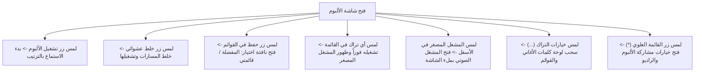

# شاشة تفاصيل الألبومات والموسيقى للهاتف المحمول
## Screen Specification: Mobile Music Album Details Screen (Inherited Redesign)

> **النوع المستهدف:** `BaseItemKind.MusicAlbum`, `MusicArtist`, `Audio`  
> **المنصة المستهدفة:** هاتف أندرويد الذكي (Android Mobile Phone) • تفاعل لمسي رأسي (Portrait-First Touch UI).  
> **المرجع المعماري الأساسي:** [00_general_layout_architecture.md](./00_general_layout_architecture.md)  
> **مكتبة المكونات المشتركة:** [01_shared_components_and_philosophy.md](./01_shared_components_and_philosophy.md)  
> **القرارات المعمارية الحاكمة:** [ADR 0004: نظام OLED True Black](../../adr/0004_oled_true_black_design_system.md) • [ADR 0005: تأجيل واستئصال التنزيلات](../../adr/0005_deferring_offline_downloads.md)

---

## 1. الهوية البصرية وميثاق التوريث

ترث شاشة الألبومات والموسيقى القالب العام الموحد لتطبيق "مدد TV" مع تطبيق المعايير الجمالية الخاصة بالوسائط الصوتية:

### العناصر الموروثة من القالب الموحد:
1. **الشريط العلوي المقتضب والقائمة المنبثقة:**
   * زر الرجوع في جانب، وزر القائمة المنسدلة الثلاثي (`MoreVert`) في الجانب المقابل (مشاركة الألبوم، راديو Mix، وتمييز الألبوم كاملاً).
2. **سواد OLED التام (`#000000`) ومصفوفة التباين:**
   * الحفاظ على خلفية سوداء تامة خالية من الضوضاء، مع هالة ضوئية دائرية خافتة تستخرج تلقائياً من ألوان غلاف الألبوم.
3. **نافذة الحفظ الموحدة (Compact Save Modal):**
   * نافذة منبثقة لاختيار إضافة الألبوم إلى (**المفضلة** أو **قائمتي / استماع لاحقاً**).

---

## 2. الفروق التخصصية الحصرية لشاشة الألبومات (MusicAlbum)

1. **غلاف الألبوم المربع الفني (1:1 Hero Artwork):**
   * بدلاً من الغلاف البانورامي 16:9، يعرض غلاف الألبوم بنسبته القياسية 1:1 مقاس `220dp x 220dp` في المنتصف العلوي مع زوايا ناعمة (`16dp`) وظل محيطي ناعم وانعكاس خافت في السواد التام.
   * في حال غياب الغلاف: تظهر أيقونة التطبيق المفرغة بنعومة في منتصف المربع الكربوني.
2. **منظومة أزرار التشغيل والخلط العشوائي المريحة:**
   * **الصف الأول المنفرد (54dp):** زر عريض بالأبيض العاجي الناصع (`Ivory50`): **"تشغيل الألبوم"** (أو "استئناف الألبوم").
   * **الصف الثاني الثنائي المتناظر (48dp):**
     * زر **"خلط عشوائي"** (`Shuffle`): لبدء الاستماع بترتيب عشوائي للتراكات.
     * زر **"حفظ في القوائم"**: لإضافة الألبوم للمفضلة أو قوائم الاستماع.
3. **قائمة المسارات المرقمة التفاعلية (`Numbered Tracklist`):**
   * تعرض كل مقطوعة في سطر مريح للمس:
     * رقم المسار (01, 02, 03) بخط مونوكرومي.
     * عنوان الأغنية ومدتها الزمنية.
     * **المسار النشط:** يضاء التراك الذي يعمل حالياً بلون ذهبي سينمائي ناصع (`RatingGold`) مع ذبذبة مؤشر صوتي مونوكرومي ناعم.
     * زر خيارات جانبي ثلاثي (`...`) لكل تراك لعرض كلمات الأغنية المتزامنة (Lyrics) أو إضافتها لقوائم التشغيل.
4. **المشغل الصوتي المصغر المثبت في الأسفل (`Bottom Sticky Mini Player` - 64dp):**
   * شريط عائم مثبت فوق شريط التنقل السفلي بارتفاع `64dp` يظهر فور بدء التشغيل، يحتوي على صورة التراك، اسمه، أزرار التشغيل/الإيقاف المؤقت والتخطي، ونقره يفتح مشغل الصوت بملء الشاشة.

---

## 3. المخطط الهيكلي لهاتف أندرويد (Mobile Portrait Wireframe)

```text
┌────────────────────────────────────────────────────────┐
│ [<- رجوع]                                          [*] │  <-- شريط علوي شفاف وقائمة منسدلة
├────────────────────────────────────────────────────────┤
│                                                        │
│                 ┌──────────────────┐                   │
│                 │                  │                   │
│                 │   غلاف الألبوم   │                   │  <-- غلاف مربع 1:1 متمركز في المنتصف
│                 │   المربع (1:1)   │                   │
│                 │                  │                   │
│                 └──────────────────┘                   │
│                                                        │
│ Discovery (2001)                                       │
│ الفنان: Daft Punk                                      │
│ 14 مقطوعة · إجمالي 60 دقيقة · [Hi-Res FLAC]            │
│                                                        │
│ ┌────────────────────────────────────────────────────┐ │
│ │                  [>] تشغيل الألبوم                 │ │  <-- زر التشغيل المنفرد العريض (أبيض عاجي 54dp)
│ └────────────────────────────────────────────────────┘ │
│                                                        │
│ ┌──────────────────────────┐┌────────────────────────┐ │
│ │      [*] خلط عشوائي      ││   [+] حفظ في القوائم   │ │  <-- صف ثنائي متناظر لراحة الإبهام (48dp)
│ └──────────────────────────┘└────────────────────────┘ │
│                                                        │
│ ══════════════ مسارات الألبوم المرقمة ═════════════════ │
│ 01  One More Time                         05:20  [...] │
│ 02  Aerodynamic                           03:27  [...] │
│ 03  Digital Love (يعمل الآن)              04:58  [...] │  <-- مميز بلون ذهبي ناصع
│ 04  Harder, Better, Faster, Stronger      03:45  [...] │
│ 05  Crescendolls                          03:31  [...] │
│                                                        │
│ ════════════ المشغل المصغر الدائم في الأسفل ═══════════ │
│ ┌────────────────────────────────────────────────────┐ │
│ │ [غلاف] Digital Love - Daft Punk          [||] [>>] │ │  <-- Mini Player مثبت بارتفاع 64dp
│ └────────────────────────────────────────────────────┘ │
└────────────────────────────────────────────────────────┘
```

---

## 4. تدفق تفاعلات اللمس على الهاتف (Touch Interaction Flow)



---

## 5. الحقول المستلمة من السيرفر واستراتيجية معالجة النقص

* **جلب بيانات الألبوم والتراكات:** `GET /Items?parentId={albumId}&userId={userId}`
* **استراتيجية معالجة النقص:**
  * **غياب غلاف الألبوم:** عرض بطاقة مربعة بديلة بلون كربوني مدخن تحتوي على أيقونة التطبيق المفرغة بنعومة في المنتصف.
  * **غياب كلمات الأغاني (Lyrics):** إخفاء خيار الكلمات من قائمة التراك تلقائياً لمنع ظهور لوحات فارغة.
