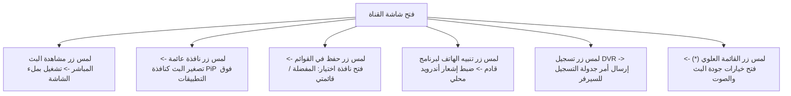

# شاشة تفاصيل قنوات البث المباشر للهاتف المحمول
## Screen Specification: Mobile Live TV Channel Screen (Inherited Redesign)

> **النوع المستهدف:** `BaseItemKind.LiveTvChannel`, `LiveTvProgram`, `Recording`  
> **المنصة المستهدفة:** هاتف أندرويد الذكي (Android Mobile Phone) • تفاعل لمسي رأسي (Portrait-First Touch UI).  
> **المرجع المعماري الأساسي:** [00_general_layout_architecture.md](./00_general_layout_architecture.md)  
> **مكتبة المكونات المشتركة:** [01_shared_components_and_philosophy.md](./01_shared_components_and_philosophy.md)  
> **القرارات المعمارية الحاكمة:** [ADR 0004: نظام OLED True Black](../../adr/0004_oled_true_black_design_system.md) • [ADR 0005: تأجيل واستئصال التنزيلات](../../adr/0005_deferring_offline_downloads.md)

---

## 1. الهوية البصرية وميثاق التوريث

ترث شاشة البث المباشر القالب العام الموحد لتطبيق "مدد TV" وتطبق الفروق الوظيفية للبث الحي ودليل البرامج الإلكتروني (EPG):

### العناصر الموروثة من القالب الموحد:
1. **الشريط العلوي المقتضب والقائمة المنبثقة:**
   * زر الرجوع في جانب، وزر القائمة المنسدلة الثلاثي (`MoreVert`) في الجانب المقابل (مشاركة القناة، خيارات جودة البث والصوت، وجدولة تسجيل DVR).
2. **سواد OLED التام (`#000000`):**
   * خلفية سوداء نقية مع شارات البث التقنية (`1080p 50fps`, `Direct Play`, `صوت ستيريو/5.1`).
3. **نافذة الحفظ الموحدة (Compact Save Modal):**
   * نافذة منبثقة لاختيار إضافة القناة إلى (**المفضلة** أو **قائمتي / القنوات المختارة**).

---

## 2. الفروق التخصصية الحصرية لشاشة البث المباشر (Live TV)

1. **ترويسة القناة والبرنامج المعروض حياً (Live On-Air Header):**
   * **شعار القناة:** يعرض شعار القناة بدقة عالية بجانب اسمها ورقمها وشارة مونوكرومية خافتة `[بث مباشر]`.
   * **بطاقة البرنامج الجاري حالياً:**
     * عنوان البرنامج المعروض على الهواء الآن.
     * وقت العرض (مثل: `21:00 - 23:30 · متبقي 35 دقيقة`).
     * شريط تقدم حي يوضح نسبة الوقت المنقضي من البرنامج الجاري لحظياً.
2. **منظومة أزرار التشغيل والنافذة العائمة المريحة:**
   * **الصف الأول المنفرد (54dp):** زر عريض بالأبيض العاجي الناصع (`Ivory50`): **"مشاهدة البث المباشر"** لفتح القناة بملء الشاشة مع التدوير التلقائي للعرض الأفقي (Landscape).
   * **الصف الثاني الثنائي المتناظر (48dp):**
     * زر **"نافذة عائمة"** (`Picture-in-Picture / PiP`): لتشغيل البث في نافذة مصغرة عائمة فوق تطبيقات الهاتف أثناء تصفح أشياء أخرى.
     * زر **"حفظ في القوائم"**: لتثبيت القناة في المفضلة المحلية للمستخدم.
3. **دليل البرامج الإلكتروني اليومي الرأسي (`Vertical EPG Schedule`):**
   * قائمة متسلسلة زمنياً ببرامج القناة لبقية اليوم، ولكل برنامج قادم:
     * وقت العرض واسم البرنامج ومدته.
     * **زر تنبيه الهاتف (`Remind Me`):** زر لمسي قياسي لضبط منبه/إشعار محلي على الهاتف لتذكير المشاهد قبل موعد البرنامج بـ 5 دقائق.
     * **زر تسجيل سحابي (`Record`):** لجدولة تسجيل البرنامج على سيرفر Jellyfin DVR (إن توفرت صلاحيات التسجيل).

---

## 3. المخطط الهيكلي لهاتف أندرويد (Mobile Portrait Wireframe)

```text
┌────────────────────────────────────────────────────────┐
│ [<- رجوع]                                          [*] │  <-- شريط علوي شفاف وقائمة منسدلة
├────────────────────────────────────────────────────────┤
│                                                        │
│   ┌──────────────┐ beIN SPORTS 1 HD                    │
│   │ [شعار القناة]│ قناة رقم 101                        │
│   └──────────────┘ [بث مباشر] [1080p 50fps] [Direct]   │
│                                                        │
│ يُبث الآن: استوديو دوري أبطال أوروبا                   │
│ 21:00 - 23:30 (متبقي 35 دقيقة)                         │
│ [═════════════════ شريط الوقت المنقضي 65% ═══════════] │
│                                                        │
│ ┌────────────────────────────────────────────────────┐ │
│ │               [>] مشاهدة البث المباشر              │ │  <-- زر التشغيل المنفرد العريض (أبيض عاجي 54dp)
│ └────────────────────────────────────────────────────┘ │
│                                                        │
│ ┌──────────────────────────┐┌────────────────────────┐ │
│ │      [o] نافذة عائمة     ││   [+] حفظ في القوائم   │ │  <-- صف ثنائي متناظر لراحة الإبهام (48dp)
│ └──────────────────────────┘└────────────────────────┘ │
│                                                        │
│ ══════════════ جدول برامج القناة لليوم ═══════════════ │
│ 23:30 - 00:30  ملخص مباريات الجولة                     │
│                [تنبيه الهاتف]              [تسجيل DVR] │
│                                                        │
│ 00:30 - 02:00  إعادة مباراة اليوم كاملة                │
│                [تنبيه الهاتف]              [تسجيل DVR] │
│                                                        │
│ 02:00 - 06:00  البث الصباحي وتحليل الأهداف             │
│                [تنبيه الهاتف]              [تسجيل DVR] │
└────────────────────────────────────────────────────────┘
```

---

## 4. تدفق تفاعلات اللمس على الهاتف (Touch Interaction Flow)



---

## 5. الحقول المستلمة من السيرفر واستراتيجية معالجة النقص

* **جلب بيانات القناة والبرامج:** `GET /LiveTv/Channels/{channelId}?userId={userId}`
* **جلب جدول دليل البرامج (EPG):** `GET /LiveTv/Programs?channelIds={channelId}&userId={userId}`
* **استراتيجية معالجة النقص:**
  * **غياب جدول EPG:** عرض بطاقة ترويسة البث المباشر فقط وإخفاء جدول المواعيد بسلاسة دون رسائل خطأ مشوهة.
  * **عدم دعم التسجيل (No DVR):** إخفاء زر التسجيل تلقائياً إذا كان حساب المستخدم يفتقر لصلاحيات الـ DVR.
