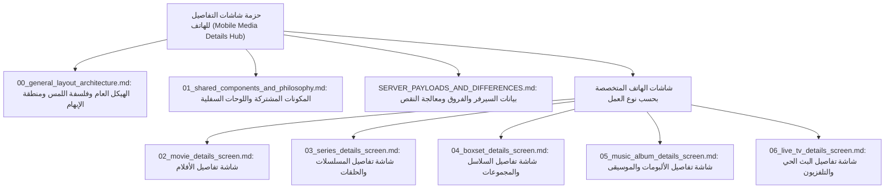

# حزمة مواصفات وتصاميم شاشات التفاصيل لهواتف أندرويد
## Mobile Media Details Specialized Screens Architecture Hub

> **النطاق:** مرجع هندسي وتصميمي شامل لشاشات تفاصيل الوسائط في تطبيق "مدد TV".  
> **المنصة المستهدفة:** هواتف أندرويد الذكية (Android Mobile Phones) حصراً • تفاعل لمسي رأسي (Portrait-First Touch UI).  
> **الفلسفة الحاكمة:** سواد OLED تام (`#000000`) • منطقة راحة الإبهام (Thumb Zone) • شريط علوي متكيف (Collapsing Toolbar) • التكيف الذكي مع نقص البيانات.

---

## 1. الفهرس المعماري للحزمة الخاصة بالهاتف

---

## 2. ملخص وثائق الحزمة

1. [00_general_layout_architecture.md](./00_general_layout_architecture.md): **الهيكل العام الموحد وفلسفة الهاتف**  
   يوثق هندسة اللمس بيد واحدة (Thumb Zone)، أهداف اللمس (`48dp+`)، شريط الأدوات المتلاشي والمتكيف مع التمرير (Collapsing Toolbar)، واللوحات السفلية التفاعلية (Modal Bottom Sheets).

2. [01_shared_components_and_philosophy.md](./01_shared_components_and_philosophy.md): **المكونات المشتركة القابلة لإعادة الاستخدام للهاتف**  
   يوثق المكونات السبعة: الغلاف المتلاشي المتكيف، شريط الأختام المونوكرومية، زر الإجراء الأولي العريض (56dp)، شريط الأزرار السريعة، صندوق القصة الممتد باللمس، اللوحات السفلية المنبثقة، وشريط الممثلين الأفقي.

3. [02_movie_details_screen.md](./02_movie_details_screen.md): **شاشة تفاصيل الأفلام السينمائية للهاتف (`Movie`)**  
   التشغيل والاستئناف الفوري بلمسة واحدة، حفظ المفضلة المحلية، فصول الفيلم بالسحب الأفقي، ولوحة اختيار مسارات الصوت والترجمة.

4. [03_series_details_screen.md](./03_series_details_screen.md): **شاشة تفاصيل المسلسلات والمواسم للهاتف (`Series`)**  
   زر استئناف الحلقة التالية (Next Up Hero Button)، محدد المواسم، وقائمة الحلقات الرأسية مع مؤشرات المشاهدة والتقدم.

5. [04_boxset_details_screen.md](./04_boxset_details_screen.md): **شاشة تفاصيل المجموعات والسلاسل للهاتف (`BoxSet`)**  
   استعراض السلاسل السينمائية، زر استئناف السلسلة، وقائمة الأجزاء المرتبة زمنياً ببوسترات عمودية وزر تشغيل فوري لكل جزء.

6. [05_music_album_details_screen.md](./05_music_album_details_screen.md): **شاشة تفاصيل الألبومات والموسيقى للهاتف (`MusicAlbum`)**  
   غلاف الألبوم المربع (1:1)، أزرار تشغيل وخلط المسارات، قائمة التراكات الرأسية، المشغل الصوتي المصغر المثبت في الأسفل (Mini Player)، ولوحة كلمات الأغاني المتزامنة (Lyrics).

7. [06_live_tv_details_screen.md](./06_live_tv_details_screen.md): **شاشة قنوات البث المباشر للهاتف (`LiveTvChannel`)**  
   شعار القناة والبرنامج الجاري، البث الحي مع دعم النافذة العائمة (Picture-in-Picture)، دليل البرامج الرأسي وتنبيهات الهاتف للبرامج القادمة.

8. [SERVER_PAYLOADS_AND_DIFFERENCES.md](./SERVER_PAYLOADS_AND_DIFFERENCES.md): **بيانات السيرفر والفروق واستراتيجية معالجة النقص**  
   مقارنة حقول `BaseItemDto` بين الأنواع، وطرق السقوط الآمن والتكيف البصري التلقائي عند غياب البوسترات أو التقييمات أو الفصول.
