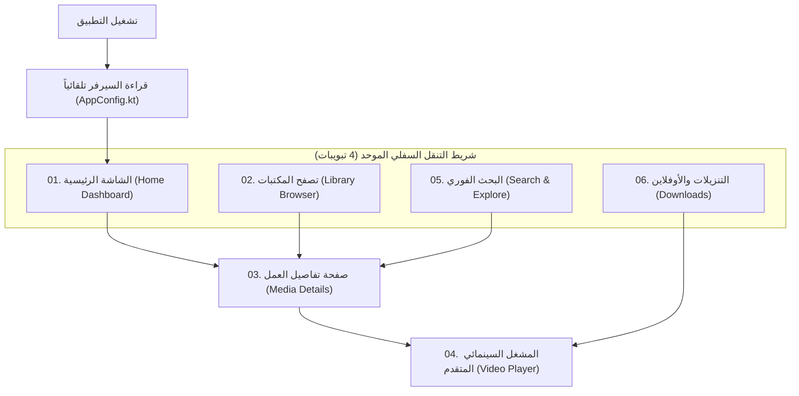

# وثيقة المتطلبات والمواصفات الفنية الشاملة (SPEC.md)
# Jellyfin Mobile Application — Master Product Specification

> **حالة الوثيقة:** معتمدة رسمياً ومحدثة (Approved Requirements)  
> **الإصدار:** 1.1.0  
> **تاريخ آخر تحديث:** 18 نوفمبر 2026  
> **المنصة:** 100% Native Android (Kotlin 2.0+ • Jetpack Compose • AndroidX Media3)  
> **المرحلة الحالية:** مرحلة التخطيط والتأسيس (Phase 1: Planning & Architecture)

---

##  سجل المراجعات (Revision History)

| الإصدار | التاريخ | التعديلات والتحسينات |
| :---: | :---: | :--- |
| `1.0.0` | 18 نوفمبر 2026 | مسودة المتطلبات الأولية. |
| `1.1.0` | 18 نوفمبر 2026 | • تعقيم كامل للبيانات الحساسة واستبدالها بـ Placeholders آمنة.<br>• إصلاح جميع الروابط الداخلية المكسورة للشاشات.<br>• إزالة التكرار المعماري والربط مع `ARCHITECTURE_AND_TECH_STACK.md`.<br>• توثيق اعتماد بروتوكول HTTP الصريح للشبكة المحلية (LAN-Only Policy). |

---

##  1. نظرة عامة ورؤية المنتج (Executive Summary & Mission)

### 1.1 الهدف الأساسي (The Core Objective)
بناء تطبيق عميل وسائط شخصي فائق الفخامة والسرعة لنظام أندرويد يتصل بخوادم **Jellyfin**، ليقدم للمستخدم تجربة سينمائية منزلية غامرة تحاكي أرقى المعايير العالمية (مثل **Infuse** على أجهزة أبل)، مع ضمان استهلاك أدنى حد ممكن من طاقة المعالج والبطارية وخفض استهلاك معالج الخادم إلى أدنى مستوياته بتجنب التحويل البرمجي (Transcoding) عبر التشغيل المباشر للعتاد (Hardware Direct Play).

### 1.2 فلسفة التصميم (Design Philosophy: Cinematic Ambient Immersion)
* **السواد التام لشاشات الـ OLED:** استخدام السواد الحالك (`#000000`) لإطفاء بكسلات الشاشة وإبراز ألوان البوسترات المشبعة.
* **الإضاءة المحيطية التفاعلية (Dynamic Ambient Glow):** تلوين خلفية الشاشة تلقائياً باللون المهيمن على بوستر الفيلم عبر أداة `Palette API`.
* **الانتقالات الحركية السلسة (Shared Element Transitions 120Hz):** حركة انسيابية تجعل بوستر الفيلم يطير ويتمدد ليتحول إلى خلفية شاشة التفاصيل بضغطة زر.
* **شارات الجودة المعدنية (Infuse Tech Badges):** كبسولات زجاجية مصقولة تبرز الدقة والترميز (`4K UHD`, `Dolby Vision`, `Atmos 7.1`, `Direct Play `).

---

##  2. نطاق الشاشات المعتمدة للمرحلة الأولى (Core 6 Screens)

تم اعتماد تقليص نطاق المرحلة الأولى للتركيز على **جوهر المشاهدة والترفيه الصافي**، وتأجيل شاشات المصادقة والإعدادات المعقدة للمرحلة القادمة:



### تفصيل متطلبات كل شاشة:

| # | الشاشة | المتطلبات الوظيفية الأساسية | الملف التوثيقي |
| :---: | :--- | :--- | :--- |
| **01** | **الرئيسية (Home)** | • بانر سينمائي عريض 16:9 مع إضاءة محيطية.<br>• كبسولات المكتبات الديناميكية المستدعاة من السيرفر.<br>• شريط متابعة المشاهدة (Continue Watching) مع نسبة التقدم.<br>• صفوف أحدث الإضافات ببوسترات 2:3. | [`01_HOME_DASHBOARD.md`](./screens/01_HOME_DASHBOARD.md) |
| **02** | **تصفح المكتبات (Library)** | • شبكة ملصقات Compose سريعة بثلاثة أعمدة.<br>• شريط فلاتر زجاجي (سنة، تقييم، دقة 4K، غير المشاهد).<br>• شريط تمرير أبجدي سريع (A-Z) للقفز بين آلاف المواد. | [`02_LIBRARY_BROWSER.md`](./screens/02_LIBRARY_BROWSER.md) |
| **03** | **تفاصيل العمل (Details)** | • **شارات Infuse التقنية الفاخرة** (`4K`, `Atmos`, `HDR`, `Direct Play`).<br>• خلفية متلاشية مع سواد الشاشة بدون حواف حادة.<br>• طاقم التمثيل التفاعلي (Cast Carousel).<br>• للمسلسلات: مستعرض المواسم والحلقات. | [`03_MEDIA_DETAILS.md`](./screens/03_MEDIA_DETAILS.md) |
| **04** | **المشغل المتقدم (Player)** | • فك تشفير عتادي أصيل عبر AndroidX Media3 بدون ضغط السيرفر.<br>• إيماءات لمسية: يساراً للسطوع، يميناً للصوت (مضخم حتى 200%).<br>• شريط تحكم زجاجي عائم يختفي بعد 3 ثوانٍ.<br>• مزامنة الترجمة الحية (`±100ms`) ودعم صورة داخل صورة (PiP). | [`04_ADVANCED_PLAYER.md`](./screens/04_ADVANCED_PLAYER.md) |
| **05** | **البحث والاستكشاف** | • بحث فوري يستجيب بعد 300ms من التوقف عن الكتابة (Debounced).<br>• دعم الإدخال الصوتي وسجل العمليات السابقة.<br>• تصنيف النتائج بين أفلام، مسلسلات، وممثلين، مع زر تشغيل مباشر. | [`05_SEARCH_AND_EXPLORE.md`](./screens/05_SEARCH_AND_EXPLORE.md) |
| **06** | **التنزيلات (الأوفلاين)** | • مقياس بياني لمساحة الذاكرة المستهلكة في الهاتف.<br>• معمارية تنزيل في الخلفية عبر Foreground Service مدمج مع Media3.<br>• مشغل أوفلاين فوري يعمل في وضع الطيران دون خادم. | [`06_DOWNLOADS_OFFLINE.md`](./screens/06_DOWNLOADS_OFFLINE.md) |

---

##  3. مواصفات الربط بالخادم (Dynamic Integration & Config)

### 3.1 مبدأ الديناميكية المطلقة (100% Dynamic Rule)
* **يُمنع منعاً باتاً تثبيت معرفات المكتبات في الكود (No Hardcoded Library IDs).**
* التطبيق يحمل فقط عنوان السيرفر وبيانات الدخول في ملف التهيئة، بينما تُجلب المكتبات والأقسام لحظياً عبر طلب:
  ```http
  GET /Users/{userId}/Views
  ```
* أي مكتبة تُضاف أو تُعدل على سيرفر المستخدم تظهر وتتحدث فوراً في واجهة أندرويد.

### 3.2 إعدادات الخادم والاتصال (Server Verification & Security)
* **بروتوكول الاتصال:** اعتماد بروتوكول `HTTP` الصريح للشبكة المحلية (LAN) في المرحلة الأولى.
* **عنوان السيرفر:** يُقرأ ديناميكياً من `BuildConfig.JELLYFIN_SERVER_URL` (أو ملف `local.properties`).
* **إصدار السيرفر المدعوم:** `Jellyfin 10.8.x+` وما بعده.
* **مرجع التوثيق الشامل:** [`SERVER_CONFIG.md`](./SERVER_CONFIG.md).

---

## ️ 4. المتطلبات المعمارية والبرمجية (Architecture Reference)

> [!NOTE]
> تفاصيل البنية الهندسية، تدفق البيانات أحادي الاتجاه (UDF)، وأنماط التصميم موثقة بشكل مفصل في:  
>  [`ARCHITECTURE_AND_TECH_STACK.md`](./ARCHITECTURE_AND_TECH_STACK.md)

### ملخص المعايير المعتمدة:
* **Presentation Layer:** واجهات Jetpack Compose صافية + `ScreenViewModel` يعتمد على تدفق بيانات أحادي الاتجاه `StateFlow<UIState>`.
* **Domain Layer:** كود **Kotlin خالص وخالٍ تماماً من أي تبعيات أندرويد**، لاختبار حالات الاستخدام (UseCases) بسرعة فائقة ودون محاكيات.
* **Data Layer:** مستودعات موحدة (Repository Pattern) تدمج بيانات شبكة Retrofit مع كاش Room المحلي ومحولات البيانات (Mappers).
* **Core Player:** محرك تشغيل مستقل ومعزول مبني على `AndroidX Media3` مع دعم التشغيل المباشر للعتاد (Direct Play).

---

##  5. ضوابط بيئة التطوير للأجهزة ذات الموارد المحدودة (Low-Spec Constraints)

نظراً لمواصفات جهاز التطوير (بدون محاكيات وبدون أندرويد ستوديو الثقيل):
1. **بيئة العمل المعتمدة:** العمل الحصري داخل **Antigravity IDE**.
2. **محرك البناء الخفيف:** ضبط ذاكرة Gradle بحد أقصى **2 جيجابايت** عبر `gradle.properties` لمنع تجمد النظام.
3. **آلية المعاينة والتجربة:** 
   * التثبيت والتشغيل المباشر على **هاتف أندرويد الحقيقي** عبر كابل USB أو الواي فاي (`adb install`).
   * التحقق البرمجي التلقائي عبر اختبارات الوحدة الصامتة (Unit Tests) التي لا تستهلك أي موارد.

---

##  6. معايير القبول والجودة العامة للمشروع (Acceptance Criteria)

> [!TIP]
> للاطلاع على القيود التفصيلية للأداء وسرعة الاستجابة، واستهلاك الذاكرة والبطارية، وأمان الشبكة، وإمكانية الوصول، ومصفوفة التحقق الشاملة:  
>  [`NON_FUNCTIONAL_REQUIREMENTS.md`](./NON_FUNCTIONAL_REQUIREMENTS.md)

قبل إعلان اكتمال أي ميزة:
- [ ] خلو الكود من أي أخطاء أو تحذيرات بناء أو استيرادات غير مستخدمة.
- [ ] استجابة الشاشات بمعدل 60/120 إطار في الثانية (Jank-Free) وخلو القوائم من التقطيع.
- [ ] التشغيل المباشر للوسائط (Direct Play) مع بقاء ضغط السيرفر في أدنى مستوياته دون Transcoding.
- [ ] عمل الإيماءات اللمسية للسطوع والصوت بمعدل تحديث سلس.
- [ ] عمل التنزيلات عبر Foreground Service واستمرار تشغيل الصوت في شريط إشعارات أندرويد.
- [ ] دعم معايير إمكانية الوصول الأولية (وصوفات TalkBack التوضيحية لجميع المكونات التفاعلية).
