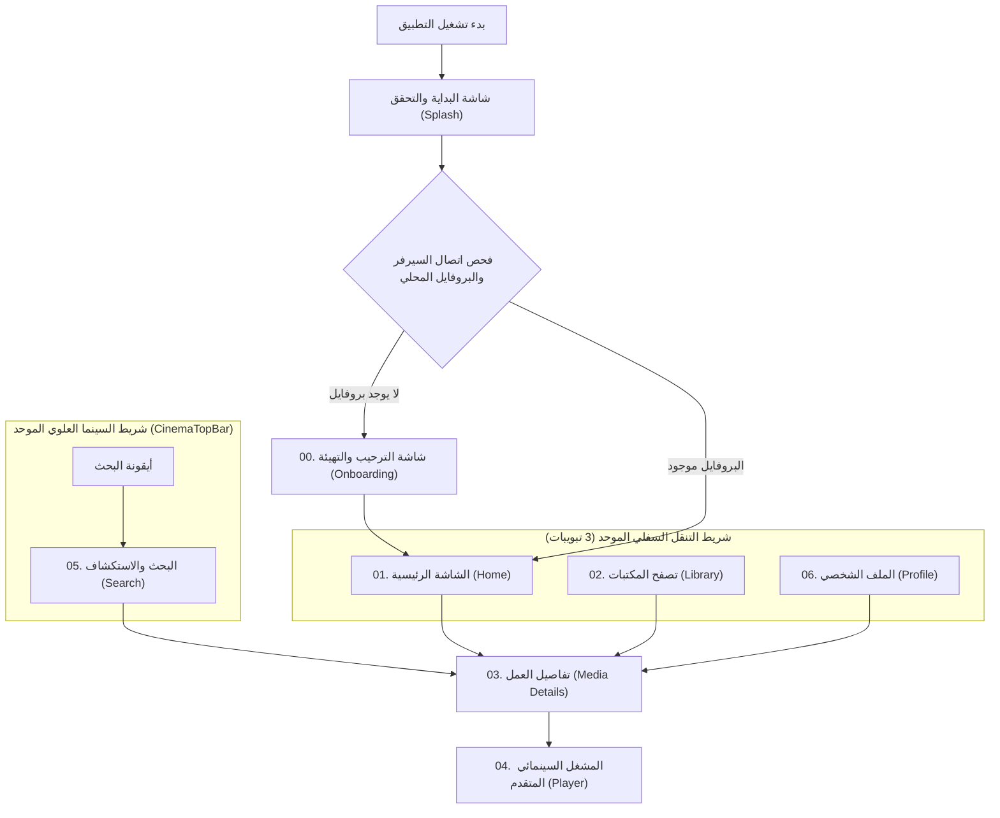

# وثيقة المتطلبات والمواصفات الفنية الشاملة (SPEC.md)
# Jellyfin Android Client - Master Product Specification

> **حالة الوثيقة:** معتمدة ومطابقة لواقع الكود البرمجي الفعلي (Live Source of Truth)  
> **الإصدار المستقر:** 1.0.0  
> **المنصة:** 100% Native Android (Kotlin 2.0+ / Jetpack Compose / AndroidX Media3 / Koin / Room DB)  
> **نطاق الوثيقة:** المرجع الفني المعماري الشامل لكافة شاشات التطبيق، تدفق التنقل، وقواعد تكامل البيانات وعزلها.

---

## 1. سجل المراجعات (Revision History)

| الإصدار | التاريخ | التعديلات والتحسينات |
| :---: | :---: | :--- |
| `1.0.0` | 18 نوفمبر 2026 | مسودة المتطلبات الأولية. |
| `1.1.0` | 18 نوفمبر 2026 | تعقيم البيانات واعتماد بروتوكول HTTP للشبكة المحلية. |
| `1.2.0` | 20 نوفمبر 2026 | مطابقة الوثيقة لواقع الكود البرمجي الفعلي، تضمين شاشة البداية والبروفايل، وتوثيق معمارية العزل المحلي Room DB v2. |

---

## 2. نظرة عامة ورؤية المنتج (Executive Summary & Mission)

### 2.1 الهدف الأساسي
تطبيق وسائط شخصي سينمائي فائق السرعة والأناقة مبني أصلياً بالكامل (Native Android) ليتصل بخوادم Jellyfin. يوفر تجربة مشاهدة منزلية غامرة تحاكي أرقى المعايير العالمية (مثل Infuse)، مع ضمان أدنى استهلاك ممكن لطاقة المعالج والبطارية، وتجنب التحويل البرمجي في الخادم (Transcoding) عبر التشغيل المباشر للعتاد (Hardware Direct Play).

### 2.2 إعدادات وبيئة التشغيل المعتمدة في الكود (`AppConfig.kt`)
* **اسم التطبيق:** مدد TV (`mdd TV`).
* **خادم الاتصال الافتراضي:** `http://192.168.200.200:80` (شبكة محلية LAN).
* **حساب الاختبار المعتمد:** المستخدم `الاستراحه` (دخول مباشر بدون كلمة مرور).
* **محرك التشغيل:** تشغيل عتادي مباشر إلزامي (`FORCE_HARDWARE_DECODE = true` و `ENABLE_DIRECT_PLAY = true`).
* **مسار دفق الفيديو المباشر:** `/Videos/{mediaId}/stream?static=true`.

---

## 3. تدفق التنقل وهيكل الشاشات (Navigation & Screen Hierarchy)

يعتمد التطبيق نمط التنقل الموحد عبر `NavGraph.kt` و `MainScaffold.kt`:

---

## 4. مصفوفة الشاشات المنفذة في الكود (Implemented Screens Matrix)

| المسار (Route) | الشاشة في الكود | المكونات والوظائف المنفذة فعلياً | وثيقة التفصيل |
| :--- | :--- | :--- | :--- |
| `splash` | `SplashScreen.kt` | فحص السيرفر، وميض الهوية السينمائي، والتحقق التلقائي من وجود بروفايل في Room DB للتوجيه. | - |
| `onboarding` | `OnboardingScreen.kt` | إدخال اسم المشاهد، اختيار الأفاتار الرمزي، وحفظ البروفايل المحلي في Room DB للمرة الأولى. | [`00_onboarding_and_profiles.md`](./screens/00_onboarding_and_profiles.md) |
| `home` | `HomeScreen.kt` | بانر البطل (Hero Spotlight)، كبسولات المكتبات، صف متابعة المشاهدة المحلي، وصف أحدث الإضافات. | [`01_home_dashboard.md`](./screens/01_home_dashboard.md) |
| `library` | `LibraryScreen.kt` | مستعرض المجلدات، شبكة البوسترات 120Hz، شريط الفلاتر، وشريط القفز الأبجدي السريع (Alphabet Scrubber). | [`02_library_browser.md`](./screens/02_library_browser.md) |
| `details/{mediaId}` | `MediaDetailsScreen.kt` | خلفية سينمائية متلاشية، شارات Infuse الفاخرة (4K, Atmos, Direct Play)، استعراض المواسم والحلقات، وقائمة الممثلين. | [`03_media_details.md`](./screens/03_media_details.md) |
| `player/{mediaId}` | `AdvancedPlayerScreen.kt` | فك تشفير عتادي عبر AndroidX Media3، إيماءات لمسية للصوت والسطوع، نقر مزدوج للتخطي، وترجمة عربية مدمجة. | [`04_advanced_player.md`](./screens/04_advanced_player.md) |
| `search` | `SearchScreen.kt` | بحث فوري متوازن (Debounced 300ms)، نتائج مصنفة فورية، وتكامل زر التشغيل المباشر. | [`05_search_and_explore.md`](./screens/05_search_and_explore.md) |
| `profile` | `ProfileScreen.kt` | التبويب الثالث في شريط التنقل: إحصائيات المشاهد، المفضلة المحلية، وسجل المشاهدة المؤرشف، مع نافذة تعديل البروفايل السفلية. | [`00_onboarding_and_profiles.md`](./screens/00_onboarding_and_profiles.md) |

---

## 5. معمارية عزل البيانات محلياً (Local-First Data Isolation - Room DB v3)

لحماية حساب الخادم المشترك (`الاستراحه`) من تضارب تفضيلات المشاهدين وتشتت تقدم المشاهدة:
1. **البروفايل المحلي (`UserProfileEntity`):** تخزين اسم المشاهد والأفاتار وإعداداته محلياً على الهاتف.
2. **المفضلة المحلية (`LocalFavoriteEntity`):** إضافة الأعمال للمفضلة يتم محلياً دون إرسال طلب تلوين المفضلة إلى السيرفر الرئيسي.
3. **أرشيف المشاهدة (`WatchedArchiveEntity`):** تمييز الأعمال المنتهية محلياً.
4. **شريط متابعة المشاهدة (`LocalWatchProgressEntity`):** حفظ نقطة توقف الفيديو بالثواني محلياً لاستئنافها بدقة دون الكتابة على تقدم المستخدمين الآخرين في السيرفر.

---

## 6. قواعد التكامل الشبكي (Remote API Contracts)

* **الديناميكية المطلقة:** لا يتم تثبيت أي معرفات مكتبات برمجياً، بل تجلب ديناميكياً عبر استدعاء:
  `GET /Users/{userId}/Views`
* **استرداد المشاهدة الحديثة:**
  `GET /Users/{userId}/Items/Resume?mediaTypes=Video&limit=12`
* **أحدث الإضافات:**
  `GET /Users/{userId}/Items/Latest?limit=16`
* **المشغل المباشر:**
  `/Videos/{mediaId}/stream?static=true`

---

## 7. المرجعيات الهندسية المعتمدة (Architectural Cross-References)

* **المعمارية البرمجية وهيكل الحزم:** [`docs/foundations/architecture.md`](../foundations/architecture.md)
* **نظام التصميم ورموز OLED True Black:** [`docs/foundations/design_system.md`](../foundations/design_system.md)
* **معايير الأداء ومؤشرات الجودة:** [`docs/foundations/non_functional_requirements.md`](../foundations/non_functional_requirements.md)
* **سجل القرارات المعمارية السابقة:** [`docs/adr/`](../adr/)
* **حاضنة التفكير والأفكار المستقبلية:** [`docs/thinking/`](../thinking/README.md)
* **لوحة المهام النشطة الجارية:** [`tasks/active_task.md`](../../tasks/active_task.md)
