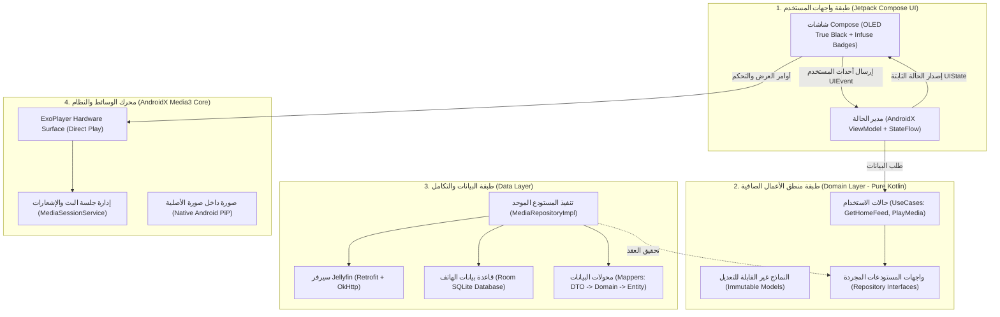

# وثيقة المعمارية والحزمة التقنية المعتمدة
# Master Architecture, Technical Stack & Design Patterns

> **المنصة واللغة:** Native Android • Kotlin 2.0+ • Jetpack Compose • AndroidX Media3  
> **النمط المعماري العام:** Clean Architecture + MVI (Model-View-Intent / Unidirectional Data Flow)  
> **تنظيم المجلدات:** Feature-First (المجلدات حسب الميزة)

---

## 1. المخطط المعماري العام لتدفق البيانات (Unidirectional Data Flow)



---

## 2. الحزمة التقنية الأساسية المعتمدة (Core Tech Stack)

| التقنية / المكتبة | الإصدار | الغرض والدور المعماري |
| :--- | :---: | :--- |
| **Kotlin** | `2.0+` | أحدث إصدار مع مترجم K2 لتسريع وقت التجميع والتطوير ودعم Compose Compiler المدمج. |
| **Jetpack Compose** | `2024.10+ (BOM)` | بناء الواجهات كلياً بالأكواد التصريحية الصافية ودعم شاشات الـ 120Hz. |
| **AndroidX Media3** | `1.4+` | المحرك الرسمي لفك التشفير العتادي وتكامل شريط الإشعارات وشاشات القفل عبر Foreground Service. |
| **Koin** | `3.5+` | حقن تبعيات عملي وخفيف (Zero Annotation Processing) يوفر الرام والمعالج أثناء البناء في الأجهزة المتواضعة. |
| **Retrofit 2 + OkHttp 4** | أحدث إصدار | عميل REST والـ WebSocket للاتصال بسيرفر Jellyfin مع دعم ضغط البيانات. |
| **Room Database** | `2.6+` | قاعدة بيانات محلية لتخزين الميديا وسجل المشاهدة ووضع الأوفلاين. |
| **Coil** | `2.7+` | مكتبة غير متزامنة لتحميل وتخزين البوسترات والصور مؤقتاً في الذاكرة والقرص مبنية على Coroutines. |

---

##  3. أنماط التصميم المعتمدة (Design Patterns Catalogue)

1. **Repository Pattern:**
   * عزل تام لمصادر البيانات؛ الشاشات لا تعرف إن كانت البيانات قادمة من السيرفر أو من كاش الذاكرة أو من قاعدة بيانات Room.
2. **Strategy Pattern (استراتيجيات التشغيل):**
   * `DirectPlayStrategy`: تشغيل مباشر عبر فك التشفير العتادي لمعالج الهاتف مع تجنب ضغط التحويل البرمجي (Transcoding) على معالج السيرفر.
   * `OfflinePlayStrategy`: تشغيل الملفات المحملة محلياً عبر مسار الملف الأصلي دون الحاجة لوجود اتصال بالخادم.
   * `TranscodeFallback`: الانتقال التلقائي للتحويل البرمجي في حال عدم دعم معالج الهاتف لصيغة الترميز المحددة.
3. **Mapper Pattern:**
   * حماية كود التطبيق من أي تغيير في JSON الخاص بسيرفر Jellyfin؛ حيث تتولى كائنات `Mappers` تحويل كائنات DTO إلى نماذج Domain نقية ومحصنة.
4. **Observer & MVI Pattern:**
   * تدفق البيانات في اتجاه واحد عبر `StateFlow<UIState>`؛ كل شاشة تملك كائن حالة صلب غير قابل للتعديل يمثل الحالات المختلفة (`Loading`، `Success`، `Error`).
5. **Interceptor Pattern:**
   * اعتراض طلبات الشبكة في OkHttp لإضافة ترويسات المصادقة (Auth Header) وتحديد مدة الـ Timeout ومتابعة حالة الاتصال بالخادم.

---

##  4. هياكل البيانات المحسنة لحماية الذاكرة والبطارية

1. **الذاكرة المؤقتة الذكية (Image Memory Cache عبر Coil):**
   * الاعتماد على نظام التخزين المؤقت الذكي المدمج في Coil (`MemoryCache` بنمط LRU) للبوسترات، مع تخصيص `LruCache` مستقل لصور التمرير السريع (Trickplay thumbnail tiles) لتفادي استنزاف الذاكرة العشوائية (OOM).
2. **`ImmutableList` في Compose:**
   * استخدام حزمة `kotlinx.collections.immutable` لإخبار Jetpack Compose بأن القوائم ثابتة ومستقرة، مما يمنع إعادة رسم الشاشات دون داعٍ ويقلل استهلاك المعالج والبطارية.
3. **طابور الجلب المسبق للبث (Playback Prefetch & Buffer Queue):**
   * ضبط مخازن البث المؤقتة في Media3 لضمان استمرارية التشغيل السلس دون تقطيع أو تجميد للفيديو.
4. **خرائط الفهرسة اللحظية ($O(1)$ Hash Maps):**
   * فهرسة الحلقات والمواسم داخل هياكل `Map<Id, Item>` للوصول الفوري السريع لأي عنصر دون الحاجة للتكرار والبحث الخطي.

---

##  5. إعدادات بيئة العمل للأجهزة ذات الموارد المحدودة (Low-Spec Strategy)

* **تقييد ذاكرة البناء في `gradle.properties`:**
  ```properties
  org.gradle.jvmargs=-Xmx2048m -XX:+UseParallelGC -Dfile.encoding=UTF-8
  org.gradle.parallel=true
  org.gradle.caching=true
  org.gradle.configuration-cache=true
  ```
