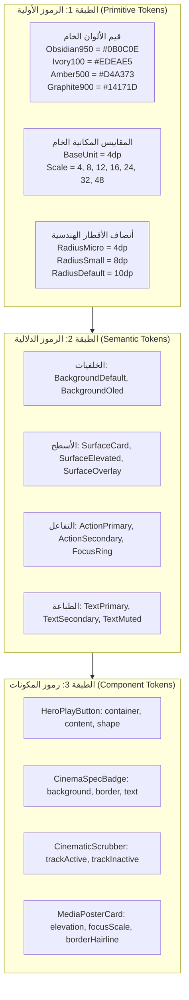

# نظام التصميم السينمائي الراقي (Refined Cinema & Obsidian Design System)
## الدستور المعماري الشامل لرموز التصميم ومكونات Jetpack Compose المتقنة

> **الحالة:** معتمد ونافذ  
> **الإصدار:** 2.0.0  
> **تاريخ الاعتماد:** 20 نوفمبر 2026  
> **المنصة المستهدفة:** 100% Native Android (Android TV & Mobile) • Jetpack Compose 120Hz • AMOLED / OLED Displays  
> **الفلسفة الأساسية:** **المحتوى هو البطل (Content is the Hero)**.

---

## مخطط المعمارية ثلاثية الطبقات للرموز (3-Tier Token Architecture)



---

## الركن الأول: الدستور الفلسفي وميثاق مناهضة نمط الذكاء الاصطناعي (Anti-AI Manifesto)

بوسترات الأفلام وأغلفة الألبومات الفنية غنية بالألوان والدراما بطبيعتها؛ لذا يجب أن تنحسر الواجهة البرمجية في الخلفية لتخدم المحتوى دون أن تنافسه.

### جدول معايير الحظر والاعتماد الصارم:

| عنصر الواجهة المستبعد (نمط الـ AI المستهلك) | البديل السينمائي الراقي المعتمد | المبرر الوظيفي والجمالي |
| :--- | :--- | :--- |
| كبسولات بيضاوية كاملة (RadiusPill: 999dp) | استدارة هندسية منضبطة (4dp للشارات، 8dp للأزرار، 10dp للبطاقات) | بناء معماري رصين يتخلص من المظهر الطفولي الاستعراضي. |
| هالات النيون والتوهج البنفسجي والسماوي (Glow Aura) | تباين صلب ونظيف (High Contrast Clean Edges) وإضاءة محايدة | الحفاظ على دقة ألوان الفيلم ومنع إجهاد العين في الغرف المظلمة. |
| الزجاج الشفاف البراق بحدود فاقعة (Glassmorphism) | أسطح جرافيت مدخنة مطفأة (Matte Smoked Surfaces) بحد شعري 1dp | بيئة عرض وقورة مريحة للمشاهدة الليلية بدون لمعان مصطنع. |
| شارات الجودة الفاقعة الملونة (Neon Tech Chips) | أختام تقنية مونوكرومية محفورة بدقة (Monospace Spec Seals) | إظهار مواصفات 4K و HDR كأختام استوديو احترافية هادئة. |
| وميض الشيمر السريع المتدرج بألوان قوس قزح | شيمر كربوني هادئ يتنفس بين درجات الجرافيت (Carbon Breathing) | انتظار مريح بصرياً دون لفت الانتباه العنيف أثناء جلب البيانات. |

---

## الركن الثاني: مصفوفة الألوان ثلاثية الطبقات وتدقيق التباين (Color System & Contrast)

### 1. الرموز الأولية (Primitive Color Tokens)
قيم خام مجردة تمثل لوحة الألوان الأساسية للمنظومة:

```kotlin
object JellyfinPrimitives {
    // درجات الكربون والأوبسيديان
    val BlackOled = Color(0xFF000000)
    val Obsidian950 = Color(0xFF0B0C0E)
    val Graphite900 = Color(0xFF14171D)
    val Graphite800 = Color(0xFF1B1E26)
    val Slate700 = Color(0xFF272B35)

    // درجات الحياد والطباعة
    val Ivory50 = Color(0xFFEDEAE5)
    val WhitePure = Color(0xFFFFFFFF)
    val Gray100 = Color(0xFFF3F4F6)
    val Gray400 = Color(0xFF9CA3AF)
    val Gray500 = Color(0xFF6B7280)
    val Gray700 = Color(0xFF374151)

    // درجات التمييز السينمائي
    val Amber400 = Color(0xFFD4A373)
    val GoldCinema = Color(0xFFE5A93C)
    val CrimsonMuted = Color(0xFF9E4343)
    val EmeraldMuted = Color(0xFF2D8A66)
}
```

---

### 2. الرموز الدلالية وتبديل وضع السواد التام (Semantic Tokens & OLED Switching)
تُترجم القيم الخام إلى وظائف داخل واجهة المستخدم، وتوفر التبديل التلقائي عند تفعيل وضع `LocalOledTrueBlack`:

```kotlin
@Immutable
data class JellyfinSemanticColors(
    val backgroundRoot: Color,
    val surfaceDefault: Color,
    val surfaceElevated: Color,
    val surfaceOverlay: Color,
    val borderHairline: Color,
    val borderFocus: Color,
    val actionPrimary: Color,
    val onActionPrimary: Color,
    val accentHighlight: Color,
    val ratingBadge: Color,
    val textPrimary: Color,
    val textSecondary: Color,
    val textMuted: Color,
    val statusSuccess: Color,
    val statusAlert: Color
)

fun createJellyfinColorScheme(isOledTrueBlack: Boolean = false): JellyfinSemanticColors {
    return JellyfinSemanticColors(
        backgroundRoot = if (isOledTrueBlack) JellyfinPrimitives.BlackOled else JellyfinPrimitives.Obsidian950,
        surfaceDefault = if (isOledTrueBlack) JellyfinPrimitives.BlackOled else JellyfinPrimitives.Graphite900,
        surfaceElevated = JellyfinPrimitives.Graphite800,
        surfaceOverlay = Color(0x990B0C0E),
        borderHairline = Color(0x14FFFFFF), // حد ناعم بنسبة 8%
        borderFocus = Color(0x4DFFFFFF),    // حد تركيز بنسبة 30% أو كهرماني مطفأ
        actionPrimary = JellyfinPrimitives.Ivory50,
        onActionPrimary = JellyfinPrimitives.Obsidian950,
        accentHighlight = JellyfinPrimitives.Amber400,
        ratingBadge = JellyfinPrimitives.GoldCinema,
        textPrimary = JellyfinPrimitives.Gray100,
        textSecondary = JellyfinPrimitives.Gray400,
        textMuted = JellyfinPrimitives.Gray500,
        statusSuccess = JellyfinPrimitives.EmeraldMuted,
        statusAlert = JellyfinPrimitives.CrimsonMuted
    )
}
```

---

### 3. جدول تدقيق نسب التباين وإمكانية الوصول (WCAG 2.1 Contrast Audit)

| العنصر الدلالي | لون العنصر | لون الخلفية الحاضنة | نسبة التباين المحسوبة | معيار WCAG المعتمد |
| :--- | :--- | :--- | :---: | :---: |
| النص الأساسي (textPrimary) | #F3F4F6 | #0B0C0E (Obsidian) | 16.5:1 | AAA |
| النص الثانوي (textSecondary) | #9CA3AF | #14171D (Surface) | 6.8:1 | AAA |
| الميتاداتا والكوديك (textMuted) | #6B7280 | #14171D (Surface) | 4.6:1 | AA |
| زر التشغيل الأساسي (actionPrimary) | #EDEAE5 | #0B0C0E (داخل الزر) | 15.2:1 | AAA |
| شارة الجودة (CinemaSpecBadge Text) | #F3F4F6 | 0x1AFFFFFF (خلفية الشارة) | 14.1:1 | AAA |

---

## الركن الثالث: الهندسة والفضاء المكاني (Geometry & Spatial System)

تعتمد المنظومة على شبكة مضاعفات الرقم 4 و 8 (8pt Grid System) لإلغاء أي قيم عشوائية:

```kotlin
@Immutable
object JellyfinDimens {
    // 1. شبكة المسافات (Spacing Grid)
    val SpaceNone: Dp = 0.dp
    val SpaceMicro: Dp = 2.dp
    val Space2XS: Dp = 4.dp
    val SpaceXS: Dp = 8.dp
    val SpaceSm: Dp = 12.dp
    val SpaceMd: Dp = 16.dp
    val SpaceLg: Dp = 24.dp
    val SpaceXL: Dp = 32.dp
    val Space2XL: Dp = 48.dp
    val Space3XL: Dp = 64.dp

    // 2. مصفوفة الاستدارة المنطقية (Anti-Pill Radii)
    val RadiusMicro: Dp = 4.dp      // شارات المواصفات التقنية (4K, HDR, Atmos)
    val RadiusSmall: Dp = 8.dp      // الأزرار، حقول الإدخال، وأشرطة التصفح
    val RadiusDefault: Dp = 10.dp   // بوسترات الأعمال، بطاقات الحلقات، والكروت المربعة
    val RadiusLarge: Dp = 16.dp     // البطاقات العريضة، القوائم الجانبية، وصناديق الحوار

    // 3. سُمك الحدود (Hairline & Focus Borders)
    val BorderHairline: Dp = 1.dp   // الحد الشعري لكافة الأسطح غير النشطة
    val BorderFocus: Dp = 2.dp      // حد التركيز النشط لأجهزة التلفاز D-Pad

    // 4. أدنى مقياس للمس والتفاعل البشري (WCAG Touch Target)
    val MinTouchTarget: Dp = 48.dp  // الحد الأدنى الإلزامي للأزرار والأيقونات التفاعلية
}
```

---

## الركن الرابع: المنظومة الطباعية والأرقام الجدولية (Typography & Tabular Figures)

### 1. دعم اللغتين وتناسق الخطوط
* **اللغة العربية:** دعم الخطوط الرصينة الواضحة (مثل IBM Plex Sans Arabic أو Noto Sans Arabic) بأوزان محددة ومسافات أسطر مريحة (Line-height لا يقل عن 1.4).
* **اللغة الإنجليزية:** خطوط هندسية نظيفة (Inter أو Geist).

### 2. مصفوفة المقاييس الطباعية (Type Scale):

| النمط الطباعي | الحجم (sp) | مسافة السطر (sp) | الوزن (Weight) | الاستخدام المعتمد |
| :--- | :---: | :---: | :--- | :--- |
| `displayLarge` | 36.sp | 44.sp | Bold | العناوين الترويجية الضخمة في البانر الرئيسي |
| `titleLarge` | 22.sp | 28.sp | SemiBold | أسماء الأفلام والمسلسلات في شاشات التفاصيل |
| `titleMedium` | 16.sp | 22.sp | Medium | عناوين أقسام المكتبة وصفوف العرض |
| `bodyLarge` | 14.sp | 22.sp | Normal | القصة وملخص العمل الدرامي |
| `bodyMedium` | 13.sp | 18.sp | Normal | أسماء الممثلين وتفاصيل الاستوديو والمخرج |
| `labelSmall` | 11.sp | 14.sp | SemiBold | شارات الدقة التقنية وسنوات الإنتاج |

### 3. ميثاق الأرقام الجدولية وأوقات المشغل (Tabular Numbers Policy)
* **المشكلة:** في شاشات المشغل السينمائي، يؤدي تغير عداد الثواني (مثل الانتقال من الرقم 1 إلى 8) في الخطوط المتغيرة العرض إلى اهتزاز مؤشر الوقت وأزرار التحكم أفقياً.
* **الحل الإلزامي:** استخدام خيار `FontFeatureSettings("tnum")` أو عائلة خطوط أحادية المسافة `FontFamily.Monospace` لعرض:
  1. توقيت المشغل المنقضي والمتبقي (`01:24:08 / 02:15:30`).
  2. معدل البث والسرعة الحالية (`24.5 Mbps`).
  3. دقة العرض ومعدل الإطارات (`3840x2160 @ 60fps`).

---

## الركن الخامس: فيزياء الحركة وتفاعلات أجهزة التلفاز (Motion & 10-Foot UI)

### 1. سلوك مؤشر التحكم عن بُعد (D-Pad Focus States for Android TV)
عند تصفح واجهة التلفاز من مسافة 3 أمتار، يجب أن يعرف المستخدم موضع تركيزه فوراً دون لبس:

```kotlin
/**
 * Modifier يطبق تفاعل التركيز السينمائي لأجهزة التلفاز:
 * 1. تكبير نسبي بمقدار 1.05x عند التركيز عبر حركة نابض فيزيائية.
 * 2. حد أبيض ناصع أو كهرماني مطفأ بسُمك 2dp.
 */
fun Modifier.tvFocusableCard(
    isFocused: Boolean,
    cornerRadius: Dp = JellyfinDimens.RadiusDefault
): Modifier = this
    .scale(if (isFocused) 1.05f else 1.0f)
    .border(
        width = if (isFocused) JellyfinDimens.BorderFocus else JellyfinDimens.BorderHairline,
        color = if (isFocused) Color(0xFFFFFFFF) else Color(0x14FFFFFF),
        shape = RoundedCornerShape(cornerRadius)
    )
```

### 2. فيزياء الحركة بمعدل 120Hz (Spring Animation Physics)
* تجنب الحركات الخطية الميكانيكية (`LinearEasing`).
* الاعتماد الصارم على حركة النوابض الفيزيائية (`spring`):
  * **معامل التخميد (Damping Ratio):** `Spring.DampingRatioLowBouncy` (0.75f) لحركة سريعة ومستقرة بدون ارتداد مبالغ فيه.
  * **معامل الصلابة (Stiffness):** `Spring.StiffnessMediumLow` لحركة ناعمة مريحة للعين.
  * **زمن انتقال المشاهد:** بين `200ms` و `300ms` كحد أقصى لمنع تعطيل المستخدم.

### 3. نمط التحميل الشبحي الكربوني (Carbon Breathing Shimmer)
* يُحظر استخدام الشيمر الأبيض الناصع أو الشيمر المتدرج بألوان النيون.
* يتنفس الشيمر المعتمد برقة فائقة بين درجتين كربونيتين هادئتين:
  * نقطة البداية: `#14171D` (جرافيت داكن).
  * نقطة الذروة: `#1C2028` (جرافيت خافت بنسبة إضاءة طفيفة جداً).
  * دورة التردد: `1200ms` مع تلاشٍ ناعم (Infinite Transition).

---

## الركن السادس: التجسيد البرمجي في Jetpack Compose (Code Implementation)

### 1. دالة السطح المدخن السينمائي (Matte Cinema Surface Modifier)
البديل الرسمي المعتمد لدوال الـ Glassmorphism السابقة:

```kotlin
fun Modifier.cinemaSurface(
    backgroundColor: Color = JellyfinPrimitives.Graphite900,
    borderColor: Color = Color(0x14FFFFFF),
    cornerRadius: Dp = JellyfinDimens.RadiusDefault,
    borderWidth: Dp = JellyfinDimens.BorderHairline
): Modifier {
    val shape = RoundedCornerShape(cornerRadius)
    return this
        .clip(shape)
        .background(backgroundColor)
        .border(borderWidth, borderColor, shape)
}
```

---

### 2. شارة المواصفات التقنية المحفورة (CinemaSpecBadge)
شارة مونوكرومية هندسية بديلة لكبسولات النيون:

```kotlin
@Composable
fun CinemaSpecBadge(
    text: String,
    modifier: Modifier = Modifier
) {
    Box(
        modifier = modifier
            .clip(RoundedCornerShape(JellyfinDimens.RadiusMicro))
            .background(Color(0x1AFFFFFF)) // عتامة خافتة جداً 10%
            .border(
                width = JellyfinDimens.BorderHairline,
                color = Color(0x26FFFFFF),  // إطار رمادي دقيق ومحفور
                shape = RoundedCornerShape(JellyfinDimens.RadiusMicro)
            )
            .padding(horizontal = JellyfinDimens.SpaceXS, vertical = JellyfinDimens.SpaceMicro),
        contentAlignment = Alignment.Center
    ) {
        Text(
            text = text.uppercase(),
            style = MaterialTheme.typography.labelSmall.copy(
                fontWeight = FontWeight.Bold,
                letterSpacing = 0.5.sp,
                fontFamily = FontFamily.Monospace // أرقام وحروف ثابتة العرض
            ),
            color = JellyfinPrimitives.Gray100
        )
    }
}
```

---

### 3. زر التشغيل السينمائي عالي التباين (HeroPlayButton)

```kotlin
@Composable
fun HeroPlayButton(
    title: String = "تشغيل",
    onClick: () -> Unit,
    modifier: Modifier = Modifier
) {
    Button(
        onClick = onClick,
        colors = ButtonDefaults.buttonColors(
            containerColor = JellyfinPrimitives.Ivory50,
            contentColor = JellyfinPrimitives.Obsidian950
        ),
        shape = RoundedCornerShape(JellyfinDimens.RadiusSmall),
        contentPadding = PaddingValues(
            horizontal = JellyfinDimens.SpaceLg,
            vertical = JellyfinDimens.SpaceSm
        ),
        modifier = modifier.defaultMinSize(minHeight = JellyfinDimens.MinTouchTarget)
    ) {
        Icon(
            imageVector = Icons.Filled.PlayArrow,
            contentDescription = null,
            modifier = Modifier.size(24.dp)
        )
        Spacer(modifier = Modifier.width(JellyfinDimens.SpaceXS))
        Text(
            text = title,
            style = MaterialTheme.typography.titleMedium.copy(
                fontWeight = FontWeight.SemiBold
            )
        )
    }
}
```

---

### 4. شريط التقدم السينمائي الدقيق (CinematicMediaScrubber)

```kotlin
@Composable
fun CinematicMediaScrubber(
    progress: Float,
    modifier: Modifier = Modifier
) {
    Box(
        modifier = modifier
            .fillMaxWidth()
            .height(3.dp)
            .clip(RoundedCornerShape(1.5.dp))
            .background(Color(0x26FFFFFF))
    ) {
        Box(
            modifier = Modifier
                .fillMaxWidth(fraction = progress.coerceIn(0f, 1f))
                .fillMaxHeight()
                .background(JellyfinPrimitives.Amber400)
        )
    }
}
```

---

## جدول خريطة التحويل البرمجي الشامل (Migration Mapping)

| الكود القديم (نمط الـ AI المستبعد) | الكود الراقي الجديد (المعتمد) |
| :--- | :--- |
| `JellyfinColors.PrimaryIndigo` (`#6366F1`) | `JellyfinPrimitives.Ivory50` (للأزرار) أو `Amber400` (للتمييز) |
| `JellyfinColors.IndigoGlow` | **ملغي نهائياً** (الاعتماد على التباين المصمت النقي) |
| `JellyfinColors.TechSky` (`#38BDF8`) | `JellyfinPrimitives.Gray100` مع ختم مونوكرومي محفور |
| `JellyfinColors.SurfaceGlass` | `JellyfinPrimitives.Graphite900` |
| `JellyfinColors.BorderGlass` | `Color(0x14FFFFFF)` (حد شعري خافت 8%) |
| `JellyfinDimens.RadiusPill` (`999.dp`) | `JellyfinDimens.RadiusMicro` (`4.dp`) للشارات أو `RadiusSmall` (`8.dp`) للأزرار |
| `Modifier.glassmorphism()` | `Modifier.cinemaSurface()` |
