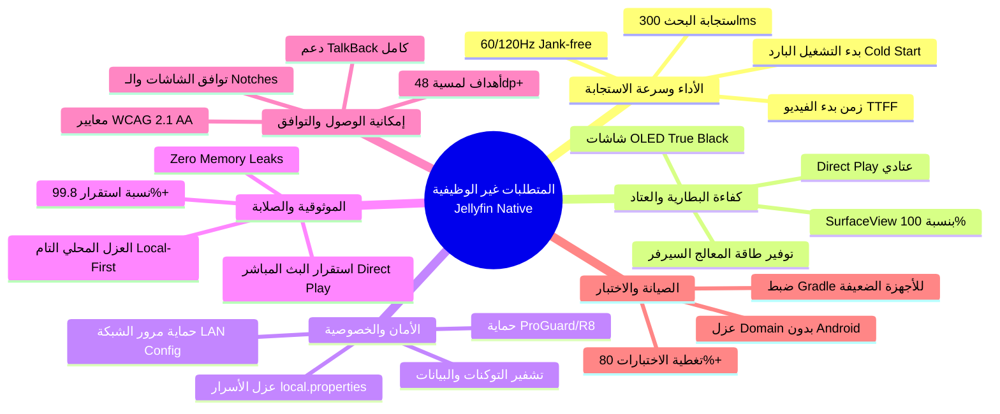

# وثيقة المتطلبات غير الوظيفية الشاملة (NFR)
# Jellyfin Android Native — Non-Functional Requirements & Performance Specification

> **حالة الوثيقة:** معتمدة رسمياً ومحدثة (Approved Engineering Specification)  
> **الإصدار:** 1.0.0  
> **تاريخ التحديث:** 18 نوفمبر 2026  
> **المنصة والتقنيات:** 100% Native Android • Kotlin 2.0+ • Jetpack Compose • AndroidX Media3 • Koin  
> **المرجعية الهندسية:** متوافقة مع معايير جودة Google Android Vitals و WCAG 2.1 AA و Clean Architecture.

---

##  الفهرس التنفيذي للمتطلبات غير الوظيفية



---

##  1. معايير الأداء والسرعة وزمن الاستجابة (Performance & Responsiveness)

تهدف هذه المعايير إلى جعل التطبيق يبدو كأنه يتفاعل لحظياً مع أصابع المستخدم دون أي تأخير ملموس، حتى مع مكتبات وسائط تضم آلاف الملفات والبوسترات بدقة 4K.

### 1.1 سرعة تشغيل التطبيق (App Startup Time)
تُقاس سرعة التشغيل وفق معايير **Android Vitals** الرسمية من Google على أجهزة متوسطة المواصفات (Mid-Range Device):

| نوع بدء التشغيل | التعريف الزمني | الحد الأقصى المسموح (SLA) | الإجراء التقني لضمان المعيار |
| :--- | :--- | :---: | :--- |
| **البدء البارد (Cold Start)** | إطلاق التطبيق لأول مرة بعد إغلاقه كلياً من الذاكرة | **$\le$ 1,200ms** (1.2 ثانية) | تأجيل تهيئة مكتبات الأطراف الثالثة، الاعتماد على Koin الخفيف دون Reflection، وعدم حظر الخيط الرئيسي (Main Thread) بأي عملية I/O. |
| **البدء الدافئ (Warm Start)** | استرجاع التطبيق بعد خروجه من الشاشة مع بقاء العملية | **$\le$ 500ms** | حفظ واسترجاع حالة شاشات Compose عبر `rememberSaveable` وتخزين آخر استجابة كاش في Room. |
| **البدء الساخن (Hot Start)** | التبديل الفوري للتطبيق من شريط التطبيقات النشطة | **$\le$ 200ms** | لا تحدث أي إعادة تحميل، عرض الواجهة مباشرة من الذاكرة الحية. |

### 1.2 سيولة الواجهة ومعدل الإطارات (Frame Rate & Rendering Stability)
* **المعدل المستهدف:** **60 إطاراً في الثانية (60fps)** كحد أدنى على الشاشات القياسية، و **120 إطاراً في الثانية (120Hz)** على شاشات الهواتف الحديثة ذات التردد العالي.
* **معدل الإطارات البطيئة (Slow Frames):** يجب ألا تتجاوز نسبة الإطارات التي يستغرق رسمها أكثر من 16ms نسبة **1.5%** من إجمالي إطارات الجلسة.
* **الإطارات المتجمدة (Frozen Frames):** نسبة الإطارات التي تستغرق أكثر من 700ms يجب أن تكون **0.0%**.
* **الضوابط البرمجية لتحقيق ذلك في Compose:**
  - استخدام `ImmutableList` و `@Immutable` في هياكل بيانات الـ UI لمنع إعادة الرسم غير الضرورية (Unnecessary Recompositions).
  - استخدام `derivedStateOf` لمراقبة التمرير في `LazyListState`.
  - اعتماد مكتبة **Coil** مع حجم أقصى للبوسترات المقتطعة يتناسب تماماً مع أبعاد العنصر (`precision(Precision.EXACT)`).

### 1.3 سرعة الاستجابة لعمليات البحث والتصفح
* **محرك البحث اللحظي:** تطبيق نافذة تهدئة (**Debounce = 300ms**) مع إلغاء Coroutine السابقة فورياً عبر `flatMapLatest`.
* **وقت استجابة البحث المحلي (From Cache/Room):** أقل من **100ms**.
* **وقت استجابة البحث عبر الشبكة المحلية (LAN Search):** أقل من **400ms**.
* **التنقل عبر الشريط الأبجدي السريع (Fast A-Z Scroll):** قفز فوري بزمن استجابة لمسي أقل من **50ms** مع نبضة اهتزازية (Haptic Pulse).

### 1.4 زمن بدء تشغيل الفيديو (Time To First Frame - TTFF)
* في وضع البث المباشر على الشبكة المحلية (**Hardware Direct Play**): يجب ألا يتجاوز الوقت بين نقر المستخدم على زر التشغيل وظهور أول إطار للفيديو بدقة 4K حاجز **800ms**.
* في وضع تشغيل الملفات المحملة أوفلاين (**Offline Playback**): يجب ألا يتجاوز زمن ظهور الإطار الأول **350ms**.

---

##  2. كفاءة استهلاك الموارد والبطارية والحرارة (Resource & Thermal Efficiency)

يعتبر تشغيل ملفات الفيديو عالية الدقة (4K Remux / HEVC / HDR) من أثقل العمليات على معالجات الهواتف؛ لذا تفرض هذه الوثيقة قيوداً صارمة لضمان بقاء الهاتف بارداً وأقصى توفير ممكن للبطارية.

### 2.1 كفاءة استهلاك طاقة المعالج والشاشة (Battery & Display)
* **استخدام السواد الحالك (#000000):** في كافة خلفيات التطبيق وشاشات المشغل، لإيقاف بكسلات شاشات OLED/AMOLED بنسبة 100%، مما يحقق وفراً يصل إلى **40% من استهلاك الشاشة للطاقة**.
* **طبقة العرض `SurfaceView` حصراً في المشغل:** 
  - إرسال إطارات الفيديو مباشرة إلى معالج الشاشة (Hardware Composer) دون المرور بطبقة View Hierarchy لنظام أندرويد.
  - خفض استهلاك البطارية أثناء جلسات المشاهدة بنسبة تتراوح بين **25% إلى 35%** مقارنة باستخدام `TextureView`.
* **معيار استهلاك البطارية أثناء التشغيل:** يجب ألا يتجاوز استهلاك البطارية أثناء تشغيل فيلم بدقة 1080p بمستوى سطوع 50% عبر الشبكة المحلية نسبة **7% إلى 9% في الساعة**.

### 2.2 تخفيف العبء عن خادم الوسائط (Zero Server Transcoding)
* الهدف الأساسي هو تحقيق نسبة **Direct Play $\ge$ 90%** من إجمالي جلسات التشغيل، لمنع إجهاد معالج الخادم.
* استهلاك المعالج على السيرفر (Server CPU Load) لكل جلسة تشغيل يجب ألا يتعدى **3%** (مقتصرة على قراءة الـ I/O وإرسال حزم البيانات عبر الشبكة دون Transcoding).

### 2.3 إدارة الذاكرة العشوائية ومكافحة التسريبات (RAM & Leak-Free Operation)
* **سقف استهلاك الذاكرة العشوائية (RAM Heap Limit):**
  - أثناء تصفح القوائم والمكتبات: لا يتجاوز **150MB**.
  - أثناء تشغيل ميديا 4K ومعالجة الترجمات والإضاءة المحيطية: لا يتجاوز **240MB**.
* **مكافحة تسريب الذاكرة (Zero Memory Leaks):**
  - تفريغ مثيلات `Media3 ExoPlayer` فور تدمير الـ Activity أو مغادرة شاشة المشغل عبر استدعاء صريح لـ `player.release()`.
  - إلغاء اشتراكات Coroutine Jobs المرتبطة بدورة حياة الشاشات عبر `viewModelScope`.
  - امتثال تام لتقارير أداة **LeakCanary** في نسخ التطوير (خلو التطبيق من أي Retention leaks).

---

##  3. الأمان، وحماية البيانات، والشبكة (Security, Privacy & Hardening)

### 3.1 سياسة مرور الشبكة المحلية (Local Network Traffic Hardening)
نظراً لأن التطبيق يعتمد بروتوكول HTTP غير المشفر للاتصال بسيرفر Jellyfin على الشبكة المحلية في المرحلة الأولى:
* **حظر فتح الشبكة عالمياً:** يُمنع استخدام `android:usesCleartextTraffic="true"` كإعداد عام في التطبيق.
* **الاعتماد الإلزامي لملف أمان الشبكة (`network_security_config.xml`):**
  يقتصر السماح بحزم HTTP الصريحة حصراً على نطاقات العناوين المحلية الخاصة المعتمدة عالمياً (RFC 1918) ونطاق الاسترجاع المحلي:
  ```xml
  <?xml version="1.0" encoding="utf-8"?>
  <network-security-config>
      <domain-config cleartextTrafficPermitted="true">
          <!-- نطاقات الشبكات المحلية المعزولة فقط -->
          <domain includeSubdomains="true">192.168.0.0/16</domain>
          <domain includeSubdomains="true">10.0.0.0/8</domain>
          <domain includeSubdomains="true">172.16.0.0/12</domain>
          <domain includeSubdomains="true">localhost</domain>
          <domain includeSubdomains="true">127.0.0.1</domain>
      </domain-config>
      <!-- حظر تام لأي مرور HTTP صريح خارج نطاقات الشبكة المحلية -->
      <base-config cleartextTrafficPermitted="false" />
  </network-security-config>
  ```

### 3.2 عزل الأسرار وبيانات الاعتماد (Zero Credentials in Source)
* **حظر تثبيت الأسرار:** يُمنع تماماً تخزين أي عناوين IP، أو رموز مصادقة (Tokens)، أو أسماء مستخدمين داخل كود المصدر أو المستودع.
* **الاعتماد الحصري لملف `local.properties`:**
  - يتم تمرير بيانات الخادم التجريبي وقت البناء عبر `BuildConfig`.
  - ملف `local.properties` مدرج بصورة إلزامية في `.gitignore`.
* **تخزين التوكنات على الهاتف:** حفظ رموز جلسة الدخول (Auth Tokens) في بيئة التخزين المشفرة بنظام أندرويد عبر **`EncryptedSharedPreferences`** أو Jetpack Preferences DataStore مع تشفير Android Keystore.

### 3.3 حماية الكود والإنتاج (R8/ProGuard & Release Hardening)
* تفعيل تقليص الكود والموارد في إصدارات الإنتاج (`isMinifyEnabled = true` و `isShrinkResources = true`).
* عزل وحذف سجلات التطوير الحساسة (Strip debug log statements) باستخدام قواعد ProGuard لمنع تسريب أسماء المستخدمين أو مسارات الملفات في `Logcat`.

---

## 4. الموثوقية، ومقاومة الأخطاء، والاسترداد (Reliability & Fault Tolerance)

### 4.1 استقلالية وضع عدم الاتصال (100% Offline Vault)
* **استمرار العمل في وضع الطيران:** عند فقدان الاتصال بالخادم، يجب ألا يُظهر التطبيق شاشات خطأ تسد الواجهة أو تؤدي لانهياره؛ بل يتحول التطبيق تلقائياً وبسلاسة إلى **وضع الأوفلاين**.
* تعرض شاشة التنزيلات الأفلام والمسلسلات المحفوظة مع إمكانية تشغيلها والوصول لملفات الترجمة المحلية مباشرة دون الحاجة لأي طلب شبكة.

### 4.2 موثوقية التنزيلات الكبيرة (Unbreakable Background Downloads)
* **الصمود أمام قيود النظام (Doze Mode & Process Kills):**
  - تنفيذ مهام التنزيل عبر **`Media3 DownloadService`** كخدمة أمامية ملزمة بإشعار نشط (Foreground Service with Persistent Notification).
  - دعم الاستئناف التلقائي للملفات الكبيرة (Resumable Chunks) عند انقطاع شبكة الواي فاي وعودتها دون إعادة تحميل الملف من الصفر.
  - إيقاف التنزيل مؤقتاً تلقائياً عند انخفاض شحن البطارية دون 15% أو عند نفاد مساحة التخزين (أقل من 1GB فارغة) لحماية استقرار نظام الهاتف.

### 4.3 استراتيجيات الاسترداد التلقائي للتشغيل (Playback Fallback Matrix)
عند تعثر تشغيل ملف فيديو عتادياً:
1. محاولة التشغيل عتادياً عبر **Direct Play**.
2. إذا أطلق المشغل خطأ فك تشفير عتادي (`MediaCodecRenderer$DecoderInitializationException`):
   - المحاولة التلقائية الثانية: فك التشفير برمجياً عبر حزمة `FFmpeg Audio/Video Extension`.
3. إذا فشل التشغيل المحلي بالكامل بسبب عدم دعم التنسيق:
   - طلب تيار بث متكيف محول برمجياً (**HLS Transcode Stream**) من الخادم كخيار أخير مع إشعار المستخدم بشارة توضيحية (` Transcoding`).

### 4.4 مؤشرات جودة الاستقرار (Crash-Free Rate)
* **نسبة الجلسات الخالية من الانهيار (Crash-Free Sessions):** يجب أن تظل **$\ge$ 99.8%**.
* **معدل عدم استجابة التطبيق (ANR Rate):** يجب أن يظل **$\le$ 0.05%** وفق معايير Google Play Console.

---

##  5. إمكانية الوصول والتوافق الشامل (Accessibility & Usability)

التطبيق مصمم ليكون متاحاً ومريحاً لجميع فئات المستخدمين، مع توافق كامل مع معايير **WCAG 2.1 (Level AA)**.

### 5.1 نسب التباين البصري (Contrast Ratios)
* **النصوص الأساسية والعناوين:** نسبة تباين لا تقل عن **7:1** (محققة مستوى AAA حيث أن النص أبيض `#FFFFFF` على خلفية سوداء بنسبة تصل إلى 20.4:1).
* **النصوص الثانوية والمعلومات الفنية:** نسبة تباين لا تقل عن **4.5:1** (مستوى AA).
* **الأيقونات وعناصر التحكم التفاعلية:** نسبة تباين لا تقل عن **3:1** ضد أسطحها المحيطة.

### 5.2 قارئ الشاشة (TalkBack Semantics)
* تزويد كل عنصر تفاعلي وصوري في Compose بوسم `Modifier.semantics`:
  - **ملصقات الأفلام:** قراءة العنوان وسنة الإنتاج والتقييم بوضوح.
  - **شارات الجودة التقنية:** قراءة الوصف الصوتي الدقيق (مثال: "تقنية العرض: فور كي الترا إتش دي، الصوت المحيطي: دولبي أتموس").
  - **أزرار المشغل والإيماءات:** نطق مستوى الصوت ونسبة السطوع والتقدم الزمني فور تعديلها.

### 5.3 المساحات اللمسية المريحة (Touch Targets)
* الحد الأدنى الصارم لأي عنصر أو زر تفاعلي هو **$48\text{dp} \times 48\text{dp}$** (أو تمديد مساحة اللمس عبر `minimumInteractiveComponentSize()`) لتفادي النقرات الخاطئة، خصوصاً في وضع الشاشة الكاملة أثناء الاستلقاء أو المشاهدة في الظلام.

### 5.4 الخطوط والأحجام الديناميكية (Dynamic Type Scaling)
* استخدام وحدة **`sp`** حصراً لكافة النصوص في نظام التصميم (`Typography.kt`).
* دعم تكبير الخط في إعدادات النظام حتى نسبة **130%** دون انقطاع النصوص أو حدوث تشوه بصري (Clipping/Overflows) في الكروت أو شريط التحكم.

---

##  6. التوافقية والأجهزة المدعومة (Compatibility & Form Factors)

### 6.1 إصدارات نظام أندرويد المستهدفة
* **الحد الأدنى للنظام (Minimum SDK):** `Android 8.0 Oreo (API 26)` — لضمان دعم بروتوكولات التشفير الحديثة، ومحرك تشغيل Media3، والـ Adaptive Icons.
* **النظام المستهدف (Target & Compile SDK):** `Android 15 (API 35)` مع توافق كامل مع إصدار `Android 14 (API 34)`.

### 6.2 أبعاد الشاشات والتكيف الهندسي (Responsive Screen Layouts)
* **نسب العرض إلى الارتفاع المدعومة:** التكيف التام مع جميع نسب الشاشات الذكية (16:9، 18:9، 19.5:9، 20:9، 21:9).
* **التعامل مع قطع الشاشة والكاميرا (Notches & Display Cutouts):**
  - في القوائم والتصفح: احترام كامل لـ `WindowInsets.safeDrawing`.
  - في مشغل الفيديو: دعم التبديل التفاعلي بين نمط "الملاءمة" (Fit with black bars) ونمط "ملء الشاشة" (Fill & Crop) مع احترام مناطق الكاميرا الأمامية لتفادي حجب الترجمة.
* **صورة داخل صورة (Picture-in-Picture - PiP):** دعم تلقائي للتبديل إلى نمط PiP بنسبة عرض الفيديو الأصلية عند الضغط على زر الشاشة الرئيسية أثناء تشغيل الميديا بنظام أندرويد 8.0 فما فوق.

---

##  7. جودة الكود، والقابلية للصيانة، والاختبار (Maintainability & Testability)

### 7.1 نظافة المعمارية والفصل التام (Clean Architecture Discipline)
* **استقلال طبقة الـ Domain:** 
  - يُحظر استيراد أي حزمة تبدأ بـ `android.*` داخل مجلدات `domain/`.
  - منطق الحسابات (مثل اختيار أفضل مسار تشغيل، وحساب أولوية التنزيل) يجب أن يتم اختباره كوحدات برمجية نقية خلال أجزاء من الثانية.
* **فصل الـ DTOs عن الـ Domain Models:** حظر استخدام نماذج Retrofit مباشرة في شاشات Compose، والاعتماد الإلزامي على كائنات `Mappers`.

### 7.2 التغطية الاختبارية (Test Coverage Targets)
* **طبقة الـ Domain (حالات الاستخدام UseCases):** تغطية اختبارية $\ge$ **85%**.
* **محولات البيانات (Mappers):** تغطية اختبارية $\ge$ **90%** (لضمان سلامة تحويل حقول JSON المعقدة من السيرفر).
* **طبقة العرض والـ ViewModels:** اختبارات تدفق الأحداث والحالات (StateFlow testing via `Turbine`) بنسبة $\ge$ **70%**.

### 7.3 معايير التحليل الثابت (Static Analysis & Linting)
* خلو المشروع تماماً من أي أخطاء أو تحذيرات بناء (**0 Errors, 0 Critical Warnings**).
* اعتماد أدوات التحليل الثابت لكود كوتلن لفرض معايير التنسيق والتسمية الموحدة.

---

##  8. ضوابط بيئة التطوير للأجهزة ذات الموارد المحدودة (Low-Spec Constraints)

نظراً لأن بيئة التطوير تعتمد على موارد معتدلة بدون أندرويد ستوديو الثقيل أو محاكيات نظام أندرويد المستنزفة للرام:
1. **سقف ذاكرة بناء Gradle:**
   تثبيت سقف ذاكرة الـ JVM بحد أقصى **2048MB** في ملف `gradle.properties`:
   ```properties
   org.gradle.jvmargs=-Xmx2048m -XX:+UseParallelGC -Dfile.encoding=UTF-8
   org.gradle.parallel=true
   org.gradle.caching=true
   org.gradle.configuration-cache=true
   ```
2. **زمن البناء التدريجي (Incremental Build Time):**
   يجب ألا يتجاوز زمن بناء وتثبيت التعديلات البسيطة على الهاتف الحقيقي حاجز **20 ثانية**.
3. **التشغيل المباشر عبر ADB:**
   يتم اختبار التطبيق حصراً على **هاتف أندرويد حقيقي** متصل عبر USB أو كابل الشبكة لتفادي تشغيل محاكيات تستهلك الرام والمعالج.

---

##  9. مصفوفة التحقق والقياس للمتطلبات غير الوظيفية (NFR Verification Matrix)

| المتطلب غير الوظيفي | المعيار الكمي المستهدف | وسيلة القياس والأداة | النتيجة المقبولة للاعتماد |
| :--- | :---: | :--- | :--- |
| **بدء التشغيل البارد** | $\le$ 1,200ms | Android Jetpack Benchmark / Macrobenchmark | إطلاق فوري دون شاشات وسيطة معلقة |
| **سيولة الرسوم (FPS)** | 60/120 fps ($\le$ 1.5% Slow) | GPU Rendering Profile / Profile GPU Rendering | عدم وجود قطوعات بصرية أثناء التمرير السريع |
| **استهلاك الذاكرة** | $\le$ 240MB Peak | Android Studio Profiler / ADB dumpsys meminfo | خلو السجلات من أي OutOfMemoryError |
| **تسريب الذاكرة** | 0 Leaks | LeakCanary | اجتياز اختبار التصفح لمدة 15 دقيقة بدون تسريب |
| **Direct Play** | $\ge$ 90% من الجلسات | سجلات Jellyfin Server Dashboard | خلو الخادم من عمليات تحويل الفيديو برمجياً |
| **أمان الشبكة** | LAN HTTP Only | اختبار اختراق شبكي / APK Manifest Inspection | حظر أي اتصال HTTP خارج نطاقات RFC 1918 |
| **التباين اللوني** | $\ge$ 4.5:1 (AA) و $\ge$ 7:1 (AAA) | Accessibility Scanner / Color Contrast Analyzer | اجتياز فحص كافة الشاشات بنسبة 100% |
| **الأهداف اللمسية** | $\ge$ 48dp x 48dp | Accessibility Scanner | عدم وجود عناصر تفاعلية أصغر من المعيار |
| **وضع الأوفلاين** | 100% Operational | اختبار وضع الطيران اليدوي على الهاتف | تشغيل الميديا المحملة والترجمة بدون شبكة |
| **جلسات دون انهيار** | $\ge$ 99.8% | Firebase Crashlytics / Google Play Console | تطبيق صلب ومستقر طوال فترات الاستخدام |
