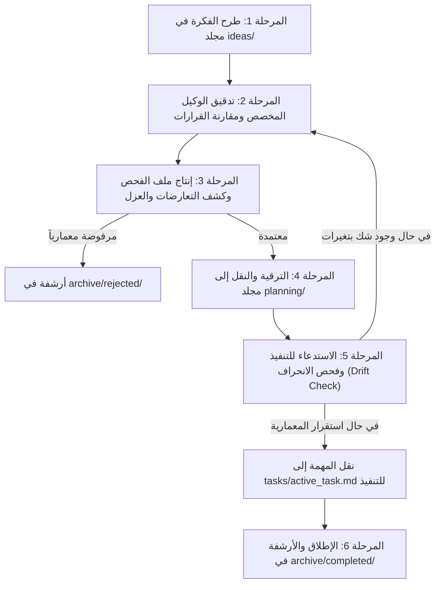

# حاضنة التفكير ودراسة الأفكار
# Thinking & Ideation Hub

مرجع التفكير الاستراتيجي، فحص الأفكار، والتخطيط المعماري المسبق لتطبيق "مدد TV" قبل نقل أي ميزة لمسار التنفيذ الفعلي.

---

## 1. الهيكل والتقسيم الداخلي

تتكون حاضنة التفكير من ثلاثة مسارات معمارية تعزل الأفكار الأولية عن الخطط المعتمدة عن السجل التاريخي:

```
docs/thinking/
|-- README.md                         # هذا الدليل: فلسفة الحاضنة ودورة الحياة
|-- AGENT_PROTOCOL.md                 # بروتوكول وتشغيل وكيل التفكير والفرز المعماري
|-- ideas/                            # مسار الأفكار الأولية والدراسة التحليلية
|   |-- README.md                     # دليل مسار الأفكار وسجل المتابعة
|   |-- template_idea_analysis.md     # القالب الموحد لتوثيق وتحليل الأفكار
|   `-- ideas_backlog.md              # سجل ومصفوفة الأفكار المقترحة
|-- planning/                         # مسار الخطط التنفيذية المعتمدة
|   |-- README.md                     # دليل مسار التخطيط وحصر الميزات الجاهزة
|   |-- 01_gesture_control_system.md  # وثائق الخطط المعمارية المفصلة (01 إلى 08...)
|   `-- ...
`-- archive/                          # مسار الأرشفة والذاكرة التاريخية
    |-- README.md                     # دليل وضوابط الأرشفة
    |-- completed/                    # الخطط المكتملة المنفذة المنشورة
    `-- rejected/                     # الأفكار المستبعدة مع أسباب الرفض والدروس
```

---

## 2. دورة حياة الفكرة وآلية العمل سداسية المراحل (6-Stage Lifecycle)



### المرحلة 1: إضافة الفكرة إلى مجلد الأفكار (`ideas/`)
* يتم تسجيل الفكرة الجديدة كملف مستقل بنمط `snake_case.md` داخل `docs/thinking/ideas/` باستخدام قالب `template_idea_analysis.md`.
* تحتوي الفكرة المبدئية على الوصف العام، الدافع والمبرر، والقيمة المضافة لتجربة المشاهدة.

### المرحلة 2: الفحص والمقارنة الصارمة بواسطة الوكيل المخصص
* فور إضافة أي فكرة، يباشر وكيل مخصص ("وكيل التفكير والفرز المعماري" - `thinking-architect`) دراستها دراسة تفصيلية.
* تتم مقارنة الفكرة بالمصادر المعمارية المعتمدة التالية دون أي تخمين:
  1. **سجل القرارات المعمارية (`docs/adr/`):** التحقق من عدم المساس بقرارات العزل المحلي عبر Room DB (ADR 0001)، التشغيل العتادي المباشر Media3 (ADR 0002)، معمارية Clean Architecture + MVI (ADR 0003)، ونظام السواد التام لشاشات OLED (ADR 0004).
  2. **أساسات التطبيق (`docs/foundations/`):** توافق طبقات البيانات والنطاق والعرض، واستهلاك الذاكرة ومؤشرات 60/120fps.
  3. **واقع التطبيق الحالي ومواصفات الشاشات (`docs/current/`):** فحص التداخل مع الشاشات الحالية، تدفق المستخدم، وبنية الكيانات البرمجية القائمة.
  4. **دستور الحوكمة وقواعد الوكيل (`AGENTS.md` و `OPERATIONAL_RULES.md`):** التحقق من الالتزام بحظر الإيموجيات، معايير التسمية، والعزل التام لمشروع `mdd_tv`.

### المرحلة 3: إنتاج ملف الفكرة وبيان التعارضات ونقاط الفصل
* يقوم الوكيل المخصص بتحديث وثيقة الفكرة ببيانات التدقيق التالية:
  * **التعارضات البرمجية والمعمارية (Architectural Conflicts):** تحديد أي تصادم مع قواعد العمل أو خيارات التصميم القائمة.
  * **نقاط الفصل والتجريد (Decoupling & Isolation Points):** بيان الواجهات البرمجية (Interfaces / Contracts) الضرورية لعزل الميزة، والتأكد من أنها لا تتسبب في اقتران وثيق (Tight Coupling) بين الطبقات أو إفساد منطق المشغل المدمج.
  * **التبعات والاحتياجات (Prerequisites & Dependencies):** المكتبات المطلوبة، الأذونات، تعديلات قاعدة البيانات المحلية، أو تغييرات واجهة المستخدم.
  * **القرار المعماري الموصى به:** اعتماد للترقية إلى خطة، طلب تعديل، أو استبعاد مع توثيق الأسباب.

### المرحلة 4: النقل والترقية إلى مجلد التخطيط (`planning/`)
* بعد استيفاء شروط النضج المعماري ومعالجة التعارضات، ترقى الفكرة وتنقل إلى `docs/thinking/planning/`.
* تأخذ الفكرة اسماً متسلسلاً كخطة تنفيذية معتمدة (مثل `09_feature_name.md`).
* تصبح الخطة مرجعاً هندسياً كاملاً وجاهزاً للاستدعاء الفعلي عند بدء الجدولة.

### المرحلة 5: الاستدعاء للتنفيذ والتحقق من الانحراف المعماري (Drift Audit)
* عند اتخاذ قرار بدء تنفيذ ميزة من مجلد التخطيط لنقلها إلى `tasks/active_task.md`:
* **قاعدة التحقق من الانحراف:** إذا كان هناك أي شك في حدوث تعديلات في واقع التطبيق أو القرارات المعمارية منذ كتابة الخطة، يتم استدعاء الوكيل المخصص من جديد لمطابقة الخطة مع الوضع الراهن وإعادة ضبط نقاط الفصل والواجهات قبل كتابة أي كود برمجي.

### المرحلة 6: الإطلاق والأرشفة الدائمة (`archive/`)
* بعد انتهاء التنفيذ البرمجي واجتياز اختبارات الجودة والإطلاق، تنقل وثيقة الخطة من `planning/` إلى `archive/completed/`، وتدمج تفاصيل الميزة وواجهاتها النهائية في واقع التطبيق `docs/current/`.
* في حال استبعاد أي فكرة أثناء المرحلة 2 أو 3، تنقل مباشرة إلى `archive/rejected/` مع توثيق أسباب الاستبعاد لمنع تكرار طرحها.

---

## 3. الوكيل المخصص لحاضنة التفكير (The Dedicated Thinking Agent)

* **الاسم البرمجي:** `thinking-architect`
* **المسمى الوظيفي:** وكيل التفكير والفرز المعماري (Thinking & Ideation Architect).
* **طريقة الاستدعاء:** يتم تشغيله آلياً عبر أدوات إدارة الوكلاء أو بطلب صريح عند إضافة فكرة جديدة أو فحص خطة مستدعاة.
* **المرجع الإجرائي الشامل:** [`AGENT_PROTOCOL.md`](./AGENT_PROTOCOL.md).
