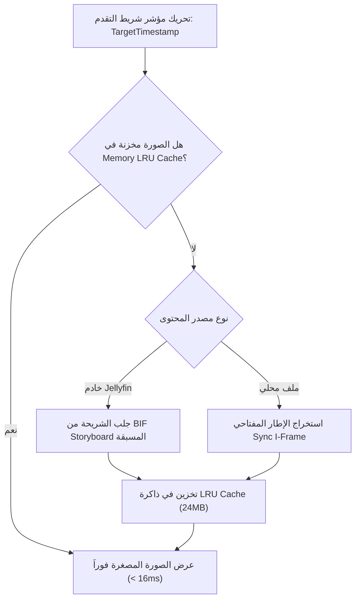

# محرك المعاينة الصورية لشريط التقدم
# Trickplay & Thumbnail Scrubbing Preview Specification

> **حالة الأرشفة:** ميزة مكتملة ومنفذة بنجاح في الكود (Completed & Archived)  
> **تاريخ الإنجاز:** 2026-11-22  
> **الإصدار الرسمي المعتمد:** v1.1.0 (Commit `93427ab`)  
> **المكونات البرمجية والشاشات المرتبطة:** `CinemaPlayerScreen.kt` • `TrickplayPreviewCard` • [مواصفات المشغل المتقدم](../../../current/screens/04_advanced_player.md)  
> **المرجع والاستلهام:** مستوحى من دراسة وتحليل مشغل MX Player.  
> **النطاق:** مشغل الوسائط المدمج في تطبيق مدد TV لنظام أندرويد.

---

## 1. الرؤية والهدف

توفير تجربة بحث وتصفح بصرية سلسة ولحظية عند تحريك شريط الفيديو (Scrubbing)، تتيح للمشاهد رؤية لقطة حية من المشهد قبل الانتقال إليه بدقة زمنية عالية، دون التسبب في هبوط معدل الإطارات أو إرهاق معالج الجهاز بالفك المفرط للترميز.

---

## 2. آلية عمل محرك المعاينة

### أ. نافذة المعاينة الصورية العائمة (Floating Thumbnail Box)
* **المظهر البصري:**
  * نافذة مصغرة بنسبة أبعاد 16:9 وبمقاس `160dp x 90dp` تعلو مؤشر شريط التقدم مباشرة وتتحرك بتزامن كامل مع حركة الإصبع.
  * زوايا دائرية `8dp` وإطار خفيف داكن مع ظل ناعم للحفاظ على الفخامة البصرية.
  * شريط زمني رقمي أنيق أسفل الصورة يعرض الوقت المستهدف (مثال: `01:12:40`).

### ب. التكامل مع خوادم Jellyfin عبر شرائح BIF / Trickplay
* يولد خادم Jellyfin ملفات BIF أو مصفوفات صور مسبقة الصنع (Storyboard Sprites) بدقة `320x180`.
* يقوم التطبيق بتحميل الفهرس الزمني لملف الصور مرة واحدة عند فتح الفيديو.
* عند سحب الشريط، يتم حساب إحداثيات الشريحة بعملية حسابية بسيطة:
  $$\text{FrameIndex} = \frac{\text{CurrentTimestampMs}}{\text{IntervalMs}}$$
* يتم قص وعرض الصورة في زمن يقل عن `10ms` دون الحاجة لأي فك ترميز فيديو محلي، مما يحافظ على برودة الجهاز وسرعته القصوى.

### ج. المعاينة السريعة للملفات المحلية (Fast Keyframe Snapping)
* للملفات المخزنة محلياً، يتم استخراج الإطارات عبر `MediaMetadataRetriever` أو `libavformat` باستخدام خيار `OPTION_CLOSEST_SYNC`.
* **سرعة فائقة:** يتم القفز فقط إلى أقرب إطار مفتاحي (I-Frame / Keyframe) بدلاً من معالجة كافة الإطارات، مما يقلل استهلاك المعالج بنسبة 90% ويمنع أي تجمد للواجهة أثناء السحب السريع.
* إدارة ذاكرة مؤقتة بحجم `24MB` بنمط `LruCache<Long, Bitmap>` لضمان سلاسة التمرير المتكرر دون إعادة جلب الصور نفسها.

---

## 3. محددات التصميم وتوزيع الأعباء المعتمدة

1. **حظر الضغط على السيرفر واستغلال عتاد الهاتف (Zero Server Load):**
   * يُمنع منعاً باتاً مطالبة السيرفر بتوليد صور مصغرة عند الطلب أو استنزاف معالجه.
   * يقتصر دور السيرفر فقط على تقديم ملفات الصور الثابتة الجاهزة مسبقاً (BIF Static Sprites).
2. **الاستخراج المحلي الكامل على الهاتف (Client-Side Snapping):**
   * في حال عدم توفر صور BIF مسبقة، يتولى **معالج الهاتف محلياً بنسبة 100%** استخراج لقطات المعاينة السريعة عبر الإطارات المفتاحية (Sync I-Frames) وتخزينها في ذاكرة الهاتف المحلية `LruCache` بحجم 24MB دون أي حمل على السيرفر، مع ثبات كامل لمعدل الإطارات عند 60/120fps.
