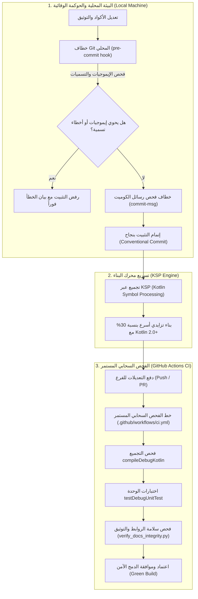

# منظومة أتمتة بيئة التطوير وهندسة الجودة وخطوط الإنتاج
# Developer Environment Automation & Quality Engineering Specification

> **حالة الأرشفة:** ميزة مكتملة ومنفذة بنجاح في الكود ومؤرشفة (Completed & Archived)  
> **تاريخ الإنجاز:** 2026-11-21  
> **الإصدار الرسمي المعتمد:** v1.1.0 (Commit `765094b`)  
> **المكونات البرمجية والأدوات المرتبطة:** `.git/hooks/pre-commit` • `.git/hooks/commit-msg` • `tools/setup_git_hooks.sh` • `tools/verify_docs_integrity.py`  
> **سجل الأفكار:** [ideas_backlog.md](../../ideas/ideas_backlog.md) (المعرفات: `IDEA-24`, `IDEA-25`, `IDEA-26`, `IDEA-27`).  
> **النطاق:** أدوات التطوير المحلية، حوكمة المستودع، ومحركات البناء والفحص لمشروع مدد TV.  

---

## 1. الرؤية والهدف

إرساء بيئة تطوير مؤتمتة، منضبطة، وسريعة تحمي استقرار الكود المصدري، تفرض قواعد الحوكمة المعمارية بشكل وقائي دون إجهاد المطور، وتوفر محركات فحص مستمرة ومستقلة تضمن خلو التطبيق من أي أخطاء تجميعية أو تراجعات برمجية.

---

## 2. المخطط المعماري لمنظومة الأتمتة والجودة

---

## 3. الركائز الهندسية الأربع للمنظومة

### أ. خط الفحص السحابي المستمر للفروع (`ci.yml`) - IDEA-24
* **الملف المستهدف:** `.github/workflows/ci.yml`
* **المشغلات (Triggers):** ينشط تلقائياً عند الدفع (`push`) وفتح طلبات السحب (`pull_request`) لفروع `main` وفروع الميزات `feature/*`.
* **المهام المنفذة:**
  * تشغيل فحص تجميع Kotlin السريع: `./gradlew compileDebugKotlin`.
  * تشغيل اختبارات الوحدة الصامتة: `./gradlew testDebugUnitTest`.
* **سياسة الموارد:** استبعاد بناء نسخ الإنتاج الثقيلة (`assembleRelease`) في هذا الخط لتوفير دقائق الحوسبة السحابية.

### ب. منظومة خطافات Git المحلية للحوكمة الوقائية - IDEA-25
* **الملفات المستهدفة:**
  * `tools/install_hooks.sh`: سكربت تثبيت وتفعيل الخطافات للمطور والوكيل بنقرة واحدة.
  * `.git/hooks/pre-commit`: فحص فوري للملفات المعدلة ومنع التثبيت إذا احتوت على أي رموز تعبيرية (Emoji Ban) أو مسافات في المسارات.
  * `.git/hooks/commit-msg`: فحص التزام رسالة التثبيت بصيغة `Conventional Commits` الإنجليزية.
* **السرعة:** تنفيذ فوري فائق السرعة عبر فحص Regex خفيف (أقل من 50 مللي ثانية) دون تعطيل سير العمل.

### ج. ترقية محرك البناء إلى KSP لـ Room DB - IDEA-26
* **الملفات المستهدفة:** `gradle/libs.versions.toml`, `build.gradle.kts`, و `app/build.gradle.kts`.
* **الخطوات:**
  * إضافة إضافة KSP الرسمية المتوافقة مع Kotlin 2.0.21.
  * إزالة `id("kotlin-kapt")` القديمة واستبدالها بـ `ksp(libs.androidx.room.compiler)`.
* **المكاسب الهندسية:** التخلص من تحذير التراجع اللغوي لـ Kotlin 1.9، تسريع بناء جداول وكيانات Room DB بنسبة تصل إلى 30%، وتوفير استهلاك الذاكرة في بيئة لينكس.

### د. أداة التحقق من سلامة التوثيق والروابط - IDEA-27
* **الملفات المستهدفة:**
  * `tools/verify_docs_integrity.py`: أداة فحص مستقلة تفحص كافة روابط ملفات `docs/` النسبية وتكتشف المسارات المكسورة.
  * تنظيف ملف `mdd_tv/README.md` الرئيسي وتحديث فهرسه بصفر إيموجيات لمطابقة واقع الكود الجديد.
* **التكامل:** تشغيل الأداة كخطوة تحقق إضافية في الـ CI وقبل تنفيذ سكربت الإصدارات `tools/release.sh`.

---

## 4. مصفوفة الامتثال المعماري الصارم

| المحور المعماري | حالة الامتثال | ملاحظات الفحص والتدقيق |
| :--- | :---: | :--- |
| **ADR 0001 (عزل البروفايل في Room DB)** | متوافق 100% | KSP يخدم توليد أكواد Room DB دون أي مساس بهيكل الجداول أو العزل المحلي. |
| **ADR 0002 (التشغيل العتادي Direct Play)** | متوافق 100% | المنظومة تعزل أدوات البناء وتتأكد من تجميع مراجع Media3 و SurfaceView سليمة. |
| **ADR 0003 (معمارية Clean Architecture)** | متوافق 100% | الـ CI يضمن عدم تداخل التبعيات أو كسر عقود UDF أحادية الاتجاه. |
| **ADR 0004 / Obsidian 2.2.0 (التصميم)** | متوافق 100% | فحص تجميع قوالب Compose والرموز دون أخطاء. |
| **ADR 0005 (تأجيل واستئصال التنزيلات)** | متوافق 100% | فحص خلو الكود تماماً من مراجع حزم التنزيل القديمة. |
| **دستور مساحة العمل (حظر الإيموجيات الشامل)** | متوافق 100% | تحويل حظر الإيموجيات إلى قيد تقني آلي عبر Git Hooks. |
| **دستور مساحة العمل (العزل التام للجذر)** | متوافق 100% | كافة الأدوات والخطافات ومسارات العمل محصورة حصراً داخل `mdd_tv/`. |
