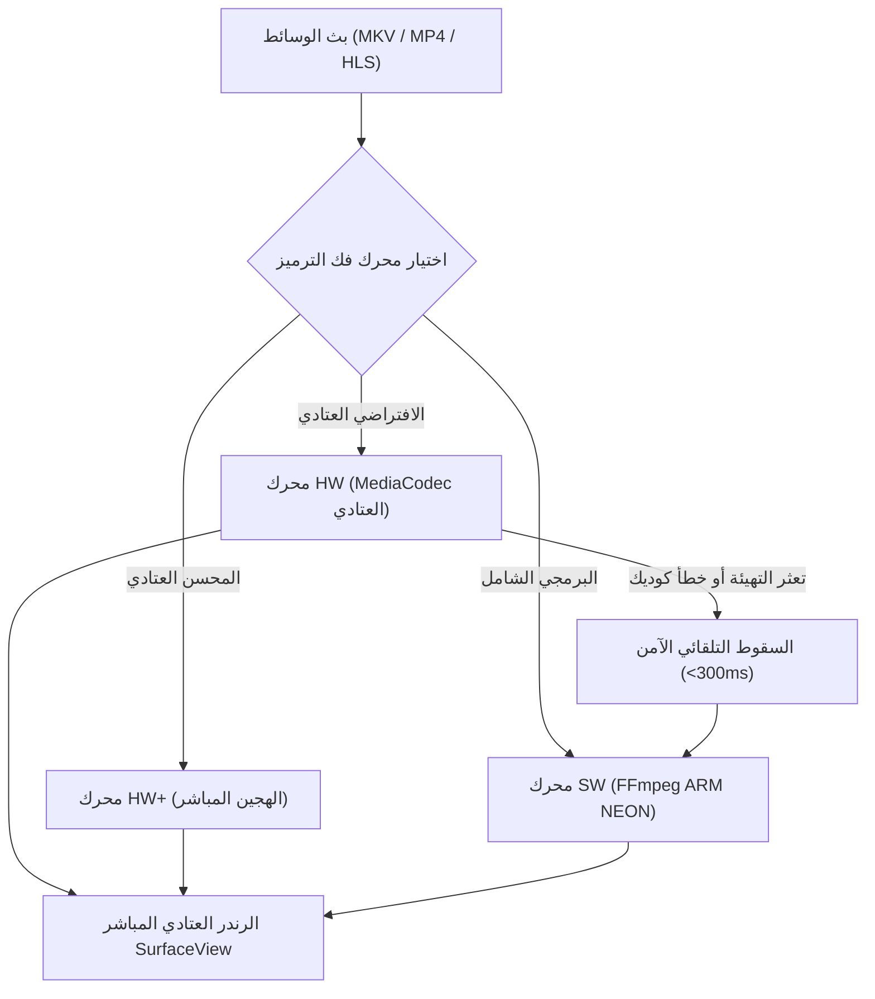

# معمارية فك الترميز التكيفية الثلاثية
# Tri-Engine Decoding Architecture (HW / HW+ / SW)

> **المرجع والاستلهام:** مستوحى من دراسة وتحليل مشغل MX Player (`knowledge/media_players/mx_player/`).
> **الحالة:** فكرة وميزة معتمدة ومكتملة المراجعة التفاعلية مع المستخدم وجاهزة للتنفيذ (Approved & Ready for Execution).
> **النطاق:** مشغل الوسائط المدمج في تطبيق مدد TV لنظام أندرويد.

---

## 1. الرؤية والهدف

ضمان تشغيل أي ملف وسائط أو بث مباشر من خادم Jellyfin بنسبة نجاح 100% دون أن يواجه المستخدم شاشات سوداء أو أخطاء تعذر التشغيل، وذلك عبر الفصل بين ثلاثة محركات مستقلة لفك الترميز ومعالجة البث مع سياسة سقوط تلقائي آمن وسريع.

---

## 2. معمارية المحركات الثلاثة

### أ. فك الترميز العتادي (HW - Hardware Accelerated)
* **المسار:** يعتمد مباشرة على شرائح فك الترميز المدمجة في معالج الجهاز عبر `Android MediaCodec`.
* **المزايا:**
  * استهلاك فائق الانخفاض للبطارية والمعالج (أقل من 3% استهلاك CPU).
  * حرارة منخفضة جداً للجهاز أثناء تشغيل ملفات 4K HDR10 و Dolby Vision.
* **الحالات المستهدفة:** المسار الافتراضي لكافة الأفلام والمسلسلات الحديثة.

### ب. فك الترميز العتادي المحسن (HW+ - Hardware Plus)
* **المسار:** إطار تسريع هجين يدمج فك الترميز العتادي مع تصيير مباشر على سطح العرض وتخطي قيود معمارية النظام القديمة.
* **المزايا:**
  * حل مشكلات تضارب مساحات الألوان (Color Profile Inversion) على بعض الشرائح.
  * إتاحة تطبيق مؤثرات الصوت وتضخيم الصوت البرمجي بالتوازي مع تسريع الفيديو العتادي.

### ج. فك الترميز البرمجي متعدد الأنوية (SW - Software FFmpeg Extension)
* **المسار:** محرك إنقاذي يعتمد بالكامل على أنوية المعالج (CPU) ومكتبة `media3-decoder-ffmpeg` بتعليمات ARM NEON SIMD.
* **المزايا:**
  * تشغيل كافة الصيغ والتراخيص النادرة أو القديمة (مثل Hi10P، ترميزات الفيديو والصوت غير المدعومة رسمياً من مصنعي الهواتف والتلفزيونات).
  * توافقية تشغيل 100% لكافة مكتبات الفيديو القديمة على السيرفر.
* **توزيع الخيوط البرمجية (Multi-Threading):**
  * توزيع الإطارات على الأنوية المتاحة (بين 2 إلى 8 أنوية بحسب مواصفات المعالج).

---

## 3. آليات التحكم والسقوط التلقائي

1. **التبديل اللحظي (On-the-fly Decoder Switcher):**
   * توفير زر مباشر في شريط التحكم العلوي للمشغل (`HW | HW+ | SW`) يتيح للمستخدم التبديل الفوري بنقرة واحدة دون إعادة تشغيل البث أو العودة للخلف.
2. **بروتوكول السقوط التلقائي الآمن (Automatic Fallback Protocol):**
   * في حال صدور استثناء تعذر التهيئة العتادية `DecoderInitializationException` أو عدم توافق مسار الصوت، ينتقل المشغل فوراً إلى المحرك البرمجي `SW` خلال زمن يقل عن `300ms`.
   * **التحول الصامت التام:** بناءً على قرار المستخدم الصريح، يتم السقوط البرمجي في الخلفية بصمت تام دون إظهار أي إشعار أو رسالة تنبيهية أو مؤشر نصي على الشاشة؛ وتتغير شارة الشريط العلوي فقط لتوضح النمط النشط `SW` لضمان عدم مقاطعة المشاهدة إطلاقاً.
3. **تخصيص مخازن الذاكرة المؤقتة (Buffer Tuning):**
   * ضبط سعة التخزين المسبق عند بدء التشغيل على `1,500ms` فقط لبدء العرض فورياً.
   * ضبط الذاكرة المؤقتة المستمرة بين `15,000ms` و `30,000ms` لتفادي التقطيع أثناء تذبذب شبكة الواي فاي.
