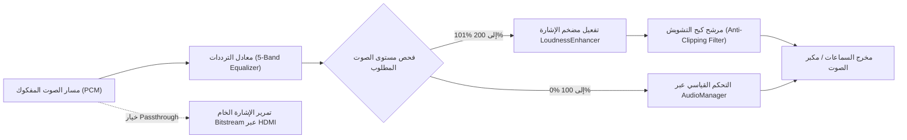

# محرك الصوت المتقدم وتضخيم الإشارة
# Advanced Audio Engine, Boost & Equalizer Specification

> **المرجع والاستلهام:** مستوحى من دراسة وتحليل مشغل MX Player (`knowledge/media_players/mx_player/`).
> **الحالة:** فكرة وميزة معتمدة ومكتملة المراجعة التفاعلية مع المستخدم وجاهزة للتنفيذ (Approved & Ready for Execution).
> **النطاق:** مشغل الوسائط المدمج في تطبيق مدد TV لنظام أندرويد.

---

## 1. الرؤية والهدف

معالجة إحدى أكبر المشاكل التي تواجه المشاهدين في الأفلام والمسلسلات: انخفاض مستوى الحوار الصوتي في بعض ملفات الفيديو، أو تأخر الصوت عند استخدام سماعات البلوتوث، أو غياب استغلال أنظمة المسرح المنزلي، وتوفير حلول برمجية وعتادية متكاملة تنافس ما يقدمه MX Player.

---

## 2. المكونات الأساسية لمحرك الصوت

### أ. تضخيم الصوت البرمجي حتى 200% (Volume Boost 200%)
* **المشكلة:** العديد من الأفلام ذات المسارات الصوتية 5.1 أو 7.1 تعاني من انخفاض شديد في صوت الحوارات عند تشغيلها عبر سماعات الهاتف أو التلفزيون العادية ذات القناتين (Stereo Downmix).
* **الحل الهندسي:**
  * الدمج مع مؤثر `android.media.audiofx.LoudnessEnhancer` المربوط بجلسة الصوت `audioSessionId`.
  * مستويات التحكم:
    * من 0% إلى 100%: استخدام نطاق الصوت النظامي الافتراضي للجهاز.
    * من 101% إلى 200%: تثبيت صوت النظام عند الحد الأقصى، وبدء ضخ كسب صوتي برمجي تدريجي يصل حتى `+1500mB`.
  * إضافة مرشح كبح التشويه الصوتي (Anti-Clipping) لمنع الخشونة وطقطقة الصوت عند المشاهد الصاخبة أو الانفجارات.

### ب. تمرير الإشارة الخام لمكبرات الصوت (Bitstream Passthrough)
* **الميزة:** إرسال إشارات الصوت المحيطي المتقدمة (Dolby Atmos, TrueHD, DTS:X, AC3, EAC3) مباشرة دون فك ترميزها في التطبيق عبر كابل HDMI إلى المسرح المنزلي أو الساوند بار (Soundbar).
* **الفائدة:** الاستمتاع بتجربة صوت سينمائية متطابقة 1:1 مع استوديو الإنتاج وتخفيف حمل المعالجة عن معالج الجهاز.

### ج. معادل الترددات الخماسي (5-Band Audio Equalizer)
* **الميزة:** توفير واجهة تحكم بترددات الصوت:
  * 60Hz (الترددات المنخفضة / Bass).
  * 230Hz (دفء الصوت المتوسط المنخفض).
  * 910Hz (نطاق الحوار البشري).
  * 3.6kHz (وضوح المخارج والحروف).
  * 14kHz (الترددات الحادة / Treble).
* **بروفايلات صوتية جاهزة بضغطة زر:**
  * **Vocal Booster:** تعزيز ترددات 910Hz و 3.6kHz لرفع وضوح أصوات الكلام في الأفلام الأكشن.
  * **Cinema Bass:** تعزيز المؤثرات الصوتية والانفجارات.
  * **Night Mode:** كبح الفوارق الصوتية العالية لتفادي إزعاج الآخرين أثناء المشاهدة الليلية.

### د. المزامنة اللحظية للصوت (Audio Delay Adjustment)
* **الميزة:** شريط تحكم دقيق بفاصل `50ms` لتقديم أو تأخير مسار الصوت مقارنة بالصورة.
* **الفائدة:** القضاء التام على مشكلة عدم تزامن حركة الشفاه (Lip Sync Lag) الناتجة عن تأخير سماعات البلوتوث اللاسلكية أو مستقبلات الصوت الخارجية.

---

## 3. محددات التصميم وتجربة المستخدم المعتمدة

1. **الالتزام الصارم بحماية السيرفر (Zero Server Transcoding & ADR 0002):**
   * يُمنع منعاً باتاً إرهاق خادم Jellyfin بإعادة ترميز مسارات الصوت؛ يتم استغلال عتاد ومعالج الهاتف محلياً بنسبة 100% لفك الترميز والتحويل (Downmix) إلى ستيريو، مع توفير Passthrough لمن يمتلك مسرحاً منزلياً.
2. **مكافحة الازدحام البصري (Anti-Clutter & Actions Button):**
   * بناءً على قرار المستخدم، يُحظر عرض أزرار المعادل الصوتي أو تأخير الصوت بشكل مباشر على الشاشة الرئيسية للمشغل لتجنب تكدس الواجهة وتشويه سواد OLED.
   * تُطوى كافة هذه الأدوات الصوتية (المعادل، بروفايل Vocal Booster، تأخير الصوت، ونمط Passthrough) داخل **"زر الإجراءات الصامت" (Quick Actions / Audio Panel)** كلوحة خيارات سفلية (Bottom Sheet) نظيفة وأنيقة تفتح فقط عند رغبة المستخدم وتختفي تلقائياً.
