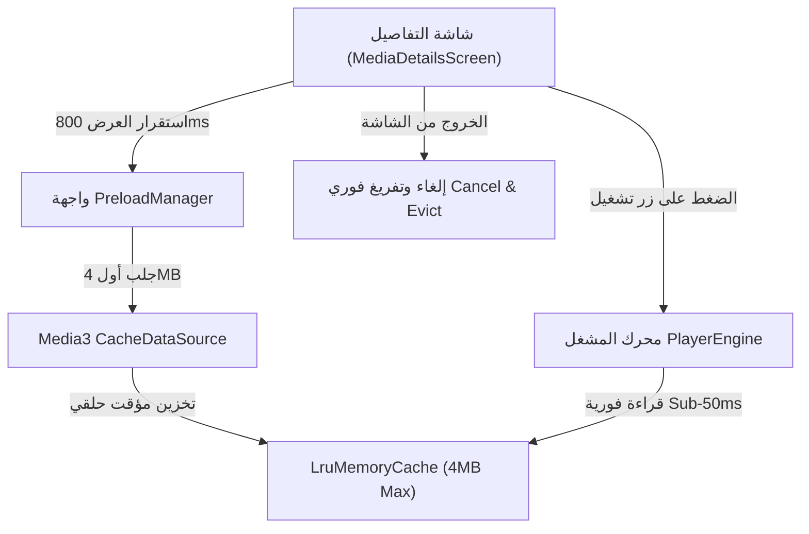

# دراسة فكرة: محرك البدء الفوري للبث التكهني
# Architectural Idea Study: Sub-50ms Speculative Pre-buffering Engine

> **المعرف المعتمد:** `IDEA-21`  
> **اسم الفكرة:** محرك البدء الفوري للبث التكهني (Sub-50ms Speculative Pre-buffering Engine)  
> **تاريخ الطرح:** 2026-11-20  
> **حالة الفكرة:** قيد الفحص والتدقيق المعماري (Under Architectural Audit)  
> **الوكيل الفاحص:** `thinking-architect`  

---

## 1. التوصيف العام والدافع (Overview & Motivation)

### 1.1 ملخص الفكرة
بناء محرك تخزين مؤقت تكهني خفيف ومستقل (`SpeculativePreloadEngine`) ينشط حصراً عند فتح شاشة تفاصيل العمل الفني (`MediaDetailsScreen`). يقوم المحرك بجلب أول 3 إلى 5 ثوانٍ فقط من ملف الفيديو الخام (أو تيار البث المباشر) في ذاكرة عشوائية حلقية معزولة بحجم أقصاه 4 ميجابايت، بحيث عندما يضغط المشاهد على زر "تشغيل"، يبدأ المشغل العتادي العرض فوراً في أقل من 50 مللي ثانية (Sub-50ms Time-to-First-Frame) دون ظهور دائرة التحميل المزعجة (Zero Buffering Spinner).

### 1.2 الدافع ومبررات الإضافة
* القضاء على فترة الانتظار (Latency) الناتجة عن مصافحة بروتوكول HTTP وجلب أول عينات من الوسائط عند بدء التشغيل.
* تقديم تجربة مشاهدة فورية تحاكي مشغلات البث العالمية من الفئة الأولى (Apple TV و Netflix).
* تحسين استجابة التطبيق على أجهزة التلفزيون والشاشات الكبيرة Leanback حيث يعتبر التأخير أكثر وضوحاً للمشاهد.

---

## 2. جدول مطابقة القرارات المعمارية (ADR Alignment Matrix)

| القرار المعماري | التوافق مع القرار | ملاحظات التدقيق والتحقق المعماري |
| :--- | :--- | :--- |
| **ADR 0001 (عزل البروفايل محلياً في Room DB)** | متوافق تماماً | المحرك يعمل حصراً في الذاكرة العشوائية المتطايرة (Volatile RAM) ولا يتصل أو يكتب في قاعدة البيانات أو يغير جلسة السيرفر. |
| **ADR 0002 (التشغيل العتادي المباشر Media3)** | متوافق بشرط حاسم | يجب أن يسحب المحرك تيار التشغيل المباشر الخام (Direct Stream) فقط دون تحفيز السيرفر على إعادة الترميز (Transcoding)، مستخدماً `CacheDataSource` المعتمد في Media3. |
| **ADR 0003 (معمارية Clean Architecture + MVI)** | متوافق | فصل المحرك بالكامل خلف واجهة تجريد في طبقة المنصة والمشغل (`PreloadManager`)، بحيث يتم إطلاقه عبر حدث دورة حياة الواجهة دون تلويث الـ ViewModel بتفاصيل الشبكة. |
| **ADR 0004 (تصميم السواد التام True Black)** | متوافق | يمنع ظهور أي شاشات تحميل رمادية أو وميض أبيض؛ يكون الانتقال مباشراً وسلساً من شاشة السواد التام إلى أول إطار سينمائي. |

---

## 3. فحص التعارضات المعمارية والبرمجية (Architectural Conflicts Audit)

### 3.1 التعارضات مع واقع التطبيق القائم (`docs/current/`)
* **هدر بيانات الشبكة عند التصفح السريع:** في حال تنقل المشاهد بين عدة شاشات تفاصيل دون تشغيل أي فيلم، قد يقوم المحرك بسحب أجزاء من وسائط متعددة مما يستهلك سرعة الشبكة.
* **معالجة التعارض:** وضع مهلة تأخير زمني قدرها 800 مللي ثانية قبل بدء السحب التكهني للتأكد من استقرار المشاهد في الشاشة، مع إلغاء فوري لكافة مهام التحميل بمجرد الخروج من الشاشة (`onCleared` / `DisposableEffect`).

### 3.2 التعارضات مع قيود النظام وموارد الجهاز (`docs/foundations/`)
* **ضغط الذاكرة العشوائية (RAM Pressure):** أجهزة التلفزيون القديمة تمتلك ذاكرة محدودة (2GB RAM).
* **معالجة التعارض:** وضع سقف صارم بحجم 4MB كحد أقصى للذاكرة الحلقية، مع ضبط المحرك ليعمل بنمط `WeakReference` يتم تنظيفه فوراً في حال تلقي النظام إشارة انخفاض الذاكرة `onLowMemory`.
* **الشبكات الخلوية المقيدة (Metered Networks):** حظر التخزين التكهني التلقائي إذا كان الجهاز متصلاً عبر بيانات الهاتف المحمول، وتفعيله حصراً عند الاتصال بشبكة Wi-Fi أو Ethernet.

---

## 4. مخطط الفصل والتجريد (Decoupling & Isolation Architecture)

> **المبدأ:** المشغل المدمج (`ExoPlayer`) يجب ألا يعتمد مباشرة على خدمة التخزين المسبق، بل يستفيد من المخزن المشترك تلقائياً عبر موفر البيانات.

### 4.1 الواجهات الفاصلة المطلوبة (Decoupling Interfaces)
* `PreloadManager`: واجهة في طبقة المنصة توفر دوال `preloadStream(itemId: String, streamUrl: String)` و `cancelPreload(itemId: String)`.
* `Media3CacheFactory`: موفر لمستودع البيانات المشترك بين محرك التخزين المسبق ومشغل الوسائط.

### 4.2 خطة السقوط البديل ومعالجة الأخطاء (Fallback Strategy)
* في حال فشل التخزين المسبق أو بطء الشبكة، يبدأ المشغل التشغيل الاعتيادي المباشر بدون أي انهيار، مع إظهار شاشة الانتظار العادية بسلاسة.

---

## 5. حصر التبعات والاحتياجات (Prerequisites & Dependencies)

* **المكتبات المطلوبة:** `androidx.media3:media3-datasource-cache` (المكتبة القياسية الرسمية ضمن حزمة Media3).
* **أذونات النظام:** لا تتطلب أي أذونات إضافية؛ تستخدم إذن `android.permission.INTERNET` القائم.
* **قواعد البيانات المحلية:** لا تتطلب أي تعديلات في Room DB.
* **مؤشرات الأداء المستهدفة:**
  * زمن بدء التشغيل: أقل من 50 مللي ثانية (Sub-50ms).
  * استهلاك الذاكرة الإضافي: 4 ميجابايت كحد أقصى.

---

## 6. القرار المعماري النهائي وخطة الانتقال (Architecture Verdict & Transition)

* **القرار المعماري:** معتمدة للترقية إلى خطة تنفيذية (Approved for Graduation).
* **الأسباب:** فكرة عالية الأثر تحل مشكلة جوهرية في تجربة المستخدم دون المساس بقرارات العزل أو بنية الكود الحالية.
* **خطوات الانتقال لمجلد التخطيط:**
  1. صياغة خطة العمل التفصيلية برقم تسلسلي معتمد: `docs/thinking/planning/09_speculative_prebuffering.md`.
  2. تحديث جدول حصر الأفكار في `docs/thinking/ideas/ideas_backlog.md`.
