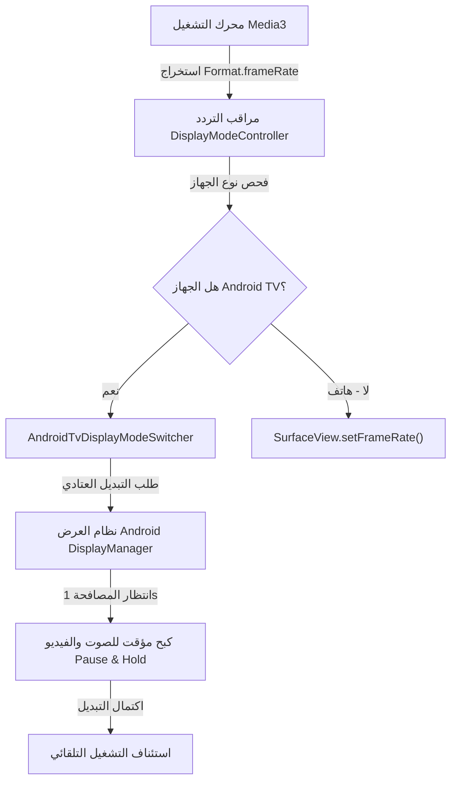

# دراسة فكرة: التبديل الديناميكي لمعدل التحديث وعمق الألوان للتلفزيون
# Architectural Idea Study: Auto Frame Rate & Dynamic HDR Mode Matcher

> **المعرف المعتمد:** `IDEA-22`  
> **اسم الفكرة:** التبديل الديناميكي لمعدل التحديث وعمق الألوان للتلفزيون (Auto Frame Rate & Dynamic HDR Matcher)  
> **تاريخ الطرح:** 2026-11-20  
> **حالة الفكرة:** قيد الفحص والتدقيق المعماري (Under Architectural Audit)  
> **الوكيل الفاحص:** `thinking-architect`  

---

## 1. التوصيف العام والدافع (Overview & Motivation)

### 1.1 ملخص الفكرة
تطوير وحدة تحكم برمجية لعرض الفيديو على أجهزة التلفزيون والشاشات الكبيرة (Android TV / Leanback) تتفاعل مع مدير العرض بنظام أندرويد (`DisplayManager`) ومحرك المشغل. تقوم الوحدة بقراءة معدل إطارات تيار الفيديو الفعلي بدقة (مثل 23.976fps أو 24.000fps أو 50.000fps) وعمق الألوان (10-bit HDR10 / Dolby Vision)، ثم تطلب تلقائياً من نظام التشغيل ومنفذ HDMI تبديل تردد الشاشة وعمق الألوان ليتطابق تماماً مع تيار المادة المعروضة، واستعادة التردد الافتراضي للشاشة عند إيقاف المشاهدة.

### 1.2 الدافع ومبررات الإضافة
* القضاء التام على ظاهرة الارتعاش الحركي المتكرر (3:2 Pulldown Judder) الناتجة عن عرض محتوى 24 إطاراً على شاشات تعمل بتردد 60 هرتز.
* تقديم تجربة مشاهدة سينمائية سلسة ومريحة للعين تطابق شاشات العرض السينمائي الاحترافية.
* إظهار المدى الديناميكي العالي HDR10 و Dolby Vision بألوان نقية ومطابقة لمواصفات الإنتاج الأصلية دون تشويه أو انخفاض في عمق التدرج اللوني.

---

## 2. جدول مطابقة القرارات المعمارية (ADR Alignment Matrix)

| القرار المعماري | التوافق مع القرار | ملاحظات التدقيق والتحقق المعماري |
| :--- | :--- | :--- |
| **ADR 0001 (عزل البروفايل محلياً في Room DB)** | متوافق | يتم حفظ خيار تفعيل الميزة ونمط التبديل (سلس / فوري) محلياً داخل جدول إعدادات الجهاز في Room DB ولا يمس السيرفر. |
| **ADR 0002 (التشغيل العتادي المباشر Media3)** | متوافق تماماً | يستخرج المحرك معدل الإطارات مباشرة من بيانات `Format.frameRate` المستخلصة عتادياً عبر Media3 دون التأثير على فك الترميز العتادي. |
| **ADR 0003 (معمارية Clean Architecture + MVI)** | متوافق | عزل كامل لمنطق التفاعل مع العتاد خلف واجهة `DisplayModeController` في طبقة المنصة، بعيداً عن منطق العرض وإدارة الحالة. |
| **ADR 0004 (تصميم السواد التام True Black)** | متوافق بحذر | أثناء تبديل تردد HDMI، قد تنطفئ بعض الشاشات مؤقتاً لمدة ثانية (HDMI Handshake)؛ يجب الحفاظ على سواد الشاشة التام `#000000` ومنع أي وميض أبيض. |

---

## 3. فحص التعارضات المعمارية والبرمجية (Architectural Conflicts Audit)

### 3.1 التعارضات مع عتاد شاشات التلفزيون ومنافذ HDMI
* **ظاهرة انقطاع الصورة المؤقت (HDMI Handshake Blackout):** في شاشات التلفزيون القديمة التي لا تدعم معيار HDMI 2.1 QMS (Quick Media Switching)، يستغرق تبديل التردد ما بين ثانية إلى ثانيتين تكون فيها الشاشة مظلمة تماماً.
* **معالجة التعارض:** تعليق بدء تشغيل الصوت والفيديو مؤقتاً لمدة ثانية أو حتى وصول إشعار اكتمال تبديل وضع العرض (`onDisplayChanged`)، لمنع ضياع أول ثانيتين من الحوار قبل أن تضيء الشاشة للمستخدم.

### 3.2 التعارضات مع هواتف أندرويد المحمولة
* **اختلاف معمارية الشاشات:** الهواتف المحمولة تستخدم شاشات متغيرة التردد التكيفي (LTPO 1-120Hz) ولا تحتاج إلى تبديل أوضاع العرض لمنفذ HDMI كما في أجهزة التلفزيون.
* **معالجة التعارض:** توفير مسارين منفصلين:
  1. على الهواتف: استخدام دالة `SurfaceView.setFrameRate()` القياسية المدعومة في Android 11+ بسلاسة.
  2. على أجهزة التلفزيون: استخدام `DisplayManager.Mode` لتبديل التردد العتادي لمنفذ HDMI بالكامل.

---

## 4. مخطط الفصل والتجريد (Decoupling & Isolation Architecture)

### 4.1 الواجهات الفاصلة المطلوبة (Decoupling Interfaces)
* `DisplayModeController`: واجهة برمجية موحدة توفر:
  * `fun matchDisplayMode(surface: Surface, format: Format)`
  * `fun restoreDefaultDisplayMode()`
* `DisplayModePreferences`: قراءة إعداد المستخدم (مفعل دائماً / معطل / للشاشات الكبيرة فقط).

### 4.2 خطة السقوط البديل ومعالجة الأخطاء (Fallback Strategy)
* في حال عدم دعم الشاشة أو الجهاز لتبديل التردد، يستمر المشغل في العمل بالتردد القياسي للنظام دون إلقاء أي استثناءات، ويسجل ذلك في سجلات التشغيل بهدوء.

---

## 5. حصر التبعات والاحتياجات (Prerequisites & Dependencies)

* **أذونات النظام في AndroidManifest:** لا تتطلب أذونات خاصة إضافية؛ تستخدم واجهات `android.view.Display` الرسمية.
* **متطلبات نظام أندرويد:** أندرويد 6.0 (API 23) فما فوق لأجهزة التلفزيون، وأندرويد 11 (API 30) لدوال `setFrameRate` على الهواتف.
* **قواعد البيانات المحلية:** إضافة حقل في جدول الإعدادات المحلية `auto_frame_rate_enabled` بقيمة افتراضية `true` لأجهزة التلفزيون و `false` للهواتف.

---

## 6. القرار المعماري النهائي وخطة الانتقال (Architecture Verdict & Transition)

* **القرار المعماري:** معتمدة للترقية إلى خطة تنفيذية (Approved for Graduation).
* **الأسباب:** ميزة معمارية فارقة تنقل تجربة العرض على الشاشات الكبيرة Leanback إلى مصاف مشغلات النخبة دون تعقيد برمجي في طبقة التطبيق.
* **خطوات الانتقال لمجلد التخطيط:**
  1. صياغة خطة العمل التنفيذية برقم تسلسلي معتمد: `docs/thinking/planning/10_auto_frame_rate_matching.md`.
  2. تحديث جدول حصر الأفكار في `docs/thinking/ideas/ideas_backlog.md`.
