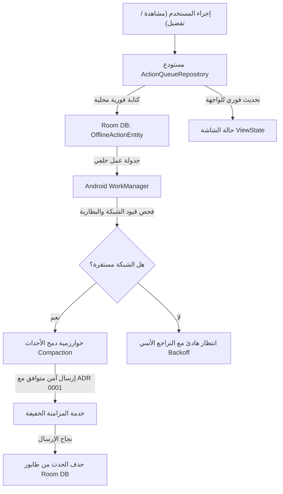

# دراسة فكرة: معمارية طابور الأحداث دون اتصال مع فض التعارض
# Architectural Idea Study: Conflict-Free Offline Action Queue

> **المعرف المعتمد:** `IDEA-23`  
> **اسم الفكرة:** معمارية طابور الأحداث دون اتصال مع فض التعارض (Conflict-Free Offline Action Queue)  
> **تاريخ الطرح:** 2026-11-20  
> **حالة الفكرة:** قيد الفحص والتدقيق المعماري (Under Architectural Audit)  
> **الوكيل الفاحص:** `thinking-architect`  

---

## 1. التوصيف العام والدافع (Overview & Motivation)

### 1.1 ملخص الفكرة
بناء معمارية محلية لتسجيل أحداث وإجراءات المستخدم (تسجيل نقاط توقف المشاهدة، وضع علامة تم المشاهدة، إضافة أو إزالة المفضلة، وتقييم الوسائط) داخل طابور دائم ومقاوم لانقطاع الشبكة في قاعدة بيانات Room DB المحلية (`OfflineActionEntity`). عند توفر الاتصال بالإنترنت، تقوم خدمة خلفية ذكية عبر `WorkManager` بتفريغ الطابور ومزامنة التغييرات تلقائياً وفق سياسة فض تعارض تعتمد على الساعة المتزايدة رتيباً (Monotonic Timestamp)، مع الالتزام التام بعدم تلويث حساب خادم السيرفر المشترك ("الاستراحه") وفق دستور ADR 0001.

### 1.2 الدافع ومبررات الإضافة
* استمرار تجربة المستخدم بشكل كامل وسلس دون توقف حتى في حال ضعف شبكة الواي فاي المنزلية أو انقطاع الإنترنت أثناء السفر.
* منع فقدان نقاط تقدم المشاهدة (Watch Progress) للمقاطع المحلية أو المحملة مسبقاً في وضع عدم الاتصال (Offline Mode).
* توفير بنية تحتية مستقرة تدعم نمط العمل المحلي أولاً (Offline-First Architecture).

---

## 2. جدول مطابقة القرارات المعمارية (ADR Alignment Matrix)

| القرار المعماري | التوافق مع القرار | ملاحظات التدقيق والتحقق المعماري |
| :--- | :--- | :--- |
| **ADR 0001 (عزل البروفايل محلياً في Room DB)** | متوافق ومعزز | يعزز هذا القرار بشكل مطلق؛ تظل بيانات البروفايل المحلي في Room DB هي المرجع المعتمد الأول، ولا ترسل للسيرفر إلا الأحداث المصرح بمزامنتها فقط. |
| **ADR 0002 (التشغيل العتادي المباشر Media3)** | متوافق | يسجل المشغل نقاط التوقف دورياً في الطابور المحلي مباشرة دون انتظار ردود الشبكة، مما يمنع تجمد واجهة المشغل أثناء البث. |
| **ADR 0003 (معمارية Clean Architecture + MVI)** | متوافق تماماً | تعزل طبقة البيانات منطق الطابور والـ WorkManager خلف مستودع موحد (`ActionQueueRepository`) بحيث تبقى طبقة العرض والـ ViewModel مستقلة تماماً عن حالة الشبكة. |
| **ADR 0004 (تصميم السواد التام True Black)** | متوافق | شارات المزامنة وحالة عدم الاتصال تُصمم بنصوص مفرغة وألوان رمادية هادئة متوافقة مع خلفيات السواد التام `#000000`. |

---

## 3. فحص التعارضات المعمارية والبرمجية (Architectural Conflicts Audit)

### 3.1 تعارضات التزامن وتسلسل الأحداث (Out-of-Order Execution)
* **المشكلة:** إذا تم تقديم وإرجاع موضع المشاهدة عدة مرات دون إنترنت، قد يؤدي إرسال الأحداث بترتيب عشوائي عند عودة الشبكة إلى اعتماد موضع قديم في السيرفر.
* **معالجة التعارض:** اعتماد خوارزمية دمج الأحداث (Event Compaction): قبل الإرسال، يتم دمج كافة أحداث نفس المادة (`mediaId`) والإبقاء حصراً على الحدث الأحدث زمناً (Latest Monotonic Timestamp) وإلغاء ما قبله.

### 3.2 تعارضات استهلاك البطارية والمحاولات الفاشلة المستمرة
* **المشكلة:** محاولة الاتصال المتكررة في بيئات الشبكة المتقطعة تستنزف بطارية أجهزة التلفزيون والهواتف.
* **معالجة التعارض:** استخدام `WorkManager` مع قيود نظام أندرويد الصارمة (`Constraints.setRequiredNetworkType(NetworkType.CONNECTED)`) وخوارزمية التراجع الأسي (Exponential Backoff) بفاصل زمني تصاعدي (30s, 60s, 120s...).

---

## 4. مخطط الفصل والتجريد (Decoupling & Isolation Architecture)

### 4.1 الواجهات الفاصلة المطلوبة (Decoupling Interfaces)
* `OfflineActionQueue`: واجهة لإدراج وسحب الأحداث (`enqueueAction`, `getPendingActions`, `markActionCompleted`).
* `ActionSyncEngine`: واجهة مسؤولة عن إرسال الحزم والتفاوض مع واجهات السيرفر عند استعادة الاتصال.

### 4.2 خطة السقوط البديل ومعالجة الأخطاء (Fallback Strategy)
* إذا فشل خادم السيرفر في قبول أي طلب، تبقى البيانات محفوظة في Room DB المحلي كمرجع نهائي للمستخدم، دون أن يشعر المستخدم بأي خلل في تجربة المشاهدة.

---

## 5. حصر التبعات والاحتياجات (Prerequisites & Dependencies)

* **المكتبات المطلوبة:** `androidx.work:work-runtime-ktx` (مكتبة إدارة المهام الخلفية القياسية في أندرويد).
* **تعديلات قاعدة البيانات المحلية (Room DB Migration):**
  * إنشاء كيان `OfflineActionEntity` يحتوي على:
    * `actionId: Long (Primary Key, AutoGenerate)`
    * `profileId: String` (لضمان العزل التام للبروفايل وفق ADR 0001)
    * `mediaId: String`
    * `actionType: String` (PROGRESS, FAVORITE, WATCHED_STATE)
    * `payloadJson: String`
    * `createdAt: Long`
* **أذونات النظام:** إذن الاستماع لحالة الشبكة `android.permission.ACCESS_NETWORK_STATE`.

---

## 6. القرار المعماري النهائي وخطة الانتقال (Architecture Verdict & Transition)

* **القرار المعماري:** معتمدة للترقية إلى خطة تنفيذية (Approved for Graduation).
* **الأسباب:** ترسخ استقلالية التطبيق وتدعم مبدأ الـ Offline-First وتعزز قرارات العزل المحلي دون مخاطر معمارية.
* **خطوات الانتقال لمجلد التخطيط:**
  1. صياغة خطة العمل التنفيذية برقم تسلسلي معتمد: `docs/thinking/planning/11_offline_action_queue.md`.
  2. تحديث جدول حصر الأفكار في `docs/thinking/ideas/ideas_backlog.md`.
