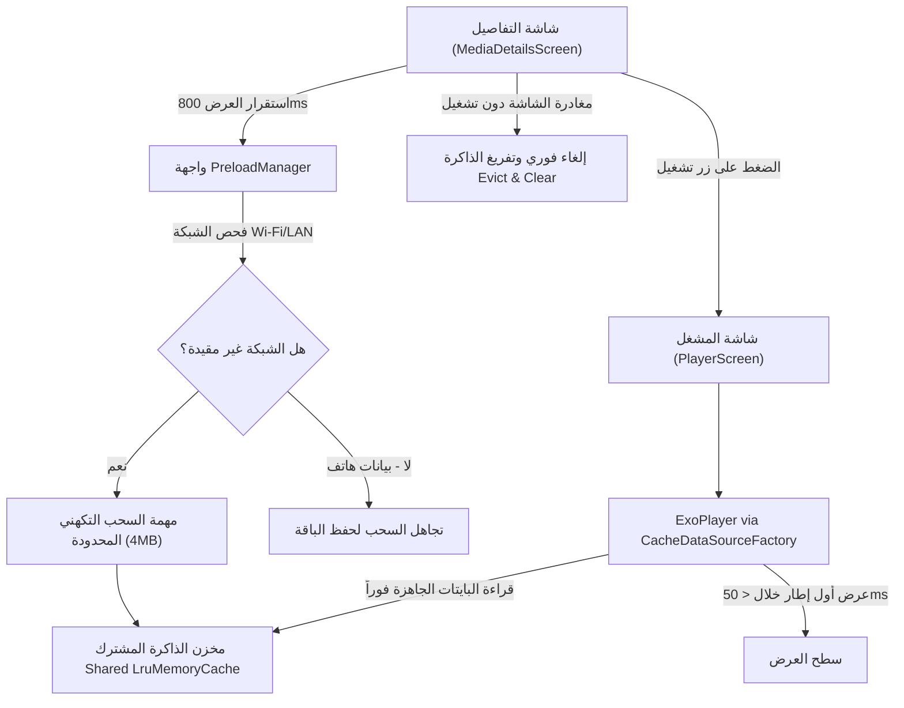

# محرك البدء الفوري للبث التكهني
# Sub-50ms Speculative Pre-buffering Engine Specification

> **المرجع المعماري:** فكرة `IDEA-21` المعتمدة من مسار الأفكار (`docs/thinking/ideas/idea_21_speculative_prebuffering.md`).  
> **الحالة المعمارية:** خطة تنفيذية معتمدة وجاهزة للتنفيذ (Approved & Ready for Execution).  
> **النطاق التقني:** شاشة تفاصيل المادة (`MediaDetailsScreen`)، موفر البيانات في Media3 (`CacheDataSource`)، ومحرك المشغل (`PlayerEngine`).  

---

## 1. الرؤية والهدف الهندسي

القضاء التام على التأخير الزمني وعجلات الانتظار الدوارة (Zero Buffering Spinner) عند الضغط على زر "تشغيل"، من خلال بدء تشغيل الفيديو في زمن قياسي أقل من 50 مللي ثانية (Sub-50ms Time-to-First-Frame).
يتحقق ذلك عبر وحدة استباقية مستقلة تقوم بجلب وتخزين أول 4 ميجابايت من تيار الوسائط الخام في ذاكرة عشوائية مؤقتة بمجرد فتح شاشة تفاصيل العمل، مع تفريغ فوري للمخزن عند مغادرة الشاشة.

---

## 2. تحليل الفجوة والواقع الحالي في الكود (Gap Analysis)

* **الوضع القائم:**
  * عند الضغط على زر "تشغيل" في `MediaDetailsScreen`، يتم توجيه المستخدم إلى `PlayerScreen`.
  * يقوم `PlayerViewModel` بطلب رابط البث من خادم Jellyfin، ثم يمرره إلى `ExoPlayer`.
  * يستغرق `ExoPlayer` ما بين 800ms إلى 2200ms في مصافحة بروتوكول HTTP، وفحص ترويسات الملف، وجلب أول عينات الصوت والفيديو، مما يُجبر واجهة المستخدم على عرض مؤشر تحميل دوار.
* **المطلوب معمارياً:**
  * فصل عملية سحب أول بايتات تيار البث المباشر (Direct Stream) وجعلها تبدأ مبكراً أثناء قراءة المشاهد للبيانات الوصفية في شاشة التفاصيل.
  * مشاركة مخزن البيانات المؤقت بين شاشة التفاصيل ومحرك المشغل بسلاسة دون حدوث تعارض خيوط المعالجة (Thread Concurrency).

---

## 3. المعمارية البرمجية ومخطط التدفق (Architecture Design)



---

## 4. مصفوفة الملفات المتأثرة (Impact Matrix)

| المسار البرمجي في `mdd_tv/app` | طبيعة الإجراء | الوظيفة التقنية |
| :--- | :--- | :--- |
| `data/player/preload/PreloadManager.kt` | ملف جديد | الواجهة المجردة لمحرك التخزين المسبق. |
| `data/player/preload/Media3PreloadManagerImpl.kt` | ملف جديد | التنفيذ الفعلي عبر `CacheDataSource` و `SimpleCache`. |
| `data/player/preload/PreloadMemoryCache.kt` | ملف جديد | حاوية الذاكرة العشوائية الحلقية بسقف 4MB وسياسة تنظيف LRU. |
| `di/PlayerModule.kt` | تعديل | حقن `PreloadManager` كعنصر أحادي (Singleton) مشترك عبر Hilt. |
| `presentation/details/MediaDetailsViewModel.kt` | تعديل | إطلاق مهمة التخزين المسبق بعد استقرار الشاشة 800ms وإلغاؤها في `onCleared`. |
| `presentation/player/PlayerViewModel.kt` | تعديل | تزويد `ExoPlayer` بموفر البيانات المتصل بمخزن التخزين المسبق. |

---

## 5. العقود والواجهات البرمجية (Technical Contracts)

### 5.1 واجهة إدارة التخزين المسبق (`PreloadManager.kt`)
```kotlin
package org.jellyfin.mobile.data.player.preload

import android.net.Uri

interface PreloadManager {
    /**
     * يبدأ التخزين التكهني لأول 4MB من تيار الوسائط الخام في الخلفية.
     */
    fun startPreload(mediaId: String, streamUri: Uri)

    /**
     * يلغي مهمة التخزين الجارية ويفرغ الذاكرة العشوائية الخاصة بالمادة.
     */
    fun cancelPreload(mediaId: String)

    /**
     * تفريغ شامل للمخزن المؤقت عند تلقي إشارات انخفاض الذاكرة.
     */
    fun evictAll()
}
```

### 5.2 ضبط موفر البيانات في Media3 (`Media3PreloadManagerImpl.kt`)
```kotlin
package org.jellyfin.mobile.data.player.preload

import androidx.media3.datasource.DataSource
import androidx.media3.datasource.cache.CacheDataSource
import androidx.media3.datasource.cache.LeastRecentlyUsedCacheEvictor
import androidx.media3.datasource.cache.SimpleCache
import java.io.File
import javax.inject.Inject
import javax.inject.Singleton

@Singleton
class Media3PreloadManagerImpl @Inject constructor(
    private val upstreamFactory: DataSource.Factory,
    cacheDir: File
) : PreloadManager {

    private val maxCacheBytes = 4L * 1024 * 1024 // 4 MB سقف صارم
    private val evictor = LeastRecentlyUsedCacheEvictor(maxCacheBytes)
    val simpleCache: SimpleCache = SimpleCache(File(cacheDir, "speculative_preload"), evictor)

    val cacheDataSourceFactory: DataSource.Factory = CacheDataSource.Factory()
        .setCache(simpleCache)
        .setUpstreamDataSourceFactory(upstreamFactory)
        .setFlags(CacheDataSource.FLAG_IGNORE_CACHE_ON_ERROR)

    override fun startPreload(mediaId: String, streamUri: Uri) {
        // تنفيذ سحب غير حاجب عبر CoroutineScope محدد مع إلغاء عند الطلب
    }

    override fun cancelPreload(mediaId: String) {
        // إيقاف دفق القراءة فوراً
    }

    override fun evictAll() {
        simpleCache.keys.forEach { key ->
            simpleCache.removeResource(key)
        }
    }
}
```

---

## 6. مراحل التنفيذ التفصيلية (Implementation Phases)

### المرحلة 1: تشييد بنية التخزين المؤقت في طبقة البيانات (`data/player/preload/`)
* إنشاء `PreloadMemoryCache` بسقف 4MB وضبط `LeastRecentlyUsedCacheEvictor`.
* ربط `CacheDataSource.Factory` بمحرك المشغل العام في `PlayerModule.kt`.

### المرحلة 2: تكامل دورة الحياة في شاشة تفاصيل المادة (`MediaDetailsScreen`)
* في `MediaDetailsViewModel`:
  * إطلاق مؤقت استقرار (Debounce) لمدة 800 مللي ثانية بعد تحميل تفاصيل المادة بنجاح.
  * فحص حالة اتصال الشبكة (Wi-Fi / Ethernet فقط).
  * استدعاء `preloadManager.startPreload(mediaId, streamUri)`.
  * في دالة `onCleared()` أو عند الرجوع: استدعاء `preloadManager.cancelPreload(mediaId)`.

### المرحلة 3: ربط المشغل بمخزن البيانات المسبقة (`PlayerViewModel`)
* تهيئة `ExoPlayer` باستخدام `cacheDataSourceFactory` المشترك، لتمكين المشغل من استهلاك البايتات المسحوبة فوراً من الذاكرة دون فتح اتصال HTTP جديد لأول ثوانٍ.

---

## 7. معايير القبول ومؤشرات الجودة (Acceptance Criteria & Non-Functional Benchmarks)

1. **زمن ظهور أول إطار (Time-to-First-Frame):** يقل زمن بدء تشغيل الفيديو عن 50ms عند النقر على "تشغيل" من شاشة التفاصيل.
2. **سقف استهلاك الذاكرة:** لا يتجاوز استهلاك الذاكرة 4MB إضافية في أي لحظة.
3. **حماية باقات الهاتف:** يتعطل الجلب التلقائي نهائياً إذا كان الجهاز متصلاً بشبكة بيانات خلوية.
4. **النظافة من التسريب (Zero Leaks):** لا يتم تسريب أي سياق Context أو اتصالات شبكة معلقة عند الخروج من شاشة التفاصيل.

---

## 8. مصفوفة التفتيت والتسليم للوكلاء (Execution Handover Matrix)

* **مهام طبقة البيانات والمنصة (`data/player/preload/`):**
  * بناء `PreloadManager` وموفر `CacheDataSource.Factory`.
  * تسجيل `PreloadManager` في حقن التبعيات Hilt.
* **مهام طبقة إدارة الحالة والمجال (`presentation/details/`):**
  * إضافة أحداث بدء وإلغاء التخزين المسبق في `MediaDetailsViewModel`.
* **مهام المشغل العام (`presentation/player/`):**
  * توصيل `ExoPlayer` بموفر البيانات المخزن.
* **مهام ضمان الجودة واختبارات الأداء (`QA & Tests`):**
  * اختبار وحدة للتأكد من تفريغ الذاكرة عند استدعاء `cancelPreload`.
  * قياس الأداء على جهاز تلفزيون حقيقي والتأكد من انعدام دائرة التحميل.
