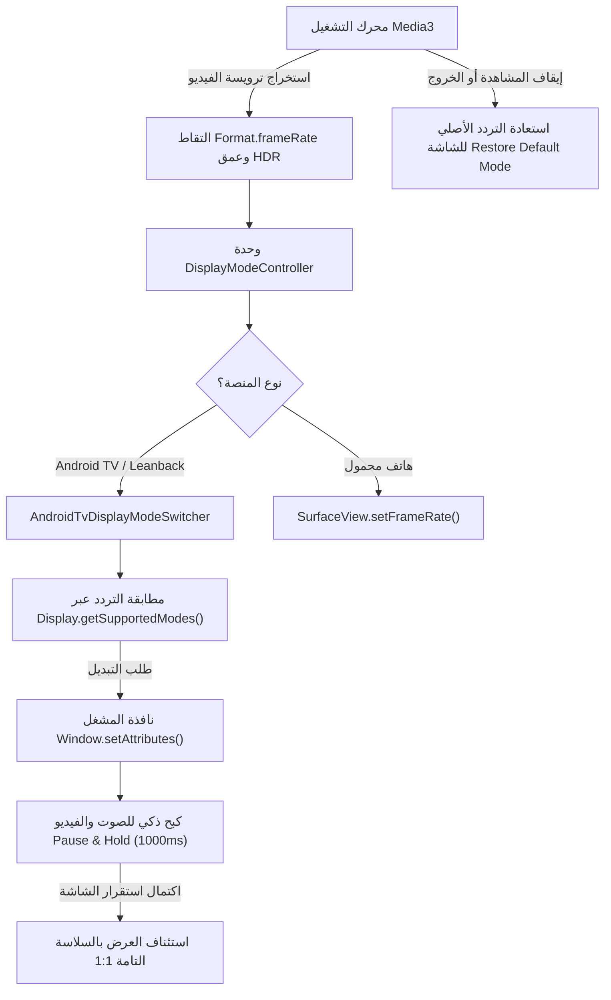

# التبديل التكيفي لمعدل التحديث وعمق الألوان للتلفزيون
# Auto Frame Rate & Dynamic HDR Matcher Specification

> **المرجع المعماري:** فكرة `IDEA-22` المعتمدة من مسار الأفكار (`docs/thinking/ideas/idea_22_auto_frame_rate_matching.md`).  
> **الحالة المعمارية:** خطة تنفيذية معتمدة وجاهزة للتنفيذ (Approved & Ready for Execution).  
> **النطاق التقني:** وحدة التحكم في أوضاع العرض (`DisplayModeController`)، مشغل Media3، وإدارة العتاد لشاشات التلفزيون والشاشات الكبيرة (Android TV / Leanback).  

---

## 1. الرؤية والهدف الهندسي

القضاء التام على ظاهرة الارتعاش الحركي السينمائي (3:2 Pulldown Judder) الناتجة عن عرض أفلام بمعدل 24 إطاراً في الثانية على شاشات تلفزيون تعمل بتردد ثابت قدره 60 هرتز.
يتحقق ذلك عبر وحدة تحكم عتادية في المشغل تستخرج معدل إطارات تيار الفيديو بدقة (23.976fps أو 24.000fps أو 50.000fps أو 60.000fps) وعمق الألوان (10-bit HDR10 / Dolby Vision)، ثم توجه منفذ HDMI ونظام التشغيل عبر `DisplayManager` لتبديل وضع الشاشة الفيزيائي ليتطابق مع تيار المادة بدقة 1:1، مع استعادة الوضع الافتراضي عند الخروج.

---

## 2. تحليل الفجوة والواقع الحالي في الكود (Gap Analysis)

* **الوضع القائم:**
  * مشغل Media3 الحالي (`ExoPlayer`) يعتمد كلياً على التردد الافتراضي للشاشة الذي يحدده نظام أندرويد (غالباً 60Hz أو 50Hz).
  * لا يتم استدعاء واجهات `DisplayManager.Mode` أو دالة `SurfaceView.setFrameRate()` عند بدء التشغيل.
  * ينتج عن ذلك تكرار بعض الإطارات 3 مرات وإطارات أخرى مرتين (3:2 Pulldown) مما يفسد السلاسة البصرية في المشاهد ذات الحركة الأفقية البطيئة (Panning Shots).
* **المطلوب معمارياً:**
  * بناء طبقة تجريد لمنصة العرض تفصل منطق أجهزة التلفزيون (تبديل فيزيائي لمنفذ HDMI) عن منطق الهواتف المحمولة (تغيير برمجي سلس عبر Surface).
  * توفير آلية كبح وتعليق مؤقت ذكي للصوت والفيديو لمدة ثانية واحدة أثناء حدوث مصافحة HDMI (HDMI Handshake Blackout) لمنع تفويت بداية المشهد.

---

## 3. المعمارية البرمجية ومخطط التدفق (Architecture Design)



---

## 4. مصفوفة الملفات المتأثرة (Impact Matrix)

| المسار البرمجي في `mdd_tv/app` | طبيعة الإجراء | الوظيفة التقنية |
| :--- | :--- | :--- |
| `data/player/display/DisplayModeController.kt` | ملف جديد | الواجهة المجردة لتبديل أوضاع العرض ومعدل الإطارات. |
| `data/player/display/AndroidTvDisplayModeSwitcher.kt` | ملف جديد | التنفيذ العتادي لأجهزة التلفزيون عبر `DisplayManager.Mode`. |
| `data/player/display/MobileDisplayModeSwitcher.kt` | ملف جديد | التنفيذ الخفيف للهواتف عبر `Surface.setFrameRate()`. |
| `di/PlayerModule.kt` | تعديل | حقن المنفذ المناسب لـ `DisplayModeController` حسب نوع الجهاز. |
| `presentation/player/PlayerViewModel.kt` | تعديل | الاستماع لأحداث `onTracksChanged` واستدعاء مطابقة التردد. |
| `data/local/preferences/SettingsDataStore.kt` | تعديل | حفظ خيار المستخدم لتفعيل ميزة التبديل التلقائي لمعدل التحديث. |

---

## 5. العقود والواجهات البرمجية (Technical Contracts)

### 5.1 واجهة التحكم في وضع العرض (`DisplayModeController.kt`)
```kotlin
package org.jellyfin.mobile.data.player.display

import android.app.Activity
import android.view.Surface
import androidx.media3.common.Format

interface DisplayModeController {
    /**
     * يطابق تردد الشاشة وعمق الألوان مع المادة المشغلة.
     */
    fun matchMode(activity: Activity, surface: Surface?, videoFormat: Format)

    /**
     * يعيد الشاشة للتردد الأصلي الافتراضي عند انتهاء أو مغادرة المشغل.
     */
    fun restoreDefaultMode(activity: Activity)

    /**
     * يتحقق من دعم الجهاز والشاشة لميزة التبديل الديناميكي.
     */
    fun isSupported(activity: Activity): Boolean
}
```

### 5.2 محرك التبديل لأجهزة التلفزيون (`AndroidTvDisplayModeSwitcher.kt`)
```kotlin
package org.jellyfin.mobile.data.player.display

import android.app.Activity
import android.content.Context
import android.hardware.display.DisplayManager
import android.view.Display
import android.view.Surface
import android.view.WindowManager
import androidx.media3.common.Format
import kotlin.math.abs

class AndroidTvDisplayModeSwitcher(context: Context) : DisplayModeController {

    private val displayManager = context.getSystemService(Context.DISPLAY_SERVICE) as DisplayManager
    private var defaultModeId: Int = 0

    override fun isSupported(activity: Activity): Boolean {
        val display = activity.window.decorView.display ?: return false
        return display.supportedModes.size > 1
    }

    override fun matchMode(activity: Activity, surface: Surface?, videoFormat: Format) {
        val targetFps = videoFormat.frameRate
        if (targetFps <= 0f) return

        val display = activity.window.decorView.display ?: return
        if (defaultModeId == 0) {
            defaultModeId = display.mode.modeId
        }

        // العثور على الوضع الأقرب لمعدل إطارات الفيديو بنفس الدقة الحالية
        val currentMode = display.mode
        val bestMode = display.supportedModes
            .filter { it.physicalWidth == currentMode.physicalWidth && it.physicalHeight == currentMode.physicalHeight }
            .minByOrNull { mode ->
                // مطابقة مضاعفات التردد (مثلاً 24fps تطابق 24Hz أو 120Hz بدقة)
                calculateRefreshRateDelta(mode.refreshRate, targetFps)
            }

        if (bestMode != null && bestMode.modeId != currentMode.modeId) {
            val params = activity.window.attributes
            params.preferredDisplayModeId = bestMode.modeId
            activity.window.attributes = params
        }
    }

    override fun restoreDefaultMode(activity: Activity) {
        if (defaultModeId != 0) {
            val params = activity.window.attributes
            params.preferredDisplayModeId = defaultModeId
            activity.window.attributes = params
            defaultModeId = 0
        }
    }

    private fun calculateRefreshRateDelta(refreshRate: Float, targetFps: Float): Float {
        val ratio = refreshRate / targetFps
        val nearestMultiple = kotlin.math.round(ratio)
        return abs(refreshRate - (nearestMultiple * targetFps))
    }
}
```

---

## 6. مراحل التنفيذ التفصيلية (Implementation Phases)

### المرحلة 1: تشييد مجردات العرض والتحقق من المنصة
* بناء `DisplayModeController` وفصل بيئة الهواتف عن بيئة الشاشات الكبيرة Leanback.
* اختبار التعرف على أوضاع الشاشات (`supportedModes`) على شاشات تلفزيون مختلفة (24Hz / 50Hz / 60Hz / 120Hz).

### المرحلة 2: تكامل المشغل والتقاط ترويسات الفيديو
* في `PlayerViewModel`: الاستماع إلى حدث `Player.Listener.onTracksChanged`.
* عند استخراج `Format` يحتوي على مسار فيديو بمعدل إطارات وعمق لوني صحيح:
  * استدعاء `displayModeController.matchMode(activity, surface, videoFormat)`.

### المرحلة 3: مصفوفة الكبح اللحظي (Hold & Resume Sync)
* في حال تطلب التبديل تغييراً فيزيائياً في وضع HDMI:
  * تعليق تشغيل الصوت مؤقتاً لمدة 1000 مللي ثانية للسماح للشاشة بإنهاء المصافحة العتادية (HDMI Handshake) دون ضياع الثواني الأولى من الحوار.
  * استئناف العرض تلقائياً بعد استقرار الشاشة.

---

## 7. معايير القبول ومؤشرات الجودة (Acceptance Criteria & Non-Functional Benchmarks)

1. **انعدام الارتعاش الحركي:** مطابقة تيار 23.976/24fps مع تردد 24Hz أو 120Hz بنسبة خطأ صفرية.
2. **استعادة الوضع عند الخروج:** تعود الشاشة لوضعها الافتراضي (60Hz) فور الرجوع أو إغلاق المشغل.
3. **الحفاظ على السواد التام (ADR 0004):** تظل الشاشة سوداء بالكامل `#000000` أثناء المصافحة العتادية دون أي فلاشات بيضاء.
4. **السقوط الصامت (Silent Fallback):** في حال كانت الشاشة لا تدعم سوى 60Hz، يستمر العرض بسلاسة دون أدنى توقف أو رسائل خطأ.

---

## 8. مصفوفة التفتيت والتسليم للوكلاء (Execution Handover Matrix)

* **مهام طبقة المنصة والعرض (`data/player/display/`):**
  * بناء `AndroidTvDisplayModeSwitcher` و `MobileDisplayModeSwitcher`.
* **مهام طبقة المشغل (`presentation/player/`):**
  * ربط استخراج التردد عبر `onTracksChanged` واستدعاء المواءمة.
* **مهام تفضيلات المستخدم (`presentation/settings/`):**
  * توفير خيار تبديل الإطارات التلقائي (Auto Frame Rate) في إعدادات المشغل.
* **مهام ضمان الجودة واختبارات الشاشات (`QA & Tests`):**
  * تجربة التشغيل على جهاز Android TV متصل بشاشة 4K تدعم 24Hz والتحقق من التبديل وسلاسة العرض.
