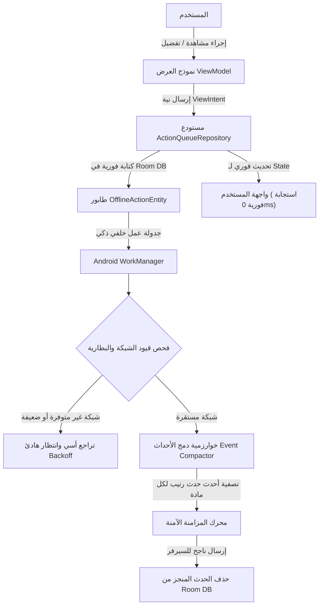

# معمارية طابور الأحداث دون اتصال مع فض التعارض
# Conflict-Free Offline Action Queue Specification

> **المرجع المعماري:** فكرة `IDEA-23` المعتمدة من مسار الأفكار (`docs/thinking/ideas/idea_23_offline_action_queue.md`).  
> **الحالة المعمارية:** خطة تنفيذية معتمدة وجاهزة للتنفيذ (Approved & Ready for Execution).  
> **النطاق التقني:** قاعدة البيانات المحلية Room DB، طبقة المستودعات (`OfflineActionRepository`)، وإدارة المهام الخلفية (`WorkManager`).  

---

## 1. الرؤية والهدف الهندسي

ترسيخ معمارية "المحلي أولاً" (Offline-First) لتطبيق "مدد TV" عبر بناء طابور أحداث محلي دائم ومقاوم لانقطاع الشبكة في Room DB.
يضمن الطابور حفظ كافة تفاعلات المستخدم (نقاط توقف المشاهدة، علامات اكتمال المشاهدة، المفضلة، وتقييم الوسائط) محلياً دون أي اعتماد على ردود الخادم اللحظية، ومزامنتها بذكاء مع السيرفر عند توفر الاتصال المستقر مع فض التعارضات وفق الساعات الرتيبة (Monotonic Timestamps)، والالتزام الصارم بعدم تلويث حساب السيرفر المشترك "الاستراحه" وفق مبدأ ADR 0001.

---

## 2. تحليل الفجوة والواقع الحالي في الكود (Gap Analysis)

* **الوضع القائم:**
  * يتم حفظ تقدم المشاهدة محلياً في `LocalWatchProgressDao` التزاماً بـ ADR 0001.
  * لكن في حال انقطاع الشبكة أو ضعف إشارة الواي فاي، فإن أي عمليات أخرى (مثل تعليم مادة كمفضلة أو تبديل حالة المشاهدة) تفشل لحظياً وتظهر رسائل خطأ للمستخدم.
  * لا توجد آلية تجميع وجدولة ذكية للأحداث غير المتزامنة تضمن إعادة إرسالها دون إرهاق بطارية الجهاز أو إرسال أحداث قديمة تلغي التعديلات الأحدث.
* **المطلوب معمارياً:**
  * تشييد كيان `OfflineActionEntity` وطابور دائم داخل Room DB.
  * خوارزمية دمج الأحداث (Event Compaction) التي تدمج التعديلات المتعددة لنفس المادة قبل الإرسال.
  * عامل مزامنة خلفي `OfflineSyncWorker` يعمل بقيود نظام أندرويد الصارمة وسياسة التراجع الأسي.

---

## 3. المعمارية البرمجية ومخطط التدفق (Architecture Design)



---

## 4. مصفوفة الملفات المتأثرة (Impact Matrix)

| المسار البرمجي في `mdd_tv/app` | طبيعة الإجراء | الوظيفة التقنية |
| :--- | :--- | :--- |
| `data/local/entities/OfflineActionEntity.kt` | ملف جديد | كيان قاعدة بيانات Room DB لتمثيل أحداث الطابور. |
| `data/local/dao/OfflineActionDao.kt` | ملف جديد | استعلامات الإدراج والدمج والحذف لطابور الأحداث. |
| `data/repository/OfflineActionRepositoryImpl.kt` | ملف جديد | المستودع المركزي لإدارة دورة حياة الأحداث المحلية. |
| `data/sync/OfflineSyncWorker.kt` | ملف جديد | مهمة العمل الخلفية بنظام `WorkManager` لتنفيذ المزامنة. |
| `data/local/AppDatabase.kt` | تعديل | رفع إصدار قاعدة البيانات وتسجيل الكيان والـ DAO الجديدين. |
| `di/DatabaseModule.kt` | تعديل | توفير `OfflineActionDao` و `OfflineActionRepository` عبر Hilt. |

---

## 5. العقود والواجهات البرمجية (Technical Contracts)

### 5.1 كيان طابور الأحداث في Room DB (`OfflineActionEntity.kt`)
```kotlin
package org.jellyfin.mobile.data.local.entities

import androidx.room.Entity
import androidx.room.Index
import androidx.room.PrimaryKey

@Entity(
    tableName = "offline_actions",
    indices = [
        Index(value = ["profileId", "mediaId"]),
        Index(value = ["createdAt"])
    ]
)
data class OfflineActionEntity(
    @PrimaryKey(autoGenerate = true)
    val actionId: Long = 0,
    val profileId: String,
    val mediaId: String,
    val actionType: ActionType,
    val payloadJson: String,
    val createdAt: Long = System.currentTimeMillis()
)

enum class ActionType {
    WATCH_PROGRESS,
    MARK_WATCHED,
    MARK_UNWATCHED,
    TOGGLE_FAVORITE
}
```

### 5.2 استعلامات الطابور ودمج الأحداث (`OfflineActionDao.kt`)
```kotlin
package org.jellyfin.mobile.data.local.dao

import androidx.room.Dao
import androidx.room.Insert
import androidx.room.OnConflictStrategy
import androidx.room.Query
import kotlinx.coroutines.flow.Flow
import org.jellyfin.mobile.data.local.entities.OfflineActionEntity

@Dao
interface OfflineActionDao {

    @Insert(onConflict = OnConflictStrategy.REPLACE)
    suspend fun enqueueAction(action: OfflineActionEntity): Long

    @Query("SELECT * FROM offline_actions WHERE profileId = :profileId ORDER BY createdAt ASC")
    suspend fun getPendingActions(profileId: String): List<OfflineActionEntity>

    @Query("DELETE FROM offline_actions WHERE actionId = :actionId")
    suspend fun deleteAction(actionId: Long)

    @Query("DELETE FROM offline_actions WHERE profileId = :profileId AND mediaId = :mediaId AND actionType = :actionType AND createdAt < :timestamp")
    suspend fun compactOutdatedActions(profileId: String, mediaId: String, actionType: String, timestamp: Long)

    @Query("SELECT COUNT(*) FROM offline_actions WHERE profileId = :profileId")
    fun observePendingCount(profileId: String): Flow<Int>
}
```

### 5.3 عامل المزامنة الخلفي (`OfflineSyncWorker.kt`)
```kotlin
package org.jellyfin.mobile.data.sync

import android.content.Context
import androidx.hilt.work.HiltWorker
import androidx.work.CoroutineWorker
import androidx.work.WorkerParameters
import dagger.assisted.Assisted
import dagger.assisted.AssistedInject
import org.jellyfin.mobile.data.repository.OfflineActionRepository

@HiltWorker
class OfflineSyncWorker @AssistedInject constructor(
    @Assisted appContext: Context,
    @Assisted workerParams: WorkerParameters,
    private val actionRepository: OfflineActionRepository
) : CoroutineWorker(appContext, workerParams) {

    override suspend fun doWork(): Result {
        return try {
            val success = actionRepository.syncPendingActions()
            if (success) Result.success() else Result.retry()
        } catch (e: Exception) {
            Result.retry()
        }
    }
}
```

---

## 6. مراحل التنفيذ التفصيلية (Implementation Phases)

### المرحلة 1: ترحيل قاعدة بيانات Room DB (`AppDatabase.kt`)
* إنشاء كيان `OfflineActionEntity` ومؤشرات البحث السريعة (`indices`).
* تشييد واجهة `OfflineActionDao` مع دوال الضغط والدمج `compactOutdatedActions`.
* إضافة ترحيل قاعدة البيانات (Database Migration) وتوفير الـ DAO في `DatabaseModule`.

### المرحلة 2: بناء مستودع الطابور وخوارزمية دمج الأحداث (`Compactor`)
* في `OfflineActionRepositoryImpl`:
  * دالة إدراج أي حدث محلياً واستدعاء دمج الأحداث القديمة فورياً لمنع تضخم الجدول.
  * جدولة `OneTimeWorkRequest` عبر `WorkManager` مع قيود `NetworkType.CONNECTED`.

### المرحلة 3: ربط واجهات المشغل والشاشات بالطابور
* استبدال الاستدعاءات الشبكية المباشرة في `PlayerViewModel` و `MediaDetailsViewModel` بإدراج الأحداث في مستودع الطابور، مما يجعل استجابة الواجهة فورية (0ms Latency) في كافة الظروف.

---

## 7. معايير القبول ومؤشرات الجودة (Acceptance Criteria & Non-Functional Benchmarks)

1. **الاستجابة الصفرية للمستخدم:** لا تنتظر الواجهة أي رد شبكي؛ تنعكس كافة التغييرات محلياً خلال أقل من 5 مللي ثانية.
2. **العزل التام لحساب السيرفر (ADR 0001):** لا يتم إرسال أي أحداث غير مصرح بها لحساب السيرفر المشترك ("الاستراحه")، وتبقى تفضيلات البروفايل معزولة محلياً.
3. **انعدام فقدان البيانات:** لا تفقد أي نقطة مشاهدة عند إغلاق التطبيق فجأة أو انقطاع البطارية بفضل تخزين Room DB الدائم.
4. **كفاءة البطارية:** منع تكرار المحاولات عند فشل الشبكة باستخدام التراجع الأسي الذكي (Exponential Backoff).

---

## 8. مصفوفة التفتيت والتسليم للوكلاء (Execution Handover Matrix)

* **مهام طبقة البيانات وقاعدة البيانات (`data/local/`):**
  * إضافة الكيان والـ DAO وترحيل Room DB.
* **مهام طبقة التزامن والمهام الخلفية (`data/sync/`):**
  * بناء `OfflineSyncWorker` وجدولة المهام مع قيود الشبكة.
* **مهام طبقة إدارة الحالة والمشغل (`presentation/`):**
  * توجيه تسجيل تقدم المشاهدة والتفضيل عبر مستودع الطابور.
* **مهام ضمان الجودة واختبارات عدم الاتصال (`QA & Tests`):**
  * اختبار سيناريو وضع الطيران (Airplane Mode): مشاهدة فيديو، تقديم وترجيع، تسجيل خروج، ثم إعادة الاتصال والتحقق من المزامنة السليمة وعدم حدوث أي تصادم.
