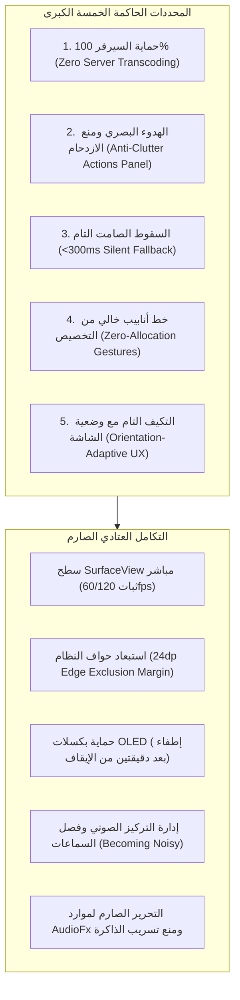

# خطة التنفيذ المعمارية الشاملة لمشغل مدد TV السينمائي
# Advanced Cinema Player Master Implementation Plan

> **المرجع والاعتماد:** مستوحى من دراسة وتحليل مشغل MX Player (`knowledge/media_players/mx_player/`)، ومقرونة بكافة قرارات المراجعة التفاعلية والتدقيق المعماري الصارم مع المستخدم.
> **الحالة:** خطة معمارية وتنفيذية شاملة مكتملة الاعتماد وجاهزة للانتقال إلى مسار التنفيذ الفعلي (`tasks/active_task.md`).
> **المنصة المستهدفة:** Android (Kotlin • Jetpack Compose • AndroidX Media3 • SurfaceView • Hardware Composer).

---

## 1. الرؤية والهدف الاستراتيجي

ترقية وبناء المشغل المدمج لتطبيق مدد TV ليصبح مشغلاً سينمائياً فائق الأداء والهدوء البصري، يدمج نقاط القوة التاريخية لمشغل MX Player (فك الترميز المتين، الإيماءات الطبيعية، وتضخيم الصوت النقي)، مع الالتزام التام بدستور Obsidian 2.2.0 لشاشات OLED، ومبادئ حماية السيرفر التامة ومكافحة الازدحام البصري، وخلو الكود والتوثيق من أي إيموجيات.

---

## 2. الدستور الهندسي والمحددات الصارمة الحاكمة



### 1. الالتزام الكامل بحماية السيرفر (Zero Server Transcoding & ADR 0002):
* يُمنع منعاً باتاً مطالبة خادم Jellyfin بإعادة ترميز الفيديو أو مسارات الصوت تحت أي ظرف.
* الاعتماد بنسبة 100% على معالج الهاتف القوي محلياً لفك الترميز، والتحويل إلى ستيريو (Downmix)، واستخراج لقطات المعاينة.

### 2. الهدوء البصري ومكافحة الازدحام (Anti-Clutter Actions Menu):
* الواجهة تختفي تلقائياً وبشكل كامل بعد 3 ثوانٍ من عدم التفاعل.
* تُطوى كافة أدوات الصوت والترجمة المتقدمة (المعادل، تضخيم الصوت، تأخير الصوت، والـ Passthrough) داخل **"زر الإجراءات الصامت" (Actions / Quick Panel)** كلوحة خيارات سفلية خفيفة تفتح فقط عند الطلب ليبقى سطح الشاشة نقياً وبسواد OLED مطلق.

### 3. السقوط البرمجي الصامت التام (Silent HW-to-SW Fallback):
* عند حدوث أي خطأ عتادي في التهيئة (`DecoderInitializationException`)، يتحول المشغل في الخلفية خلال أقل من `300ms` إلى المحرك البرمجي SW عبر FFmpeg دون إظهار أي إشعار أو رسالة تنبيهية للمشاهد، وتتغير شارة الشريط العلوي فقط بهدوء.

### 4. معالجة الإيماءات بدون تخصيص ذاكرة (Zero-Allocation Pipeline):
* حظر تخصيص كائنات جديدة أثناء اللمس لتفادي تقطيع جامع النفايات (GC Jank) وضمان ثبات 60/120fps عبر `SurfaceView`.

### 5. التكيف الديناميكي مع اتجاه الشاشة (Orientation-Adaptive Gestures):
* **القفل الصارم للمحور (Strict Axis Lock 1.5x):** عتبة حركة أولية `18dp`؛ إذا تجاوزت الحركة الأفقية الرأسية بنسبة 1.5x يُقفل وضع التقديم ويُتجاهل أي انحراف رأسي، والعكس صحيح، لمنع التداخل الناتج عن حركة الإبهام القوسية باليد الواحدة في الوضع الرأسي (Portrait).
* **المعادلات النسبية الديناميكية (Normalized Constraints Scaling):** حساب نسب السحب استناداً إلى أبعاد `BoxWithConstraints` النشطة (`maxWidth` و `maxHeight`) بدلاً من بكسلات ثابتة، لتحقيق نفس المقاومة والنعومة في الأفقي والرأسي.
* **نافذة التقديم التكيفية للاتجاه (Adaptive Seek Window):** ضبط نافذة التقديم على **90 ثانية** في الوضع الأفقي (Landscape)، و **45 ثانية** في الوضع الرأسي (Portrait) لتعويض ضيق مسافة عرض الشاشة بالهاتف ومنع القفزات الكبيرة بحركات الإبهام الصغيرة.

### 6. منطقة الأمان لحواف النظام (24dp System Inset Margin):
* استبعاد أول `24dp` من الحواف الجانبية للشاشة من الاستماع لإيماءات السطوع والصوت، لمنع أي تعارض مع إيماءة الرجوع للخلف الخاصة بنظام أندرويد (Android System Back Gesture).

### 7. حماية شاشات OLED من الاحتراق (OLED Burn-in Protection):
* إبقاء الشاشة مضاءة (`keepScreenOn = true`) أثناء حالة التشغيل الفعلي فقط.
* عند الإيقاف المؤقت (Pause): يُعطى المشاهد مهلة **دقيقتين**، وإذا لم يستأنف العرض، يتم إلغاء إبقاء الشاشة تلقائياً للسماح لنظام التشغيل بإطفائها لحماية بكسلات OLED من الاحتراق وحفظ البطارية.

### 8. إدارة التركيز الصوتي وفصل السماعات (Audio Focus & Becoming Noisy):
* **فصل السماعات فجأة (Becoming Noisy):** عند نزع السماعات السلكية أو انقطاع البلوتوث فجأة، يقوم المشغل تلقائياً بإيقاف مؤقت فوري (`Pause`) لمنع خروج صوت الفيلم عبر مكبرات الصوت الخارجية وإحراج المشاهد.
* **المكالمات الواردة (Audio Focus Loss):** إيقاف العرض مؤقتاً تلقائياً أثناء المكالمة الهاتفية، واستئنافه فور إنهائها.

### 9. التعامل الذكي مع شق الكاميرا والنوتش (Display Cutout Modes):
* في وضع الملاءمة الطبيعي (`Fit to Screen`): إبقاء هوامش أمان سوداء نقية تمنع حجب الكاميرا لأي تفاصيل من كادر الفيلم.
* في وضع ملء الشاشة (`Crop to Fill`): تفعيل `LAYOUT_IN_DISPLAY_CUTOUT_MODE_SHORT_EDGES` ليمتد الفيديو ليغطي كامل زجاج الشاشة بدون أشرطة سوداء لمن يفضل المشاهدة الغامرة.

### 10. التحرير الحتمي لموارد المؤثرات الصوتية (AudioFx Lifecycle Cleanup):
* ربط دورة حياة المؤثرات الصوتية بدورة حياة الـ `Lifecycle`: استدعاء `equalizer.release()` و `loudnessEnhancer.release()` بشكل حتمي قبل تدمير `ExoPlayer` لمنع تسريب الذاكرة (`AudioEffect memory leak`).

---

## 3. مصفوفة الميزات المعتمدة، المؤجلة، والملغية

| الميزة | الحالة بعد المراجعة التفاعلية | الملاحظات وموضع التنفيذ |
| :--- | :--- | :--- |
| **التحكم بالسطوع (السحب الأيسر)** | معتمدة (Approved) | حساسية 0.8، مع هامش أمان 24dp لمنع تعارض رجوع النظام. |
| **التحكم بالصوت والتضخيم (السحب الأيمن)** | معتمدة (Approved) | تدرج طبيعي حتى 100%، وتضخيم برمجي حتى 200% (Boost). |
| **التقديم والترجيع الدقيق (السحب الأفقي)** | معتمدة (Approved) | نافذة تكيفية (90s أفقي / 45s رأسي)، وقفل محور Axis Lock 1.5x. |
| **التسريع اللحظي 2.0x بالضغط المطول** | معتمدة (Approved) | مع تصحيح نبرة الصوت (Pitch Preservation) والعودة لـ 1.0x فور الرفع. |
| **النقر المزدوج للتخطي (10 ثوانٍ)** | معتمدة (Approved) | يمين (+10s)، يسار (-10s)، والمنتصف تشغيل/إيقاف. |
| **القرص والتكبير حتى 500% وتغيير الأبعاد** | معتمدة (Approved) | تكبير وتجول حر، وأزرار سريعة (Fit, Crop, Stretch, 100%). |
| **قفل اللمس العرضي (Touch Lock)** | معتمدة (Approved) | زر قفل مع فك القفل بالنقر المزدوج (Double-Tap to unlock). |
| **المحركات الثلاثية (HW / HW+ / SW FFmpeg)** | معتمدة (Approved) | زر تبديل علوي وسقوط برمجي صامت 100% دون أي إشعار. |
| **تضخيم الصوت 200% وفلتر Anti-Clipping** | معتمدة (Approved) | عبر `LoudnessEnhancer` مدمجة بالصوت وزر الإجراءات. |
| **تمرير الصوت الخام Bitstream Passthrough** | معتمدة (Approved) | خيار ذكي في زر الإجراءات لأجهزة المسرح المنزلي و HDMI. |
| **معادل الترددات 5-Band وبروفايل الحوار** | معتمدة (Approved) | مطوي داخل زر الإجراءات مع بروفايل Vocal Booster لعزل الكلام. |
| **المزامنة اللحظية للصوت (تأخير 50ms)** | معتمدة (Approved) | شريط دقيق في زر الإجراءات لحل مشاكل البلوتوث محلياً. |
| **المزامنة اللحظية للترجمة (تأخير 100ms)** | معتمدة (Approved) | مدمجة داخل قائمة الترجمة بزر الإجراءات دون لمس الشاشة. |
| **المعايير البصرية للترجمة و libass** | معتمدة (Approved) | حد خارجي أسود 2dp، خطوط عربية، كشف ترميز تلقائي، ودعم الأنمي. |
| **المعاينة الصورية لشريط التقدم BIF** | معتمدة (Approved) | كارت 16:9 عائم، شرائح BIF الجاهزة، أو استخراج محلي I-Frames بكاش 24MB. |
| **شريط فصول الوسائط (Chapters)** | معتمدة (Approved) | فواصل بيضاء رفيعة وأسماء الفصول أعلى شريط التقدم. |
| **التمرير بإصبعين لتعديل السرعة** | مؤجلة (Deferred) | تأجيل لتفادي التضارب مع اللمس. |
| **التحكم في حجم خط الترجمة** | مؤجلة (Deferred) | تأجيل لمرحلة إعدادات المستخدم والتطبيق العامة. |
| **القفز بين أسطر الترجمة بالسحب** | ملغية ومستبعدة (Excluded) | إلغاء بقرار المستخدم لمنع تعقيد التفاعل. |
| **تكرار المقطع (A-B Repeat)** | ملغية ومستبعدة (Excluded) | إلغاء بقرار المستخدم لعدم الحاجة لها في تطبيق ترفيهي. |
| **مؤقت النوم (Smart Sleep Timer)** | ملغية ومستبعدة (Excluded) | إلغاء بقرار المستخدم لتفادي تعقيد الخيارات. |
| **القفز المتسارع بأسهم الريموت والتلفزيون** | ملغية ومستبعدة (Excluded) | إلغاء بقرار المستخدم لكونها غير ضرورية. |

---

## 4. شجرة الملفات والمكونات البرمجية المتأثرة

```
app/src/main/kotlin/org/jellyfin/mobile/
|-- presentation/player/
|   |-- AdvancedPlayerScreen.kt           # الشاشة السينمائية المحدثة وربط SurfaceView و Insets
|   |-- PlayerViewModel.kt               # إدارة حالة المشغل، المحركات، والتبديل الصامت
|   |-- PlayerContract.kt                # نوايا وحالات المشغل الموحدة
|   |-- gestures/
|   |   |-- PlayerGestureDetector.kt     # معالج الإيماءات التكيفي (Axis Lock 1.5x & Zero-Allocation)
|   |   `-- GestureOverlayHud.kt         # المؤشرات العائمة الصامتة (سطوع، صوت، تقديم)
|   |-- components/
|   |   |-- CinemaScrubber.kt            # شريط التقدم بفواصل الفصول والمعاينة الصورية
|   |   |-- ThumbnailPreviewBox.kt       # كارت المعاينة الصورية العائم (BIF / I-Frame)
|   |   |-- PlayerTopControls.kt         # الهيدر الموحد مع شارة تبديل المحرك وقفل الشاشة
|   |   `-- PlayerActionsModal.kt        # نافذة الإجراءات السفلية (المعادل، تأخير الصوت، تزامن الترجمة)
|   `-- subtitles/
|       `-- CinemaSubtitleRenderer.kt    # تصيير الترجمة بحد 2dp ومحرك libass
|-- core/player/
|   |-- MxStyleRenderersFactory.kt       # مصنع فك الترميز التكيفي (HW / SW FFmpeg)
|   |-- AudioBoostEngine.kt              # مضخم الصوت LoudnessEnhancer، فلتر Anti-Clipping، وإدارة AudioFx
|   |-- AudioFocusManager.kt             # إدارة التركيز الصوتي وفصل السماعات (Becoming Noisy)
|   `-- TrickplayThumbnailManager.kt     # استخراج صور BIF وكاش I-Frames المحلي (24MB)
```

---

## 5. مراحل التنفيذ الهندسية الخمس (Phased Execution Breakdown)

### المرحلة 1: ترقية نواة محرك التشغيل والصوت (`core/player/`)
1. **بناء `MxStyleRenderersFactory.kt`:**
   * تفعيل `DefaultRenderersFactory` مع ملحق `media3-decoder-ffmpeg`.
   * برمجة سياسة السقوط التلقائي الصامت 100% إلى `SW` خلال `< 300ms` دون إظهار أي إشعار.
2. **بناء `AudioBoostEngine.kt`:**
   * الربط بـ `LoudnessEnhancer` لنطاق 101% إلى 200%.
   * تطبيق فلتر كبح التشويش (Anti-Clipping) ومعالج نبرة الصوت `SonicAudioProcessor`.
   * ربط `Equalizer` خماسي الترددات مع بروفايل Vocal Booster.
   * تضمين دالة التحرير الصارم للموارد `release()` لمنع تسريب الذاكرة.
3. **بناء `AudioFocusManager.kt`:**
   * استقبال أحداث `ACTION_AUDIO_BECOMING_NOISY` لإيقاف الفيديو فور فصل السماعات.
   * معالجة أحداث فقدان واستعادة التركيز الصوتي أثناء المكالمات الهاتفية.

### المرحلة 2: محرك الإيماءات السريع والمؤشرات العائمة (`presentation/player/gestures/`)
1. **بناء `PlayerGestureDetector.kt`:**
   * استبعاد هوامش حواف النظام الجانبية (`24dp Margin`).
   * تطبيق خوارزمية قفل المحور الصارم `Strict Axis Lock (1.5x)`.
   * تكييف نافذة السحب الأفقي: 90 ثانية في الوضع الأفقي و 45 ثانية في الوضع الرأسي.
   * معالجة السحب الرأسي الأيسر (سطوع)، والسحب الرأسي الأيمن (صوت + انتقال لـ Boost).
   * معالجة الضغط المطول للتسريع اللحظي 2.0x، والنقر المزدوج 10 ثوانٍ، والتكبير والتجول حتى 500%.
   * معمارية Zero-Allocation باستخدام المتغيرات البدائية لمنع تقطيع الفريمات.
2. **بناء `GestureOverlayHud.kt`:**
   * مؤشرات عائمة خفيفة جداً تبرز سواد OLED وتتلاشى تلقائياً خلال أقل من 400ms.

### المرحلة 3: شريط الفصول والمعاينة الصورية المحلية (`presentation/player/components/`)
1. **بناء `TrickplayThumbnailManager.kt`:**
   * جلب وتوزيع شرائح BIF المسبقة من السيرفر كملفات ثابتة دون أي معالجة على السيرفر.
   * الاستخراج المحلي الفوري لإطارات I-Frames على معالج الهاتف مع ذاكرة `LruCache` بحجم 24MB عند غياب BIF.
2. **بناء `CinemaScrubber.kt` و `ThumbnailPreviewBox.kt`:**
   * شريط تقدم سينمائي بفواصل بيضاء دقيقة تمثل الفصول المستخرجة من ملف الفيديو.
   * كارت معاينة عائم بنسبة 16:9 مع توقيت المشهد يتحرك بتزامن تام مع حركة التمرير.

### المرحلة 4: نافذة الإجراءات السريعة الهادئة (`PlayerActionsModal.kt`)
1. **بناء نافذة الخيارات السفلية (Bottom Sheet) المرتبطة بزر الإجراءات:**
   * تبويب الصوت: تفعيل Passthrough، معادل الترددات مع زر Vocal Booster، ومزامنة الصوت بفاصل 50ms.
   * تبويب الترجمة: اختيار المسارات، ومزامنة توقيت الترجمة بفاصل 100ms.
2. **حماية بكسلات OLED:**
   * إلغاء إبقاء الشاشة مضاءة تلقائياً بعد دقيقتين من الإيقاف المؤقت (Pause).
   * ضمان إخفاء كامل أشرطة التحكم بعد 3 ثوانٍ من عدم التفاعل.

### المرحلة 5: معايير الترجمة البصرية و libass (`subtitles/`)
1. ربط `CaptionStyleCompat` بحد خارجي أسود `2dp` ناصع وخط عربي مخصص.
2. دمج دعم ملفات الأنمي `ASS/SSA` عبر محرك `libass` البرمجي.
3. التفعيل التلقائي لكاشف الترميز لتصحيح `Windows-1256` إلى `UTF-8`.

### المرحلة 6: التحقق، التدقيق العتادي، والاختبارات
1. فحص سلامة بناء Gradle وتكامل حزم Media3 و FFmpeg.
2. اختبار ثبات معدل الإطارات (60/120fps) أثناء السحب المكثف والتأكد من خلوه من تقطيع GC Jank.
3. التحقق من صمت السقوط البرمجي وحظر أي طلب ترميز من السيرفر.
4. اختبار حافة 24dp والتأكد من عدم تداخل السطوع مع رجوع أندرويد.
5. التحقق التام من خلو كافة ملفات الكود والتوثيق من أي إيموجيات (Absolute Emoji Ban).
