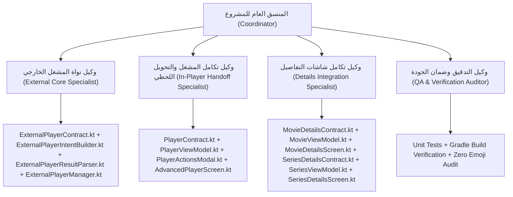

# خطة العمل التنفيذية: منظومة دعم المشغلات الخارجية ومزامنة التقدم محلياً
# Active Sprint: External Player Integration & Local-First Progress Synchronization

> **الهدف الاستراتيجي:** إتاحة خيار تشغيل الوسائط عبر مشغلات الفيديو الخارجية المتخصصة (مثل VLC, Just Player, MX Player, MPV) عبر نوايا أندرويد (Android Intents) مع الحفاظ الصارم على معمارية "المحلي أولاً" (Local-First) واسترداد وحفظ موضع التوقف داخل Room DB للبروفايل النشط دون تلويث حساب السيرفر المشترك وفق ميثاق ADR 0001.
> **المرجع المعماري:** `docs/thinking/planning/07_external_player_integration.md` • `docs/adr/0001_local_room_profiles_isolation.md`
> **ميثاق الجودة:** حظر تام وشامل للإيموجيات • صفر كود مهجور • تغطية اختبارات كاملة • التزام صارم بمعمارية MVI.

---

## 1. توزيع فرق العمل المتوازية ونطاق المسؤولية (Squad Assignments)

### مصفوفة التوزيع وحظر التداخل (Isolation Matrix):
* **وكيل نواة المشغل الخارجي (`worker-external-core`):**
  * النطاق الحصري: حزمة `core/player/external/` و `di/AppModule.kt`.
  * المسؤولية: بناء نماذج البيانات، صانع النوايا `ExternalPlayerIntentBuilder`، محلل النتائج `ExternalPlayerResultParser`، وتطبيق `ExternalPlayerManager` وحفظ التقدم في Room DB.
* **وكيل تكامل المشغل والتحويل اللحظي (`worker-player-handoff`):**
  * النطاق الحصري: `presentation/player/PlayerContract.kt`, `PlayerViewModel.kt`, `PlayerActionsModal.kt`, `AdvancedPlayerScreen.kt`.
  * المسؤولية: دعم التحويل اللحظي للمشغل الخارجي وإيقاف التشغيل الداخلي واستقبال موضع التوقف عند العودة وتحديث المشغل أو إغلاقه.
* **وكيل تكامل شاشات التفاصيل (`worker-details-integrator`):**
  * النطاق الحصري: `presentation/details/movie/` و `presentation/details/series/`.
  * المسؤولية: إضافة زر الإطلاق الخارجي واستقبال النتائج وتحديث حالة المشاهدة محلياً.
* **وكيل التدقيق وضمان الجودة (`worker-qa-auditor`):**
  * النطاق الحصري: اختبارات الوحدة، فحص بناء Gradle، وتدقيق خلو الكود من الإيموجيات بنسبة 100%.

---

## 2. مراحل العمل والتسليم التدريجي (Phased Execution)

### المرحلة 1: بناء وتأسيس نواة المشغل الخارجي في طبقة النواة
- [x] إنشاء واجهة ونماذج بيانات `core/player/external/ExternalPlayerContract.kt`.
- [x] إنشاء `core/player/external/ExternalPlayerIntentBuilder.kt` لدعم نوايا أندرويد وتوافقية MX Player / Just Player / VLC.
- [x] إنشاء `core/player/external/ExternalPlayerResultParser.kt` لاستخراج الموضع وحساب التقدير التكيفي.
- [x] إنشاء وتسجيل `ExternalPlayerManager` في Koin (`di/AppModule.kt`).

### المرحلة 2: دمج التحويل اللحظي من المشغل المدمج (In-Player Handoff)
- [x] إضافة النوايا والتأثيرات في `PlayerContract.kt`.
- [x] معالجة النية وحفظ النتائج في `PlayerViewModel.kt`.
- [x] إضافة زر التحويل للمشغل الخارجي في `PlayerActionsModal.kt`.
- [x] ربط `ActivityResultLauncher` في `AdvancedPlayerScreen.kt`.

### المرحلة 3: دمج زر المشغل الخارجي في شاشات التفاصيل
- [x] تحديث `MovieDetailsContract.kt` و `MovieViewModel.kt` و `MovieDetailsScreen.kt`.
- [x] تحديث `SeriesDetailsContract.kt` و `SeriesViewModel.kt` و `SeriesDetailsScreen.kt`.

### المرحلة 4: التحقق، التدقيق العتادي، واختبارات الوحدة
- [x] كتابة اختبارات وحدة `ExternalPlayerManagerTest` للتأكد من بناء النوايا، تحليل النتائج، والتقدير البديل.
- [x] تشغيل اختبارات الوحدة `testDebugUnitTest` والتأكد من نجاحها بالكامل.
- [x] فحص بناء الحزمة `assembleDebug`.
- [x] تدقيق خلو الكود بالكامل من الإيموجيات وتحديث `UNRELEASED.md`.
