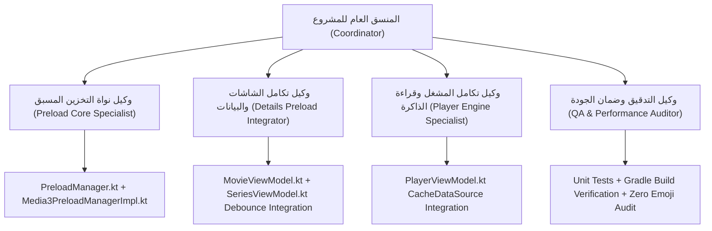

# خطة العمل التنفيذية: محرك البدء الفوري للبث التكهني
# Active Sprint: Sub-50ms Speculative Pre-buffering Engine

> **الهدف الاستراتيجي:** القضاء التام على عجلات الانتظار الدوارة (Zero Buffering Spinner) وبدء تشغيل الفيديو في زمن قياسي أقل من 50 مللي ثانية (Sub-50ms Time-to-First-Frame) عبر سحب أول 4MB من تيار الوسائط الخام في ذاكرة مؤقتة LruCache أثناء استقرار المشاهد في شاشات التفاصيل (`MovieDetailsScreen` / `SeriesDetailsScreen`).
> **المنصة المستهدفة:** Native Android • AndroidX Media3 CacheDataSource • SimpleCache.
> **المرجع المعماري:** `docs/thinking/planning/09_speculative_prebuffering.md`
> **ميثاق الجودة:** منع الإيموجيات بالكامل • استقلال الملفات • تجنب تضارب الكود • سقف ذاكرة 24MB • حماية باقات الهاتف (Wi-Fi / Ethernet فقط).

---

## 1. توزيع فرق العمل المتوازية ونطاق المسؤولية (Squad Assignments)

### مصفوفة التوزيع وحظر التداخل (Isolation Matrix):
* **وكيل نواة التخزين المسبق (`worker-preload-core`):**
  * النطاق الحصري: `core/player/preload/PreloadManager.kt` و `core/player/preload/Media3PreloadManagerImpl.kt`.
  * المسؤولية: بناء واجهة وتطبيق التخزين المسبق، إدارة `SimpleCache` وسقف الذاكرة 24MB، فحص حالة الشبكة (Wi-Fi/LAN فقط لحفظ الباقة)، وسحب أول 4MB بشكل غير حاجب مع إمكانية الإلغاء الفوري.
* **وكيل تكامل الشاشات والبيانات (`worker-details-integrator`):**
  * النطاق الحصري: `presentation/details/movie/MovieViewModel.kt` و `presentation/details/series/SeriesViewModel.kt`.
  * المسؤولية: إطلاق مهمة التخزين المسبق بعد استقرار المشاهد 800ms على شاشة التفاصيل، وإلغاء المهمة في `onCleared` عند مغادرة الشاشة.
* **وكيل تكامل المشغل وقراءة الذاكرة (`worker-player-engine`):**
  * النطاق الحصري: `presentation/player/PlayerViewModel.kt` و `di/AppModule.kt`.
  * المسؤولية: حقن `PreloadManager` في `PlayerViewModel` وربط `ExoPlayer` بـ `cacheDataSourceFactory` للبدء الفوري <50ms.
* **وكيل التدقيق وضمان الجودة (`worker-qa-auditor`):**
  * النطاق الحصري: اختبارات الوحدة، فحص بناء Gradle، وتدقيق خلو الكود من الإيموجيات بنسبة 100%.

---

## 2. مراحل العمل والتسليم التدريجي (Phased Execution)

### المرحلة 1: بناء وتأسيس محرك التخزين المسبق في طبقة النواة
- [x] إنشاء واجهة `core/player/preload/PreloadManager.kt`.
- [x] إنشاء `core/player/preload/Media3PreloadManagerImpl.kt` مع `SimpleCache` و `LeastRecentlyUsedCacheEvictor` وفحص الشبكة غير المقيدة.
- [x] تسجيل `PreloadManager` في Koin (`di/AppModule.kt`).

### المرحلة 2: دمج التخزين التكهني في شاشات التفاصيل المستقلة
- [x] حقن `PreloadManager` في `MovieViewModel.kt` وتفعيل التخزين المسبق بعد استقرار 800ms.
- [x] حقن `PreloadManager` في `SeriesViewModel.kt` لجدولة تخزين الحلقة التالية `nextUp`.
- [x] ضمان الإلغاء الفوري والتفريغ عند استدعاء `onCleared`.

### المرحلة 3: ربط المشغل بمخزن البيانات المسبقة
- [x] حقن `PreloadManager` في `PlayerViewModel.kt`.
- [x] تزويد `DefaultMediaSourceFactory` بـ `preloadManager.cacheDataSourceFactory` لاستهلاك البايتات الجاهزة فوراً.

### المرحلة 4: التحقق، التدقيق العتادي، واختبارات الوحدة
- [x] كتابة اختبارات وحدة `PreloadManagerTest` للتأكد من سلوك السحب، الإلغاء، وفحص الشبكة.
- [x] تشغيل اختبارات الوحدة `testDebugUnitTest` والتأكد من نجاحها (100% نجاح 59/59 اختبار).
- [x] فحص بناء الحزمة `assembleDebug` (نجاح البناء التام).
- [x] تدقيق خلو الكود بالكامل من الإيموجيات.
- [x] تحديث سجل التغييرات `docs/UNRELEASED.md`.
