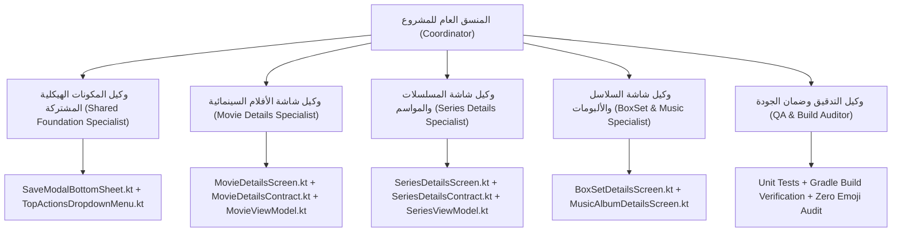

# خطة العمل التنفيذية النشطة: حزمة إعادة تصميم شاشات تفاصيل الوسائط الموزعة
# Active Sprint: Master Redesign Suite for Media Details Screens

> **الهدف الاستراتيجي:** إعادة بناء وتطوير شاشات تفاصيل الوسائط الموزعة (الأفلام، المسلسلات، السلاسل، والألبومات) وفق معمارية القالب الموحد الموروث، وتثبيت غلاف الـ 50% السينمائي، والشريط العلوي المقتضب، وزر التشغيل المنفرد العريض، والصف الثنائي المتناظر (حفظ في القوائم + مشغل خارجي)، مع عزل البيانات محلياً في Room DB وفق ميثاق ADR 0001.
> **المرجع المعماري:** `docs/current/screens/media_details/00_general_layout_architecture.md` • `docs/current/screens/media_details/`
> **ميثاق الجودة:** حظر تام وشامل للإيموجيات • صفر كود مهجور • تغطية اختبارات كاملة • التزام صارم بمعمارية MVI.

---

## 1. توزيع فرق العمل التخصصية ونطاق المسؤولية (Specialized Squad)

---

## 2. جدول تسليم المهام التنفيذية (Phased Deliverables)

### المرحلة 0: المكونات الأساسية المشتركة
- [x] إنشاء مكوّن نافذة الحفظ الموحدة المنبثقة `presentation/details/components/SaveModalBottomSheet.kt`.
- [x] إنشاء مكوّن القائمة المنسدلة العلوية `presentation/details/components/TopActionsDropdownMenu.kt`.

### المرحلة 1: شاشة تفاصيل الأفلام السينمائية
- [x] تطبيق المخطط الهيكلي المعتمد في `MovieDetailsScreen.kt` (زر التشغيل المنفرد 54dp + ثنائي الحفظ والمشغل الخارجي).
- [x] ربط نافذة الحفظ والقائمة المنسدلة في `MovieDetailsContract.kt` و `MovieViewModel.kt`.

### المرحلة 2: شاشة تفاصيل المسلسلات والمواسم
- [x] تحديث `SeriesDetailsScreen.kt` بزر الاستئناف الذكي المنفرد "استئناف: ح X · م Y".
- [x] صقل محدد المواسم الهجين وقائمة الحلقات الرأسية مع زر تمييز المشاهدة الفردي.

### المرحلة 3: شاشة السلاسل والألبومات الموسيقية
- [x] تحديث `BoxSetDetailsScreen.kt` بإحصائيات السلسلة التراكمية وزر المتابعة الذكي.
- [x] تحديث `MusicAlbumDetailsScreen.kt` بالغلاف المربع 1:1 وزر الخلط والمشغل المصغر.

### المرحلة 4: التدقيق، وضمان الجودة، وبناء Gradle
- [x] فحص خلو الكود بالكامل من الإيموجيات.
- [x] تشغيل اختبارات الوحدة `./gradlew testDebugUnitTest` بنجاح 100%.
