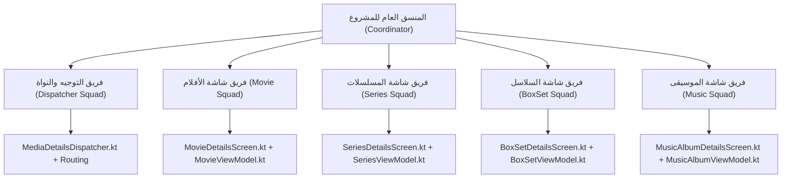

# خطة العمل التنفيذية: بناء شاشات التفاصيل المستقلة بفرق عمل متوازية
# Parallel Sprint: Modular Media Details Architecture

> **الهدف الاستراتيجي:** تفكيك الشاشة الموحدة `MediaDetailsScreen.kt` وبناء شاشات عرض متخصصة ومستقلة لكل نوع وسائط مع موجه ذكي (`MediaDetailsDispatcher`) يضمن استقرار الأداء وخفة استهلاك الذاكرة وفق دستور Obsidian 2.2.0.
> **المنصة المستهدفة:** Native Android • Jetpack Compose • هواتف أندرويد الذكية.
> **ميثاق الجودة:** منع الإيموجيات بالكامل • استقلال الملفات • تجنب تضارب الكود بين الفرق.

---

## 1. توزيع فرق العمل المتوازية ونطاق المسؤولية (Squad Assignments)

### مصفوفة التوزيع وحظر التداخل (Isolation Matrix):
* **فريق التوجيه والنواة (`worker-dispatcher`):**
  * النطاق الحصري: `presentation/details/dispatcher/` وربطه بـ `NavGraph.kt`.
  * المسؤولية: استقبال `mediaId` وتوجيه المشاهد للشاشة المناسبة فوراً بناءً على نوع الوسيط.
* **فريق شاشة الأفلام (`worker-movie`):**
  * النطاق الحصري: `presentation/details/movie/`.
  * المسؤولية: بناء `MovieDetailsScreen.kt` و `MovieViewModel.kt` الخاصة بالأفلام (تشغيل فوري، فصول زمنية، مواد إضافية، ومسارات صوت).
* **فريق شاشة المسلسلات (`worker-series`):**
  * النطاق الحصري: `presentation/details/series/`.
  * المسؤولية: بناء `SeriesDetailsScreen.kt` و `SeriesViewModel.kt` (محرك الحلقة التالية Next Up، محدد المواسم، وقائمة الحلقات الرأسية).
* **فريق شاشة السلاسل السينمائية (`worker-boxset`):**
  * النطاق الحصري: `presentation/details/boxset/`.
  * المسؤولية: بناء `BoxSetDetailsScreen.kt` و `BoxSetViewModel.kt` (استعراض الأجزاء المترابطة زمنياً وحساب المدد التراكمية).
* **فريق شاشة الموسيقى والألبومات (`worker-music`):**
  * النطاق الحصري: `presentation/details/music/`.
  * المسؤولية: بناء `MusicAlbumDetailsScreen.kt` و `MusicAlbumViewModel.kt` (الغلاف المربع 1:1، قائمة التراكات المرقمة، وربطها بالمشغل المصغر).

---

## 2. مراحل العمل والتسليم التدريجي (Phased Execution)

### المرحلة 1: بناء العقود وواجهات الحالة المستقلة (MVI Contracts)
- [ ] إنشاء `MovieDetailsContract.kt` لحالات ونوايا الفيلم.
- [ ] إنشاء `SeriesDetailsContract.kt` لحالات ونوايا المسلسل وتبويب المواسم.
- [ ] إنشاء `BoxSetDetailsContract.kt` لحالات ونوايا السلسلة والأجزاء التابعة.
- [ ] إنشاء `MusicAlbumDetailsContract.kt` لحالات ونوايا الألبوم والمقطوعات.

### المرحلة 2: بناء الشاشات والـ ViewModels المتخصصة (Screen Implementation)
- [ ] بناء `MovieDetailsScreen.kt` باستخدام `AdaptiveBackdropHeader` ومكونات الفصول.
- [ ] بناء `SeriesDetailsScreen.kt` مع `NextUpCard` وقائمة الحلقات الرأسية.
- [ ] بناء `BoxSetDetailsScreen.kt` مع البطاقات الزمنية للأفلام.
- [ ] بناء `MusicAlbumDetailsScreen.kt` مع قائمة التراكات والمشغل المصغر السفلي.

### المرحلة 3: تفعيل الموجه الذكي وربط التنقل (Dispatcher Integration)
- [ ] بناء `MediaDetailsDispatcher.kt` لفحص `type` وعرض الشاشة المخصصة.
- [ ] تحديث `NavGraph.kt` لربط مسار `/details/{mediaId}` بالموجه الذكي الجديد.
- [ ] التخلص الآمن والمنظم من الشاشة الموحدة القديمة `MediaDetailsScreen.kt`.

### المرحلة 4: التحقق، التدقيق العتادي، والاختبارات (Verification)
- [ ] تشغيل بناء Gradle للتأكد من خلو المشروع من أخطاء الـ Compilation.
- [ ] تشغيل اختبارات الوحدة للتأكد من سلامة منطق الـ ViewModels الجديدة.
- [ ] التحقق من خلو كافة الملفات من الإيموجيات بنسبة 100%.
