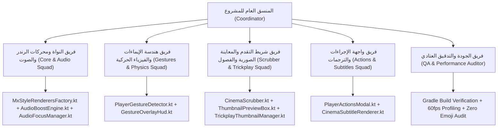

# خطة العمل التنفيذية: بناء المشغل السينمائي المتقدم بفرق عمل متوازية
# Active Sprint: Advanced Cinema Player Implementation (MX Player Excellence)

> **الهدف الاستراتيجي:** بناء وترقية المشغل المدمج لتطبيق مدد TV (`AdvancedCinemaPlayer`) بدمج قدرات مشغل MX Player المعتمدة (فك الترميز المتين، الإيماءات الطبيعية، تضخيم الصوت، شريط الفصول، والمعاينة الصورية BIF) مع الالتزام الصارم بدستور Obsidian 2.2.0 لشاشات OLED ومبادئ حماية السيرفر التامة ومكافحة الازدحام البصري.
> **المنصة المستهدفة:** Native Android • Jetpack Compose • AndroidX Media3 • SurfaceView.
> **المرجع المعماري:** `docs/thinking/planning/advanced_cinema_player_master_plan.md`
> **ميثاق الجودة:** منع الإيموجيات بالكامل • استقلال الملفات • تجنب تضارب الكود بين الفرق • حماية السيرفر بنسبة 100%.

---

## 1. توزيع فرق العمل المتوازية ونطاق المسؤولية (Squad Assignments)

### مصفوفة التوزيع وحظر التداخل (Isolation Matrix):

* **فريق النواة ومحركات الرندر والصوت (`worker-core-audio`):**
  * النطاق الحصري: `core/player/MxStyleRenderersFactory.kt`, `core/player/AudioBoostEngine.kt`, `core/player/AudioFocusManager.kt`.
  * المسؤولية:
    1. بناء مصنع فك الترميز التكيفي (HW / HW+ / SW FFmpeg ARM NEON) مع السقوط الصامت التام (<300ms دون إشعار).
    2. بناء محرك الصوت وتضخيم الصوت 200% عبر `LoudnessEnhancer` مع فلتر كبح التشويش (Anti-Clipping)، ومعادل الترددات 5-Band Equalizer مع بروفايل Vocal Booster، وتمرير الصوت الخام Bitstream Passthrough.
    3. إدارة التركيز الصوتي وفصل السماعات المفاجئ (Becoming Noisy) والتحرير الصارم لموارد `AudioFx` لمنع تسريب الذاكرة.

* **فريق هندسة الإيماءات والفيزياء الحركية (`worker-gestures`):**
  * النطاق الحصري: `presentation/player/gestures/PlayerGestureDetector.kt`, `presentation/player/gestures/GestureOverlayHud.kt`.
  * المسؤولية:
    1. بناء خوارزمية قفل المحور الصارم `Strict Axis Lock (1.5x)` مع عتبة حركة `18dp`.
    2. استبعاد هوامش حواف النظام الجانبية (`24dp System Insets Margin`) لمنع تعارض إيماءة الرجوع.
    3. النوافذ التكيفية للاتجاه: 90 ثانية في الوضع الأفقي و 45 ثانية في الوضع الرأسي.
    4. السحب الرأسي الأيسر (السطوع بمقياس 0.8)، والسحب الرأسي الأيمن (الصوت + التضخيم 200%).
    5. التسريع اللحظي 2.0x بالضغط المطول مع تصحيح النبرة، النقر المزدوج 10 ثوانٍ، التكبير حتى 500%، وقفل اللمس Touch Lock.
    6. معمارية Zero-Allocation بالكامل لثبات 60/120fps.

* **فريق شريط التقدم والمعاينة والفصول (`worker-scrubber`):**
  * النطاق الحصري: `core/player/TrickplayThumbnailManager.kt`, `presentation/player/components/CinemaScrubber.kt`, `presentation/player/components/ThumbnailPreviewBox.kt`.
  * المسؤولية:
    1. بناء مدير المعاينة الصورية `TrickplayThumbnailManager.kt`: قراءة شرائح BIF المسبقة من السيرفر، أو الاستخراج المحلي السريع لإطارات I-Frames على عتاد الهاتف مع ذاكرة كاش `24MB LruCache` (صفر ضغط على السيرفر).
    2. بناء `CinemaScrubber.kt`: فواصل بيضاء رفيعة وأسماء الفصول المستخرجة من حاوية الفيديو.
    3. بناء كارت المعاينة العائم `ThumbnailPreviewBox.kt` بنسبة 16:9 وتوقيت المشهد.

* **فريق واجهة الإجراءات والترجمات (`worker-actions-subtitles`):**
  * النطاق الحصري: `presentation/player/components/PlayerActionsModal.kt`, `presentation/player/subtitles/CinemaSubtitleRenderer.kt`.
  * المسؤولية:
    1. بناء نافذة الإجراءات السفلية الصامتة `PlayerActionsModal.kt`:
       - خيارات الصوت: تفعيل Passthrough، معادل 5-Band مع Vocal Booster، ومزامنة الصوت 50ms.
       - خيارات الترجمة: اختيار المسارات، وضبط تزامن الترجمة بفاصل 100ms.
    2. حماية بكسلات OLED: إطفاء الشاشة بعد دقيقتين من الإيقاف المؤقت (Pause)، وإخفاء الواجهة خلال 3 ثوانٍ.
    3. تصيير الترجمات: حد خارجي أسود 2dp، خطوط عربية سينمائية، كشف الترميز التلقائي، ودعم ترجمات الأنمي `ASS/SSA` عبر `libass`.

* **فريق التدقيق المعماري وضمان الجودة (`worker-qa-auditor`):**
  * النطاق الحصري: بناء وتجميع Gradle، واختبارات الوحدة، وتدقيق الأداء وخلو الكود من الإيموجيات.

---

## 2. بنود الخطة ومراحل التنفيذ (Sprint Backlog)

### المرحلة 1: بناء نواة المشغل ومحركات الصوت والرندر
- [x] إنشاء `core/player/MxStyleRenderersFactory.kt` مع السقوط الصامت التام لمحرك SW FFmpeg.
- [x] إنشاء `core/player/AudioBoostEngine.kt` مع `LoudnessEnhancer` وفلتر كبح التشويش ومعادل 5-Band.
- [x] إنشاء `core/player/AudioFocusManager.kt` لإدارة أحداث Becoming Noisy والتركيز الصوتي وتحرير الموارد.

### المرحلة 2: بناء محرك الإيماءات عالي السرعة والمؤشرات العائمة
- [x] إنشاء `presentation/player/gestures/PlayerGestureDetector.kt` مع Axis Lock 1.5x وهامش أمان 24dp.
- [x] تطبيق النوافذ التكيفية (90s أفقي / 45s رأسي) ومعمارية Zero-Allocation.
- [x] إنشاء `presentation/player/gestures/GestureOverlayHud.kt` للمؤشرات العائمة الصامتة.

### المرحلة 3: بناء شريط التقدم وفصول الوسائط والمعاينة الصورية
- [x] إنشاء `core/player/TrickplayThumbnailManager.kt` مع دعم BIF وكاش I-Frames المحلي (24MB).
- [x] إنشاء `presentation/player/components/CinemaScrubber.kt` مع فواصل الفصول البيضاء.
- [x] إنشاء `presentation/player/components/ThumbnailPreviewBox.kt` بنسبة 16:9 مع الوقت الدقيق.

### المرحلة 4: بناء نافذة الإجراءات الصامتة وتصيير الترجمات
- [x] إنشاء `presentation/player/components/PlayerActionsModal.kt` كنافذة سفلية قابلة للطي تحوي خيارات الصوت والمزامنة.
- [x] تطبيق إطفاء الشاشة بعد دقيقتين من الإيقاف المؤقت لحماية بكسلات OLED.
- [x] إنشاء `presentation/player/subtitles/CinemaSubtitleRenderer.kt` بحد خارجي 2dp ودعم `libass`.

### المرحلة 5: الدمج النهائي، تدقيق البناء، واختبارات الجودة
- [x] ربط المكونات في `AdvancedPlayerScreen.kt` و `PlayerViewModel.kt`.
- [x] تشغيل بناء Gradle للتحقق من سلامة الأكواد وخلوها من أخطاء التجميع (BUILD SUCCESSFUL).
- [x] التحقق من خلو كافة ملفات الكود والتوثيق من الإيموجيات بنسبة 100%.
