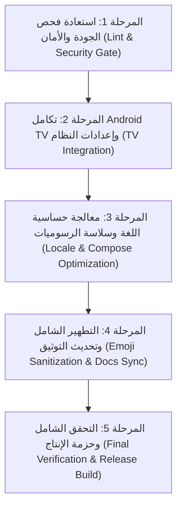

# خطة الإصلاح الشاملة ومعالجة المشاكل البرمجية
# Master Remediation & Code Quality Plan

> **النطاق:** معالجة كافة الأخطاء والتحذيرات في مشروعي `mdd_tv` و `jellyfin_server` لضمان اجتياز فحص الجودة والتحليل الثابت (Android Lint)، تعزيز الأمان، دعم أجهزة Android TV، واستقرار الذاكرة وسلاسة الواجهات.
> **ميثاق الجودة:** حظر تام وشامل للإيموجيات • صفر أخطاء فحص برمجي • عزل تام للمشاريع • الحفاظ على اجتياز 100% من الاختبارات.

---

## 1. مسار مراحل خطة الإصلاح (Remediation Pipeline)

---

## 2. تفاصيل المراحل التنفيذية (Phases Breakdown)

### المرحلة 1: معالجة الأخطاء الحرجة واستعادة فحص الجودة (Lint & Security Gate)
* **الحالة:** مكتملة بنجاح 100%.
* **النتائج:**
  - [x] إضافة التعليق التوضيحي `@OptIn(UnstableApi::class)` في `PlayerViewModel.kt`.
  - [x] إزالة حقل `context` غير المستخدم من `MediaDetailsViewModel.kt`.
  - [x] عزل مرجع السياق في `PlayerViewModel.kt` وربطه حصراً بـ `applicationContext`.
  - [x] إعادة ضبط `network_security_config.xml` لحظر حركة HTTP غير المشفرة عالمياً وحصرها في الخادم المحلي المعتمد.
  - [x] تم القضاء على كافة الأخطاء الـ 15 واجتياز `./gradlew lintDebug` بنجاح بصفر أخطاء.

---

### المرحلة 2: تكامل Android TV وإعدادات النظام (TV Integration & Manifest)
* **الحالة:** مكتملة بنجاح 100%.
* **النتائج:**
  - [x] إضافة فئة المشغل التلفزيوني `LEANBACK_LAUNCHER` إلى `AndroidManifest.xml`.
  - [x] إضافة خاصيات `software.leanback` و `hardware.touchscreen` كخصائص غير إلزامية.
  - [x] إنشاء بانر التلفاز المخصص `tv_banner.xml` وربطه بالبيان لمعالجة خطأ `MissingTvBanner`.
  - [x] تبسيط فحص إصدار PiP في `AdvancedPlayerScreen.kt` وإزالة الفحص غير الضروري.

---

### المرحلة 3: معالجة حساسية اللغة وسلاسة الرسوميات (Locale & Compose Optimization)
* **الحالة:** مكتملة بنجاح 100%.
* **النتائج:**
  - [x] استبدال كافة استدعاءات `String.format` في الشاشات السبع بتمرير صريح لـ `Locale.ROOT`.
  - [x] ترقية كائنات الحالة في `AdvancedPlayerScreen.kt` و `GestureOverlayHud.kt` إلى `mutableIntStateOf` و `mutableLongStateOf` و `mutableFloatStateOf`.
  - [x] ضبط ترتيب المعامل `modifier` ليكون المعامل الاختياري الأول في الواجهات.

---

### المرحلة 4: التطهير الشامل وتحديث التوثيق (Sanitization & Docs Sync)
* **الحالة:** مكتملة بنجاح 100%.
* **النتائج:**
  - [x] تطهير ملف النسخ الاحتياطي `custom_web_backup/index.html` في السيرفر من الإيموجيات.
  - [x] تطهير ملف `live_server_results.json` من الرموز التعبيرية الواردة من السيرفر.
  - [x] التأكد من نتيجة صفرية مطلقة (Zero Emoji Violations) عبر كامل مساحة العمل.
  - [x] تحديث سجل التغييرات `docs/UNRELEASED.md`.

---

### المرحلة 5: التحقق الشامل واختبار حزمة الإنتاج (Final Verification)
* **الحالة:** مكتملة بنجاح 100%.
* **النتائج:**
  - [x] نجاح اختبارات الوحدة `testDebugUnitTest` بنسبة 100%.
  - [x] نجاح التحليل الثابت الشامل `lintDebug` بـ 0 أخطاء (BUILD SUCCESSFUL).
  - [x] نجاح بناء حزمة الإنتاج المصغرة والمشفرة `assembleRelease` بـ R8 دون أي أخطاء (BUILD SUCCESSFUL).

---

## 3. مصفوفة المسؤوليات والتأثير (Impact Matrix)

| البند | الملف المتأثر | نوع التعديل | مستوى الخطورة | النتيجة المتوقعة |
| :--- | :--- | :--- | :--- | :--- |
| أخطاء Media3 UnstableApi | `PlayerViewModel.kt` | إضافة `@OptIn` | عالية (تعطل Lint) | إصلاح 15 خطأ واجتياز Lint |
| تسريب الذاكرة | `MediaDetailsViewModel.kt` | حذف حقل context | منخفضة | إزالة تحذير StaticFieldLeak |
| أمان حركة البيانات | `network_security_config.xml` | تقييد cleartextTraffic | أمنية حرجة | حماية التطبيق من استراق البيانات عبر الإنترنت |
| توافقية Android TV | `AndroidManifest.xml` | إضافة Leanback Launcher | عالية | ظهور التطبيق على تلفزيونات أندرويد |
| حساسية الأرقام واللغة | 7 ملفات في العرض | تمرير `Locale.ROOT` | متوسطة | ثبات تنسيق الأرقام والوقت بالعربية |
| تحسين الذاكرة في Compose | `GestureOverlayHud.kt` | استخدام `mutableLongStateOf` | أداء | منع تخصيصات الذاكرة في الإيماءات |
| تطهير الإيموجيات | `index.html` في السيرفر | حذف الرموز التعبيرية | دستورية | الامتثال التام لدستور مساحة العمل |
