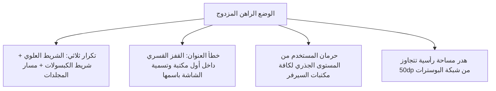
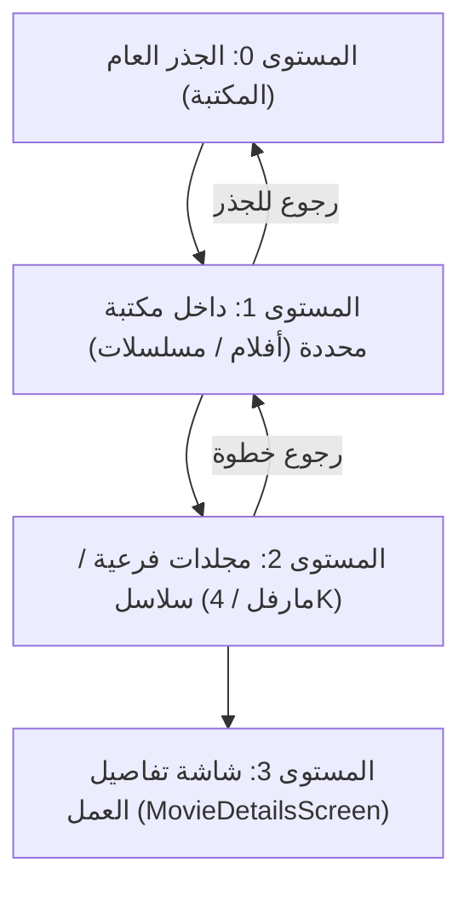

# خطة الإصلاح المعمارية: التصفح الهرمي الصافي وإلغاء الازدواجية البصرية
# Architecture Plan: Pure Hierarchical Library Browser & Card Enhancement (Obsidian 2.2.0)

> **الهدف الاستراتيجي:** القضاء التام على التكرار البصري في شاشة المكتبة عبر استئصال شريط كبسولات المكاتب، واعتماد شجرة تصفح هرمية نقية تبدأ من جذر المكتبات، وتصحيح العناوين ومسارات التنقل، مع ترقية بطاقات الأفلام والمسلسلات.
> **المرجع التقني:** mdd_tv/docs/current/screens/02_library_browser.md
> **ميثاق الجودة:** حظر تام وشامل للإيموجيات • صفر كود مهجور • اتساق تام في الترقيم • سلاسة فائقة 120Hz.

---

## 1. تشخيص الوضع الراهن ومواطن الخلل (Diagnostic & Root Causes)

1. **الازدواجية والتكرار:**
   * وجود شريط كبسولات المكاتب الأفقي (`LibraryCategoriesRow`) يكرر نفس أسماء المكاتب المعروضة في الشريط العلوي وفي مسار المجلدات (`BreadcrumbsBar`).
2. **خطأ العنوان (Wrong Title):**
   * عند الدخول من شريط التنقل السفلي عبر تبويب "المكتبة"، يقوم `LibraryViewModel.loadInitialLibrary()` باختيار أول مكتبة تلقائياً (`firstLibrary` مثل أفلام) ويضع عنوانها كعنوان رئيسي، مما يوحي للمستخدم بأن العنوان خاطئ.
3. **غياب شجرة الجذر (Missing Root Level):**
   * لا يمكن للمستخدم استعراض كافة المكاتب كبطاقات متناسقة، ولا يمكنه العودة بـ Back للجذر.

---

## 2. الهيكلية المعمارية الجديدة للتصفح الهرمي (Target Architecture)

### تفصيل المستويات الثلاثة:
1. **المستوى 0 — الجذر العام (`Root`):**
   * **العنوان في الشريط العلوي:** "المكتبة" مع إظهار عدد المكاتب: مثلاً `(4 مكتبات)`.
   * **شريط المسار:** يختفي أو يقتصر على `المكتبة`.
   * **الشبكة (Grid):** تعرض مكاتب السيرفر (`UserViews`) كبطاقات مجلدات فاخرة (`FolderCard`) بأيقونات سينمائية وتلفزيونية مخصصة.
2. **المستوى 1 — داخل مكتبة معينة (مثلاً: "أفلام"):**
   * **العنوان في الشريط العلوي:** "أفلام" مع عدد الأعمال الإجمالي `(1,240 عملاً)`.
   * **شريط المسار (`BreadcrumbsBar`):** `المكتبة > أفلام` مع زر الترتيب وزر الرجوع الدائري.
   * **الشبكة:** تعرض محتويات تلك المكتبة فقط (مجلدات وأعمال فردية).
3. **المستوى 2 وما بعده — داخل مجلدات فرعية (مثلاً: "سلاسل مارفل"):**
   * **العنوان في الشريط العلوي:** اسم المجلد الفرعي.
   * **شريط المسار:** `المكتبة > أفلام > سلاسل مارفل`.
   * **الشبكة:** تعرض محتويات المجلد الفرعي.

---

## 3. باقة الأفكار الابتكارية لترقية بطاقات الأفلام والمسلسلات (Card Innovations)

1. **التمييز البصري بين الفيلم والمسلسل (Movie vs Series Identification):**
   * للمسلسلات: إظهار كبسولة مدمجة لعدد المواسم (مثال: `3 مواسم`) أو شارة مخصصة بدلاً من الاكتفاء بجودة العرض.
   * للأفلام: إظهار مدة العرض الدقيقة (مثال: `1س 54د`) بجوار سنة الإنتاج.
2. **مؤشر التقدم الدقيق (Micro-Progress Bar):**
   * للأعمال قيد المشاهدة (`playbackPositionPercentage > 0`): إضافة خط تقدم ناعم ورفيع (2dp) في أسفل البوستر باللون البنفسجي المتوهج (`PrimaryIndigo`)، لمعرفة موقع التوقف فوراً دون فتح شاشة التفاصيل.
3. **طبقة الحماية والتدرج (Obsidian Contrast Scrim):**
   * إضافة تدرج لوني خفيف من الأسفل لضمان وضوح النصوص والبيانات بنسبة 100% فوق البوسترات الساطعة.
4. **تأثيرات البطاقات للمجموعات والسلاسل (BoxSet Stacking Effect):**
   * تصميم بطاقات المجلدات والسلاسل بحدود مزدوجة خفيفة توحي بطبقات متراكبة كدلالة على احتوائها على مجموعة أعمال.
5. **قائمة الإجراءات السريعة بالضغط المطول (Long-Press Quick Actions):**
   * دعم الضغط المطول على بطاقة العمل لإظهار قائمة سريعة: تشغيل مباشر، إضافة للمفضلة، تحديد كمشاهد.

---

## 4. مراحل التنفيذ المتتابعة (Phased Implementation Plan)

### المرحلة 1: إدارة الحالة وتطهير الميثاق (`LibraryContract.kt` و `LibraryViewModel.kt`)
- [x] إضافة حالة الجذر `isRoot: Boolean` في `LibraryUiState.Success`.
- [x] تعديل `loadInitialLibrary()` لتعرض قائمة المكتبات في الجذر كـ `FolderCard` دون القفز لأول مكتبة عند فتح التاب العام.
- [x] دعم الانتقال من الصفحة الرئيسية (`HomeScreen`) مباشرة إلى المستوى 1 لمكتبة محددة مع الاحتفاظ بالجذر في المسار.
- [x] تحديث منطق الرجوع `NavigateBackInHierarchy` للعودة من أي مكتبة إلى الجذر قبل مغادرة الشاشة.

### المرحلة 2: تطهير واجهة المستخدم (`LibraryScreen.kt` و `BreadcrumbsBar.kt`)
- [x] استئصال مكون `LibraryCategoriesRow` بالكامل وتوفير 50dp من الارتفاع الرأسي.
- [x] ضبط الشريط العلوي `LibraryFloatingTopBar` ليعرض "المكتبة" في الجذر مع عدد المكاتب، واسم المجلد في المستويات الفرعية.
- [x] ضبط شريط المسار `BreadcrumbsBar` ليظهر زر الرجوع فور الانتقال من المستوى 0 إلى المستوى 1 وما بعده.

### المرحلة 3: ترقية بطاقات البوسترات والمجلدات (`LibraryPosterCard.kt` و `FolderCard.kt`)
- [x] إضافة شريط التقدم الدقيق (`MicroProgressBar`) للأعمال غير المكتملة.
- [x] تمييز المسلسلات بشارة المواسم أو الحلقات، والأفلام بمدة العرض وسنة الإنتاج.
- [x] صقل تدرج القراءة والتأكد من توافقه التام مع شاشات OLED True Black.

### المرحلة 4: التحقق وضمان الجودة واختبارات الوحدة (Testing & Verification)
- [x] تحديث اختبارات `LibraryViewModelTest` لتغطية مسار الجذر والمستويات الهرمية.
- [x] تشغيل `testDebugUnitTest` والتأكد من نجاح كافة الاختبارات.
- [x] تدقيق خلو الكود بالكامل من الإيموجيات بنسبة 100%.
