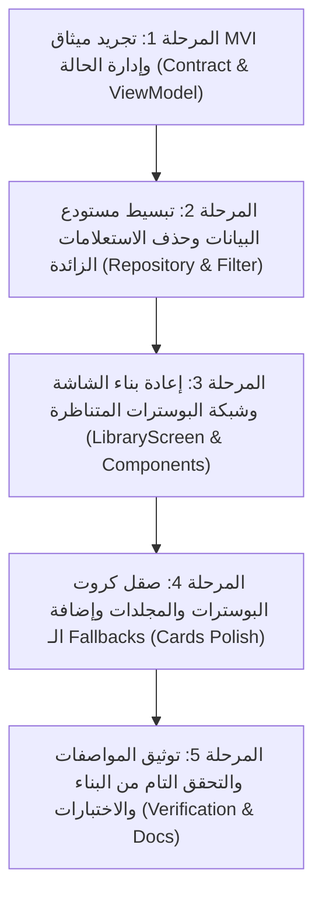

# خطة الإصلاح الشاملة لواجهة المكتبة ومنظومة التصفح الهرمي
# Master Remediation Plan: Pure Hierarchical Library Browser (Obsidian 2.2.0)

> **الهدف الاستراتيجي:** استئصال كافة أشكال التشتت والتعقيد المصطنع (Over-engineering)، وإلغاء كبسولات الفلاتر الثابتة وشريط القفز الأبجدي، واعتماد التصفح الهرمي النقي (Pure Hierarchical Browsing) كنمط أوحد وثابت في مكتبة تطبيق مدد TV، مع حماية السيرفر وضمان التوافق التام مع شاشات OLED ومبادئ Obsidian 2.2.0.
> **المرجع التقني:** `mdd_tv/docs/current/screens/02_library_browser.md`
> **ميثاق الجودة:** حظر تام للإيموجيات • صفر كود مهجور • اتساق تام في الترقيم • سلاسة 120Hz.

---

## 1. التقييم والرأي الهندسي في قرارات التطوير (Architectural Assessment)

### أولاً: إلغاء كبسولات الفلاتر الثابتة (Eliminating Static Filter Chips)
* **التقييم:** قرار صائب وممتاز بنسبة 100%.
* **الأسباب الفنية:**
  1. **كسر التعارض مع الخادم والترقيم (Zero Pagination Drift):** الفلاتر الحالية (4K UHD فقط، تقييم +8.0، والمفضلة) كانت تُطبَّق محلياً بعد جلب صفحة محددة (60 عنصراً) من الخادم. هذا السلوك كان يقلص عدد العناصر في الذاكرة دون علم الخادم، مما يدمر مؤشر البداية (`startIndex`) ويتسبب في تكرار جلب العناصر السابقة في حلقة مفرغة أو توقف التمرير اللانهائي.
  2. **إنهاء تناقض المفضلة:** كانت شاشة المكتبة تخلط بين استعلام الخادم المشترك للمفضلة وسجل المفضلة المحلي في Room DB، مما حرم المستخدم من رؤية مفضلته المحلية إذا لم تكن مفضلة على الخادم المشترك.
  3. **استعادة المساحة الرأسية والنقاء البصري:** إزالة شريط الفلاتر يوفر أكثر من 56dp من الارتفاع الرأسي للشاشة، ويمنع التشويش الإدراكي ويوجه التركيز بالكامل للبوسترات. وظائف البحث المتقدم والتصفية الدقيقة مكانها الطبيعي هو شاشة البحث المخصصة (`SearchScreen`).

### ثانياً: اعتماد التصفح الهرمي حصراً (Pure Hierarchical Browsing Only)
* **التقييم:** قرار هندسي جوهري يمثل الهوية الطبيعية لخوادم Jellyfin.
* **الأسباب الفنية:**
  1. **التوافق التام مع هيكلية الخادم:** وسائط Jellyfin مرتبة دائماً في مجلدات ومسلسلات ومواسم. التصفح الهرمي يمثل التمثيل الحقيقي لما على القرص.
  2. **حماية موارد السيرفر وذاكرة الهاتف:** النمط المسطح القديم (`Flat Mode`) كان يطلب جلب كافة العناصر متداخلة (`recursive = true`)، وهو ما يثقل الخادم ويستهلك الذاكرة. التصفح الهرمي النقي يستعلم فقط عن المحتوى المباشر للمجلد الحالي (`recursive = false`)، فيكون حجم البيانات صغيراً جداً وسرعة الاستجابة خارقة (<50ms).
  3. **إلغاء تعقيد التبديل المزدوج:** التبديل بين "مجلدات" و"الكل" كان يضاعف تعقيد الحالة البرمجية في `LibraryViewModel` ويربك المستخدم. التصفح الهرمي مع شريط `BreadcrumbsBar` يمنح مساراً تفاعلياً واضحاً وأنيقاً.

### ثالثاً: إلغاء شريط الحروف الأبجدي (Eliminating Alphabet Scrubber)
* **التقييم:** قرار مكمل وضروري.
* **الأسباب الفنية:**
  1. في التصفح الهرمي، لا يوجد مجلد يحتوي على آلاف العناصر المتتالية لتبرير وجود شريط قفز أبجدي كامل.
  2. الشريط الحالي كان يعاني من أخطاء في الواجهة العربية (RTL) تجعل الفقاعة تختفي خارج الشاشة، ويفتقر للأحرف العربية، ويسبب عدم تماثل في هوامش الشبكة (36dp في جهة و 16dp في جهة).
  3. حذفه يعيد التماثل الكامل لشبكة البوسترات ثلاثية الأعمدة بهوامش متطابقة 16dp في كلا الطرفين.

---

## 2. مراحل خطة الإصلاح الشاملة (Remediation Execution Phases)



---

### المرحلة 1: تجريد وتطهير ميثاق MVI وإدارة الحالة (`LibraryContract` و `LibraryViewModel`) [مكتملة بنجاح]

1. **تحديث ميثاق النوايا والواجهة (`LibraryContract.kt`):**
   * [x] حذف النوايا المهجورة:
     - `Toggle4kOnly`, `ToggleUnwatchedOnly`, `ToggleFilter`, `ResetFilters`.
     - `JumpToLetter`, `FilterByLetter`.
     - `ToggleViewMode` (اعتماد الهرمية حصراً).
     - `QuickPlayMedia` (توحيدها مع `QuickPlay`).
   * [x] الإبقاء حصراً على النوايا الفعالة:
     - `LoadLibrary(parentId, libraryName)`
     - `SwitchLibrary(libraryId, libraryName)`
     - `NavigateIntoFolder(folderId, folderName)`
     - `NavigateBackInHierarchy`
     - `JumpToBreadcrumb(targetIndex)`
     - `ChangeSort(sortBy)`
     - `OpenMediaDetails(mediaId)`
     - `QuickPlay(mediaId)`
     - `Refresh`
     - `LoadNextPage`
   * [x] تبسيط `LibraryUiState.Success`:
     - حذف: `activeFilters`, `selectedLetter`, `activeFilter`, `isHierarchicalMode`.
     - الإبقاء على: `items`, `totalCount`, `currentLibraryId`, `currentLibraryName`, `availableLibraries`, `selectedLibraryId`, `selectedSort`, `isRefreshing`, `isLoadingMore`, `hasMoreItems`, `breadcrumbs`.

2. **تطهير وتصحيح `LibraryViewModel.kt`:**
   * [x] حذف مصفوفات ومجموعات الفلاتر المهجورة (`activeFilterChips`, `currentLetter`, `isHierarchicalMode`).
   * [x] إرسال `LibraryEffect.ScrollToIndex(0)` تلقائياً وفورياً عند:
     - تبديل المكتبة (`SwitchLibrary`).
     - الدخول لمجلد جديد (`NavigateIntoFolder`).
     - الرجوع لمجلد سابق (`NavigateBackInHierarchy` و `JumpToBreadcrumb`).
     - تغيير نوع الترتيب (`ChangeSort`).
   * [x] تصحيح مؤشر البداية في الترقيم (`startIndex`):
     - استخدام الفهرس المباشر لعدد السجلات المسترجعة من السيرفر لمنع أي تكرار أو جمود في التمرير اللانهائي.

---

### المرحلة 2: تبسيط مستودع البيانات وحذف استعلامات الفلاتر (`LibraryRepositoryImpl`) [مكتملة بنجاح]

1. **تحديث `LibraryFilter.kt` و `LibrarySortBy.kt`:**
   * [x] إزالة `enum class LibraryFilterChip`.
   * [x] تبسيط `LibraryFilter` ليقتصر حصراً على:
     ```kotlin
     data class LibraryFilter(
         val sortBy: LibrarySortBy = LibrarySortBy.DATE_ADDED
     )
     ```
2. **تطهير `LibraryRepositoryImpl.kt`:**
   * [x] حذف إرسال `filters=IsFavorite` و `filters=IsUnplayed` إلى خادم Jellyfin.
   * [x] ضبط الاستعلام دائماً ليكون هرمياً ومباشراً للمجلد الحالي (`recursive = false` مع تضمين أنواع `Folder,Series,Movie,Episode,Video,Audio`).
   * [x] إزالة التصفية المحلية العشوائية لـ 4K والتقييم، والاعتماد بنسبة 100% على بيانات السيرفر النقية.
   * [x] المحافظة على دعم الاستدعاء الخاص في `BoxSetViewModel` دون أي تعارض.

---

### المرحلة 3: إعادة بناء واجهة المستخدم وتناظر الشبكة (`LibraryScreen.kt` و المكونات) [مكتملة بنجاح]

1. **حذف المكونات الملغاة:**
   * [x] حذف واستئصال `FilterChipsRow.kt`.
   * [x] حذف واستئصال `AlphabetScrubber.kt`.
2. **إصلاح تناظر وهوامش شبكة البوسترات (`LazyVerticalGrid`):**
   * [x] إزالة الهامش غير المتماثل `end = 36.dp`.
   * [x] توحيد الهوامش الجانبية لتكون متناظرة تماماً:
     ```kotlin
     contentPadding = PaddingValues(
         start = JellyfinDimens.SpaceLarge,
         end = JellyfinDimens.SpaceLarge,
         top = JellyfinDimens.SpaceSmall,
         bottom = LocalBottomClearance.current + JellyfinDimens.SpaceMedium
     )
     ```
3. **تطوير مسار التنقل الهرمي (`BreadcrumbsBar.kt`):**
   * [x] إزالة زر التبديل المزدوج (مجلدات / الكل).
   * [x] إبراز مسار المجلدات النقي: أيقونة المجلد، الأسماء المتتالية، أسهم التنقل العربية RTL (`KeyboardArrowLeft`)، وزر الرجوع السريع الدائري عند التواجد داخل مجلدات فرعية.
   * [x] دمج زر الترتيب المدمج الصغير بجوار المسار.
4. **توحيد الشريط العلوي العائم (`LibraryFloatingTopBar`):**
   * [x] جعل العنوان يعكس اسم المجلد الحالي النشط مع عدد الأعمال، وزر البحث، وزر الرجوع.

---

### المرحلة 4: صقل كروت البوسترات والمجلدات (`LibraryPosterCard` و `FolderCard`) [مكتملة بنجاح]

1. **إضافة Fallback وأيقونة بديلة في `LibraryPosterCard.kt`:**
   * [x] إضافة طبقة بديلة عند غياب البوستر أو فشل تحميله من السيرفر.
   * [x] عرض أيقونة سينمائية ناعمة متوهجة في المنتصف (`Icons.Rounded.Movie` أو `Icons.Rounded.Tv`) مع اسم العمل، مما يمنع ظهور المستطيلات السوداء الفارغة نهائياً.
2. **تحسين بطاقات المجلدات `FolderCard.kt`:**
   * [x] ضبط التصميم ليتوافق مع لغة بطاقات Obsidian 2.2.0 (ألوان السطح الداكن `SurfaceDark`، حدود زجاجية خفيفة `BorderGlass`، وتلاشي ناعم).

---

### المرحلة 5: تحديث التوثيق واختبارات الجودة وضمان البناء [مكتملة بنجاح]

1. **تحديث وثيقة المواصفات الرسمية:**
   * [x] تعديل `docs/current/screens/02_library_browser.md` لتوثيق التحول الكامل للتصفح الهرمي الصافي وإلغاء الفلاتر والشريط الأبجدي، وتطهيرها من الإيموجيات القديمة.
2. **اختبارات الوحدة (Unit Tests):**
   * [x] تحديث وتطوير اختبارات `LibraryViewModelTest` للتحقق من:
     - دورة حياة التنقل الهرمي (الدخول لمجلد، الرجوع، والقفز لمستوى سابق).
     - إرسال `LibraryEffect.ScrollToIndex(0)` عند تغيير الموقع.
     - الترقيم الصحيح بدون تكرار.
3. **التحقق العتادي والبناء الكامل (Gradle Build & Quality Gate):**
   * [x] تشغيل `./gradlew testDebugUnitTest` ونجاح كافة الاختبارات (BUILD SUCCESSFUL).
   * [x] التحقق من خلو الكود من أي تحذيرات أو إيموجيات بنسبة 100%.
