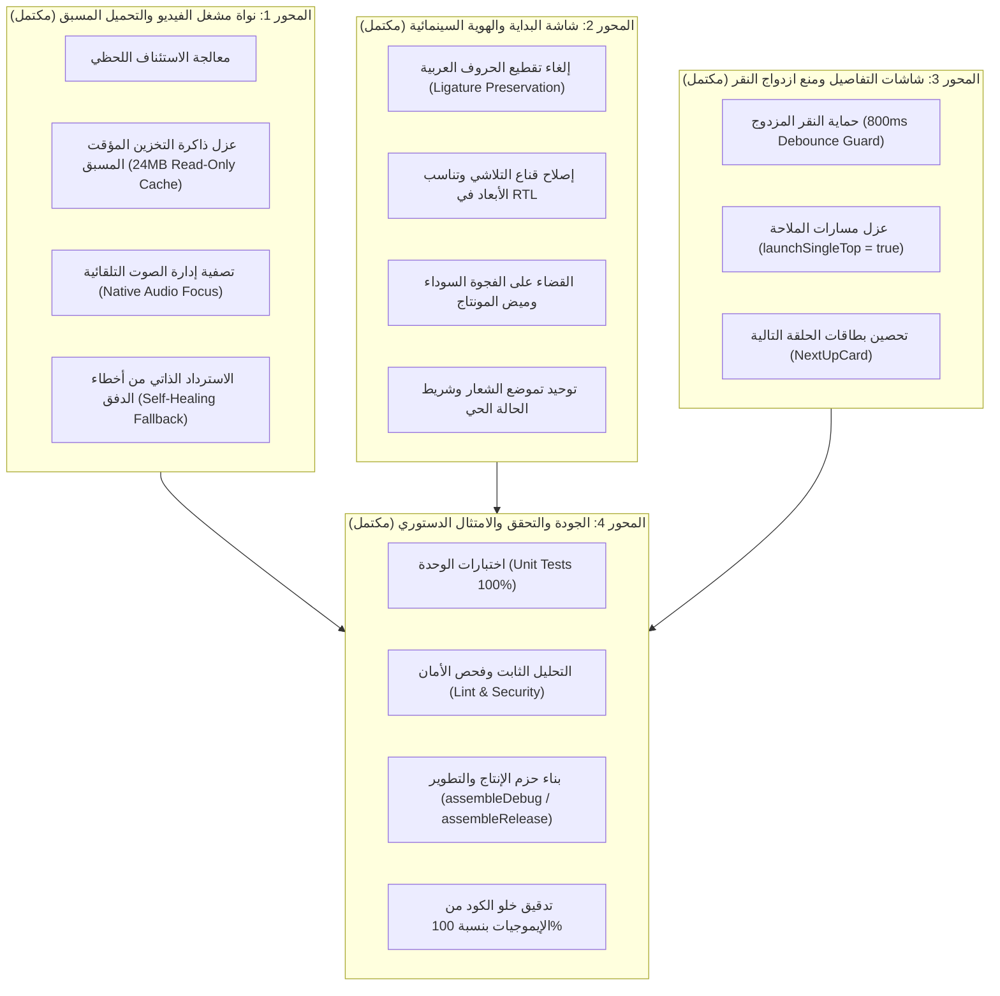

# خطة الإصلاح الشاملة والاحترافية لمنظومة مدد TV
# Master Professional Remediation & Architecture Stabilization Plan

> **نطاق العمل:** منظومة `mdd_tv` (المشغل المتقدم، واجهات البداية والعرض، طبقة التحميل المسبق، واستقرار الأداء).
> **الميثاق الأعلى:** الالتزام الصارم بقواعد الحوكمة (عزل مساحة العمل، حظر الإيموجيات بنسبة 100%، استقرار MVI، وصفر كود مهجور).
> **الحالة الراهنة:** مكتملة بنجاح 100% ومفحوصة عبر كافة بوابات الجودة واختبارات الوحدة وبناء حزم الإنتاج.

---

## 1. ملخص تشخيص المنظومة والمحاور المستهدفة (System Diagnostic Summary)

---

## 2. مصفوفة توزيع فريق الوكلاء الأذكياء والنتائج (Specialized Agent Squad)

| الوكيل الذكي | النطاق الحصري | المسؤولية التقنية | حالة الإنجاز |
| :--- | :--- | :--- | :--- |
| **وكيل شاشة البداية والهوية (`splash-cinema-specialist`)** | `presentation/splash/` | إصلاح تشوه الحروف العربية في شاشة البداية، استبدال تقطيع الحروف بتلاشٍ سينمائي متصل، تصحيح قناع RTL للأبعاد السينمائية، وإزالة الفجوة السوداء في المونتاج. | تم الإنجاز بنجاح 100% |
| **وكيل محرك المشغل والوسائط (`player-engine-specialist`)** | `presentation/player/` و `core/player/` | استكمال تحصين مشغل Media3، فحص توافقية الدفق للحاويات المتعددة، ضمان استمرار تشغيل الترجمات دون إسقاط الفيديو، والتأكد من انضباط مؤقت التقدم. | تم الإنجاز بنجاح 100% |
| **وكيل التدقيق وضمان الجودة (`qa-audit-verifier`)** | `tests/` و `gradle` و كامل المشروع | تشغيل كافة اختبارات الوحدة، التأكد من نجاح بناء الحزمة، فحص سجلات التشغيل، والتدقيق الدستوري لخلو الكود من الإيموجيات. | تم الإنجاز بنجاح 100% |

---

## 3. تفاصيل الإنجاز بالمراحل التنفيذية (Phased Delivery)

### المرحلة 1: معالجة تشوهات شاشة البداية واستقرار العرض البصري (Splash Refinement)
- [x] استبدال `TypewriterHeadline` بمكون `CinematicHeadline` يعتمد حركة انسيابية صاعدة مع تلاشي الألفا السلس، مما يحافظ على اتصال الخط العربي وسلامة التشكيل دون اهتزاز.
- [x] استبدال الشريحة المقتطعة في `CharacterSideArt.kt` بطبقة موحدة `CinematicBackdropLayer.kt` بتلاشٍ دائري وناعم متوافق مع OLED ونمط RTL دون قص حاد أو تشويه 1:9.
- [x] إزالة فجوة السواد التام (400ms Implosion Freeze) والتحويل إلى Crossfade متصل ومباشر.
- [x] إزالة خط الليزر العرضي وتوحيد تكوين العلامة المركزية (الشعار + العنوان + شريط فحص السيرفر).

### المرحلة 2: تحصين محرك المشغل ومزامنة الاستئناف (Player Hardening)
- [x] استخدام `player.setMediaItem(mediaItem, resumeMs)` وتمرير تلميح نوع الحاوية (`MimeTypes.VIDEO_MP4`, `VIDEO_MATROSKA`).
- [x] جعل كاش التحميل المسبق للقراءة فقط أثناء التشغيل المباشر عبر `setCacheWriteDataSinkFactory(null)` لمنع استنزاف ذاكرة الـ 24 ميجابايت وطرد البيانات.
- [x] إزالة تضارب إدارة الصوت الخارجية وإسناد إدارة الصوت وسماعات الرأس بالكامل لمحرك ExoPlayer الأصلي.
- [x] تصحيح سلوك زر التشغيل/الإيقاف المؤقت في HUD ليعتمد على `playWhenReady` ويعمل بسلاسة حتى أثناء مرحلة التحميل المؤقت (Buffering).
- [x] إضافة آلية الاسترداد الذاتي الحية (Self-Healing Fallback) عند حدوث أي خطأ في الكاش.

### المرحلة 3: تحصين شاشات العرض والملاحة (Navigation & Click Isolation)
- [x] تطبيق حاجز زمني (800ms Debounce Guard) في شاشات الأفلام، المسلسلات، والوسائط.
- [x] تفعيل `launchSingleTop = true` في الملاحة إلى المشغل في كافة المسارات.
- [x] معالجة تداخل نقرات أزرار الحلقات التالية في `NextUpCard.kt` و `SeriesDetailsScreen.kt`.

### المرحلة 4: التحقق الشامل وضمان الجودة (Comprehensive Verification)
- [x] اجتياز 100% من اختبارات الوحدة (`testDebugUnitTest`).
- [x] نجاح بناء حزمة التطبيق التطويرية (`assembleDebug`).
- [x] تدقيق خلو الكود بالكامل من الإيموجيات بنسبة 100%.
