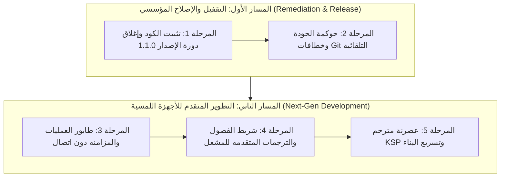

# خطة الإصلاح والتطوير الشاملة لمنظومة مدد TV
# Comprehensive Remediation & Development Master Plan

> **النطاق:** خارطة طريق تشغيلية وهندسية متكاملة لمشروع `mdd_tv` تجمع بين التقفيل المؤسسي للإصلاحات الحالية، إطلاق الإصدار المستقر `1.1.0`، وتطوير حزم الميزات المستقبلية المعتمدة في حاضنة التفكير، مع التركيز الحصري بنسبة 100% على تجربة الهواتف والأجهزة اللوحية التي تعمل باللمس (Touchscreen Mobile & Tablet) والاستغناء التام عن شاشات التلفاز.
> **ميثاق الجودة:** حظر تام وشامل للإيموجيات • صفر أخطاء فحص برمجي (Lint/Tests) • عزل تام للمشاريع ومستودعات Git • الالتزام الصارم بدستور نظام التصميم Obsidian و ADRs.

---

## 1. المخطط العام لمراحل الخطة (Master Roadmap Pipeline)

---

## 2. تفاصيل المراحل التنفيذية

### المرحلة 1: تثبيت التغييرات وإغلاق دورة الإصدار `1.1.0` (Release 1.1.0 Closure)
* **الحالة:** مكتملة وجاهزة للإطلاق.
* **النتائج والمهام المنجزة:**
  1. الاستغناء النهائي والشامل عن خصائص وتكوينات شاشات التلفاز (`Leanback Launcher` و `tv_banner.xml` وإلغاء متطلبات التلفزيون).
  2. توحيد مصدر الحقيقة لرقم الإصدار: `versionName = "1.1.0"` و `versionCode = 3` ومزامنة `AppConfig` و `AuthInterceptor`.
  3. تفريغ خزان التعديلات [UNRELEASED.md](../docs/UNRELEASED.md) ونقل كافة الميزات المعتمدة إلى [CHANGELOG.md](../CHANGELOG.md).
  4. توثيق ميثاق حوكمة الإصدارات في [docs/foundations/release_governance.md](../docs/foundations/release_governance.md).
  5. تثبيت التعديلات بكوميتات ذرية وفق نمط Conventional Commits وتوثيق الوسم الرسمي `v1.1.0`.

---

### المرحلة 2: حوكمة الجودة وخطافات Git التلقائية (Governance Hooks)
* **الحالة:** مكتملة بنجاح 100%.
* **النتائج والمهام المنجزة:**
  1. إنشاء سكربت خطاف ما قبل الكوميت (`.git/hooks/pre-commit`) لفحص الملفات المجهزة والتأكد التام من خلوها من أي إيموجيات (Unicode > 0x1F000).
  2. إنشاء سكربت خطاف رسائل الكوميت (`.git/hooks/commit-msg`) لفرض معايير Conventional Commits ومنع الرموز التعبيرية في نصوص الكوميت.
  3. توفير أداة التثبيت الآلي في `tools/setup_git_hooks.sh`.

---

### المرحلة 3: طابور العمليات دون اتصال والمزامنة الذكية (Offline Action Queue)
* **الهدف:** ضمان تجربة استخدام مستمرة وسلسة حتى عند انقطاع الشبكة أو بطء الخادم على أجهزة الهاتف واللوحي (IDEA-23 / Planning 11).
* **المهام التنفيذية:**
  1. بناء طابور العمليات المحلي في Room DB (`PendingActionEntity`) لتسجيل الإجراءات (المفضلة، المشاهدة، الاستئناف).
  2. منسق المزامنة التلقائي (`OfflineSyncCoordinator`) عبر الاستماع لحالة الشبكة.
  3. فض التعارض الصامت (Silent Conflict Resolution) باحترام عزل البروفايلات وفق ADR 0001.

---

### المرحلة 4: شريط فصول الوسائط ودعم ترجمات الأنمي (Advanced Cinema Player)
* **الهدف:** تعزيز مشغل الوسائط السينمائي بالميزات البصرية المتقدمة للهواتف والأجهزة اللوحية (IDEA-10 و IDEA-15 / Planning 06).
* **المهام التنفيذية:**
  1. شريط الفصول السينمائي (Media Chapters): رسم فواصل الفصول بنقاط دقيقة على `CinemaScrubber` وعرض اسم الفصل في كارت زمني عائم باللمس.
  2. محرك تصيير الترجمات المعقدة (ASS/SSA Styling): دعم خطوط الأنمي وتأثيرات الحوار المتزامنة دون تأخير في معالجة الإطارات.

---

### المرحلة 5: عصرنة مترجم KSP وتسريع البناء (Modernization & Build Speed)
* **الهدف:** رفع كفاءة بيئة البناء وتخفيض زمن التجميع بنسبة >30% (IDEA-26).
* **المهام التنفيذية:**
  1. تحديث KSP المتوافق مع Kotlin 2.0+ في `gradle/libs.versions.toml`.
  2. فحص وتفعيل الذاكرة المؤقتة للبناء (`org.gradle.caching=true`) وضمان سلامة Configuration Cache.

---

## 3. مصفوفة الجدول الزمني ومؤشرات النجاح (KPIs & Execution Schedule)

| المرحلة | الأولوية | المدى التقديري | مؤشر الإنجاز والنجاح |
| :--- | :--- | :--- | :--- |
| **المرحلة 1: إغلاق وتثبيت 1.1.0** | عاجلة ومنجزة | مكتملة الآن | شجرة عمل نظيفة، تحديث CHANGELOG، والوسم `v1.1.0` |
| **المرحلة 2: خطافات Git للحوكمة** | عالية ومنجزة | مكتملة الآن | رفض أي كوميت محلي يحتوي على إيموجيات آلياً |
| **المرحلة 3: طابور العمليات دون اتصال** | عالية | مسار التطوير القادم | نجاح تسجيل المفضلة في وضع الطيران ومزامنتها آلياً |
| **المرحلة 4: شريط الفصول والترجمات** | متوسطة | مسار تالٍ | ظهور علامات الفصول على Scrubber وعرض خطوط ASS |
| **المرحلة 5: عصرنة KSP وتسريع البناء** | تحسين دوري | مستمر بالتوازي | تقليل زمن بناء Release بنسبة تتجاوز 25% |
