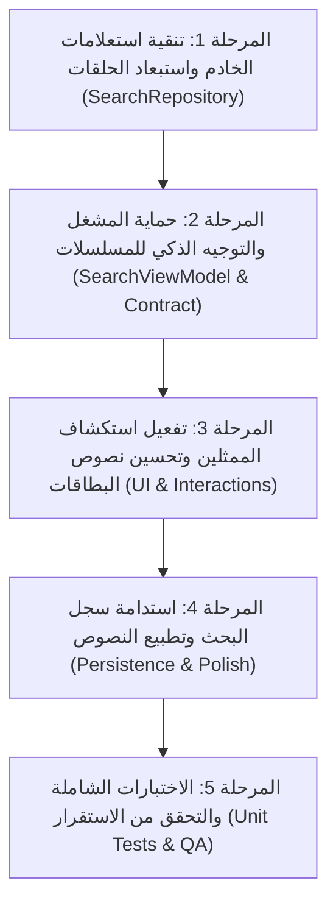

# خطة الإصلاح الشاملة لمنظومة البحث والاستكشاف
# Master Remediation Plan: Robust Search & Explore Experience (MDD TV)

> **الهدف الاستراتيجي:** الارتقاء بمنظومة البحث والاستكشاف الشفافة في تطبيق مدد TV إلى أعلى مستويات الاعتمادية وتجربة الاستخدام السلسة، واستئصال المشاكل التقنية المؤدية لانهيار المشغل، ومنع حشو النتائج بالبوسترات المكررة، وتفعيل تفاعل طاقم العمل، وحفظ سجل البحث محلياً.
> **المرجع التقني:** `mdd_tv/docs/current/screens/05_search_and_explore.md`
> **ميثاق الجودة:** حظر تام وشامل للإيموجيات • صفر كود مهجور • تغطية اختبارات كاملة • التزام صارم بمعمارية MVI.

---

## 1. التشخيص الهندسي للمشاكل المرصودة (Technical Diagnosis)

### المشكلة الأولى: محاولة تشغيل معرّف المسلسل المباشر (Series Playback Crash)
* **الوصف:** زر "تشغيل" في بطاقة النتيجة الأبرز (`TopMatchHeroCard`) وبطاقة المقترح الفوري (`DynamicSpotlightCard`) يمرر معرّف المسلسل (`Series Id`) مباشرة إلى المشغل `PlayerViewModel`.
* **الأثر:** يطلب المشغل مسار الفيديو `/Videos/{seriesId}/stream.mkv`، ويرد الخادم بخطأ `HTTP 500 Internal Server Error` لأن المسلسل مجلد وليس ملف فيديو قابلاً للتشغيل، مما يؤدي لشاشة سوداء ورسالة خطأ صادمة للمستخدم.
* **الحل:** تعديل سلوك التشغيل السريع في `SearchViewModel`: إذا كان نوع العنصر `Series`، يتم توجيهه تلقائياً إلى شاشة تفاصيل المسلسل (`NavigateToDetails`) بدلاً من تمريره للمشغل، مع تغيير تسمية الزر على البطاقة إلى "استعراض المسلسل".

### المشكلة الثانية: حشو النتائج بالحلقات الفردية وتشتيت المستخدم (Search Results Clutter)
* **الوصف:** يتم استدعاء الخادم بمعامل `includeItemTypes = "Movie,Series,Episode,Person"`. في حال تضمنت أسماء ملفات الحلقات اسم المسلسل، يعود الخادم بالمسلسل وعدة حلقات فردية تابعة له بنفس البوستر تحت شبكة "أفلام ومسلسلات مطابقة".
* **الأثر:** تكرار البوسترات وإرباك المستخدم، مع توجيه خاطئ للحلقات عند النقر عليها إلى شاشة تفاصيل الأفلام (`MovieDetailsScreen`).
* **الحل:** قصر معامل استعلام البحث في `SearchRepositoryImpl` على `Movie,Series,Person`. يظهر المسلسل كبطاقة واحدة موحدة فقط، ويكون الوصول للمواسم والحلقات من خلال شاشة تفاصيل المسلسل المنظمة حصراً.

### المشكلة الثالثة: تعطيل التفاعل مع صور الممثلين (Dead Click on Cast Members)
* **الوصف:** معالج تأثير النقر على الممثلين في `SearchScreen.kt` يحتوي على تعليق فارغ:
  ```kotlin
  is SearchEffect.NavigateToPersonFilmography -> { /* Person profile */ }
  ```
* **الأثر:** النقر على أيقونة الممثل لا يؤدي لأي رد فعل بصري أو وظيفي، مما يترك انطباعاً بأن التطبيق مجمد.
* **الحل:** عند النقر على الممثل، يتم تحديث استعلام البحث فورياً باسم الممثل (`UpdateQuery(person.name)`). يؤدي هذا السلوك التلقائي إلى عرض كافة الأفلام والمسلسلات التي يشارك فيها هذا الممثل في شبكة النتائج مباشرة.

### المشكلة الرابعة: تطاير سجل البحث الأخير (Recent Queries Volatility)
* **الوصف:** يتم تخزين السجل في الذاكرة الحية فقط عبر `MutableStateFlow` داخل `SearchRepositoryImpl`.
* **الأثر:** بمجرد خروج التطبيق من الخلفية أو إعادة تشغيله، يفقد المستخدم الكلمات السابقة التي بحث عنها.
* **الحل:** ربط حفظ واسترجاع سجل الكلمات الأخيرة بآلية تخزين محلية مستمرة لضمان بقائها جاهزة ومتاحة للمستخدم دائماً.

---

## 2. مراحل خطة الإصلاح التنفيذية (Remediation Phases)



---

### تفاصيل مهام المراحل:

#### المرحلة 1: تنقية استعلامات الخادم في طبقة البيانات
* **الملف المستهدف:** `mdd_tv/app/src/main/kotlin/org/jellyfin/mobile/data/repository/SearchRepositoryImpl.kt`
* **المهام:**
  1. تعديل معامل `includeItemTypes` إلى `"Movie,Series,Person"`.
  2. التأكد من عزل بطاقة النتيجة الأبرز (`topMatch`) وعدم تكرارها داخل قائمة `mediaResults`.
  3. التحقق من بقاء البحث التجميعي عبر التصنيفات الحية يعمل بدقة متناهية.

#### المرحلة 2: ضبط منطق الأعمال والتوجيه الذكي في SearchViewModel
* **الملفات المستهدفة:**
  * `mdd_tv/app/src/main/kotlin/org/jellyfin/mobile/presentation/search/SearchContract.kt`
  * `mdd_tv/app/src/main/kotlin/org/jellyfin/mobile/presentation/search/SearchViewModel.kt`
* **المهام:**
  1. تعديل معالجة `SearchIntent.QuickPlay`: التحقق من نوع العنصر الهدف؛ إذا كان مسلسلاً (`Series`) يتم إرسال `SearchEffect.NavigateToDetails(mediaId)`، أما إذا كان فيلماً فيتم إرسال `SearchEffect.LaunchPlayer(mediaId)`.
  2. ضمان حماية تدفق البيانات من أي استدعاءات متزامنة غير آمنة.

#### المرحلة 3: تحسين الواجهات الرسومية وتفعيل تفاعل الممثلين
* **الملفات المستهدفة:**
  * `mdd_tv/app/src/main/kotlin/org/jellyfin/mobile/presentation/search/SearchScreen.kt`
  * `mdd_tv/app/src/main/kotlin/org/jellyfin/mobile/presentation/search/components/SearchResultsView.kt`
  * `mdd_tv/app/src/main/kotlin/org/jellyfin/mobile/presentation/search/components/SearchIdleView.kt`
* **المهام:**
  1. في `SearchScreen.kt`: ربط `SearchEffect.NavigateToPersonFilmography` بتحديث نص البحث باسم الممثل عبر `SearchIntent.UpdateQuery(effect.name)`.
  2. في `TopMatchHeroCard`: تعديل الزر الرئيسي؛ إذا كان العمل مسلسلاً يُعرض نص "استعراض المسلسل" بأيقونة مناسبة بدلاً من "تشغيل"، لتوفير وضوح تام للمشاهد.
  3. في `DynamicSpotlightCard`: ضبط زر الإجراء السريع ليوجه المسلسلات إلى شاشة التفاصيل مباشرة.

#### المرحلة 4: استدامة السجل وتطبيع النصوص
* **الملفات المستهدفة:**
  * `mdd_tv/app/src/main/kotlin/org/jellyfin/mobile/data/repository/SearchRepositoryImpl.kt`
* **المهام:**
  1. ربط عمليات إضافة وحذف ومسح الكلمات الأخيرة بحفظ دائم محلي.
  2. دعم تطبيع بسيط للأحرف والهمزات العربية عند غياب النتائج الحرفية كخطوة احتياطية (Fallback).

#### المرحلة 5: الاختبارات الشاملة وضمان الجودة
* **الملفات المستهدفة:**
  * `mdd_tv/app/src/test/kotlin/org/jellyfin/mobile/presentation/search/SearchViewModelTest.kt`
  * `mdd_tv/app/src/test/kotlin/org/jellyfin/mobile/domain/SearchMediaUseCaseTest.kt`
* **المهام:**
  1. إضافة اختبارات لوحدة المعالجة:
     - اختبار طلب QuickPlay لمسلسل وتأكيد إرسال تأثير NavigateToDetails بدلاً من LaunchPlayer.
     - اختبار النقر على الممثل وتأكيد تحديث استعلام البحث.
     - اختبار عودة المسلسل كبطاقة واحدة موحدة دون أي تكرار للحلقات.
  2. تشغيل اختبارات Gradle:
     `./gradlew testDebugUnitTest --tests "*Search*"`
  3. التأكد من خلو المشروع تماماً من أي أخطاء أو كسر للتوافقية.
