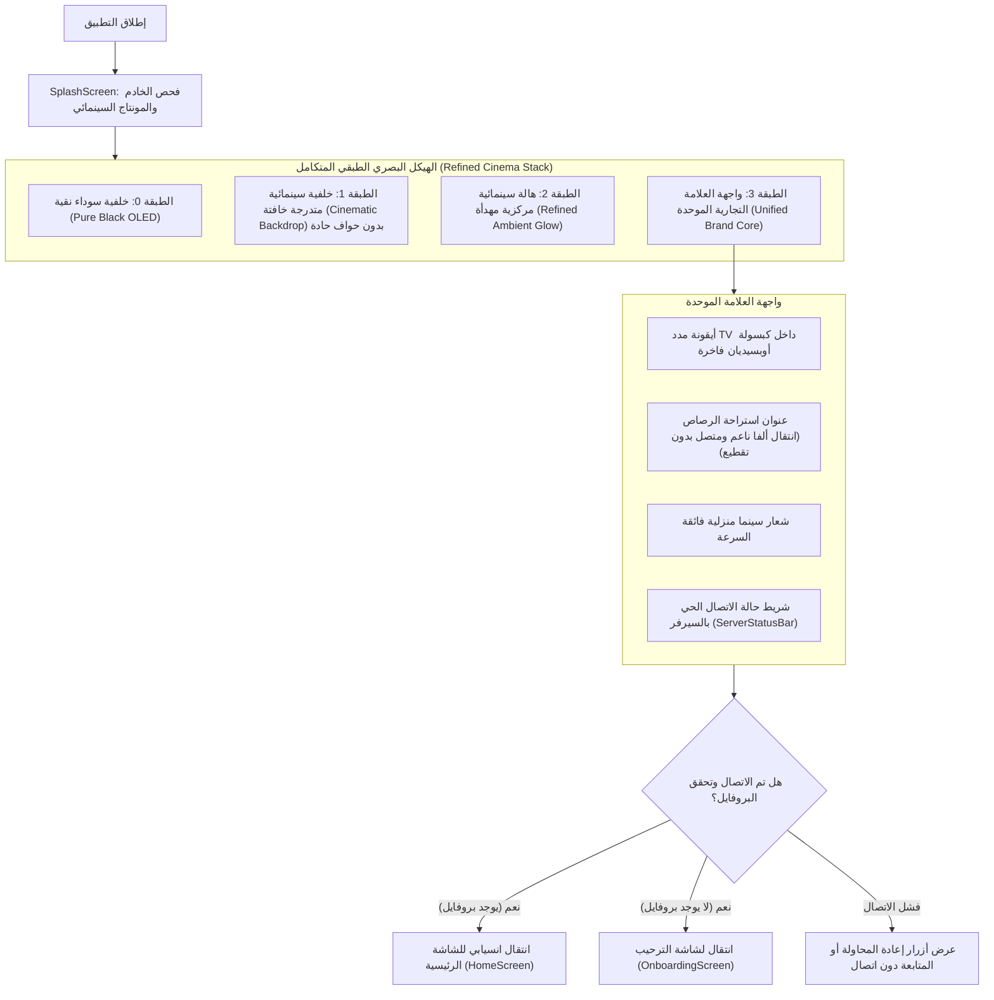

# خطة المعالجة الشاملة لتشوهات شاشة البداية (Splash Screen Remediation Plan)
# Architecture & Visual Polish: Refined Cinema Splash Screen

> **الهدف:** القضاء الجذري على كافة التشوهات البصرية (Glitching & Distortions) في شاشة البداية، وتوحيد الهوية السينمائية وفق دستور التصميم المعتمد (Anti-AI Manifesto & Refined Cinema System)، وضمان سلامة العرض في نمط RTL وتوافقية Android TV دون وميض عشوائي أو تقطيع خطي.
> **الميثاق:** حظر تام للإيموجيات، عزل العمل داخل mdd_tv، التزام كامل بنمط MVI، وصفر كود مهجور.

---

## 1. ملخص المشاكل البصرية المرصودة (Visual Glitches Root Causes)

1. **تشوه تقطيع الخط العربي (Ligature Breakage & Layout Jitter):**
   * الدالة `TypewriterHeadline` تقوم بإلحاق الحروف حرفاً بحرف كل 55ms.
   * في النص العربي، تتغير أشكال الحروف (بداية، وسط، نهاية) وتتكسر الروابط مع كل حرف جديد، مما ينتج عنه اهتزاز بصري متكرر (Text Shifting / Glyph Flutter).
2. **انعكاس قناع التلاشي وتشويه النسبة في RTL (Mask Inversion & Severe Cropping):**
   * في `CharacterSideArt.kt`، تم استخدام تدرج لوني ثابت من اليسار إلى اليمين. في اتجاه RTL، عُكست النتيجة فأصبحت الصورة تقطع بخط رأسي حاد في منتصف الشاشة وتتلاشى نحو الإطار الخارجي.
   * اقتصاص بوسترات 2:3 داخل شريط بعرض 100dp وارتفاع كامل الشاشة يسبب تشويهاً بنسبة 1:9 واقتطاع 80% من البوستر وظهور صور مشوهة ومبكسلة.
3. **الوميض العشوائي وفجوة السواد (Rapid Strobe & Implosion Black Hole):**
   * تبديل 14 بوستراً كل 75-150ms بروابط إنترنت غير مخزنة يسبب وميض بطاقات فارغة.
   * مرحلة `MontagePhase.IMPLODING` تعزل الشاشة بسواد تام فارغ لمدة 400ms كأنه تجمد (Freeze).
4. **تشتت الهوية والشعار المنعزل (Disjointed Brand Hierarchy):**
   * وضع الأيقونة في أقصى الزاوية العلوية اليسرى بعيداً عن العنوان.
   * خط الليزر الأفقي يقطع الشاشة والنصوص بشكل عشوائي ومخالف لـ Anti-AI Manifesto.

---

## 2. المعمارية البصرية المستهدفة (Target Architecture)

---

## 3. خطة العمل التنفيذية وجدولة المهام (Action Plan)

### المرحلة 1: إعادة تصميم وهندسة `SplashScreen.kt`
- توحيد تخطيط الشاشة في المنتصف بالكامل (Centered Cinematic Composition).
- إزالة خط الليزر العرضي (`laserProgress`) لتنظيف المشهد.
- إزالة `TypewriterHeadline` المشوه للحروف واستبداله بـ `CinematicHeadline` بتلاشي تدريجي صاعد (Smooth Alpha + Slide) يحافظ على سلامة الخط العربي.
- توحيد الشعار والأيقونة فوق العنوان "استراحة الرصاص" مباشرة داخل حاوية أنيقة تليق بالمنظومة.

### المرحلة 2: إصلاح وإعادة صياغة الطبقة السينمائية المتلاشية
- استبدال الشريحتين المشوهتين في `CharacterSideArt.kt` بطبقة خلفية سينمائية موحدة `CinematicBackdropLayer.kt`.
- اعتماد تلاشٍ دائري وعمودي ناعم ينسجم 100% مع اتجاه الـ RTL وشاشات OLED دون أي خطوط حادة أو اقتصاص غير طبيعي للبوسترات.

### المرحلة 3: تحسين وسلاسة تدفق المونتاج الترحيبي
- مواءمة `PosterMontageLayer.kt` ليعمل بنعومة، وإلغاء فجوة السواد التام في `MontagePhase.IMPLODING` بربط الانتقال المباشر.
- الحفاظ التام على سلامة العقود البرمجية واختبارات `SplashViewModelTest`.

### المرحلة 4: التدقيق، التحقق، والاختبارات الشاملة
- تشغيل اختبارات الوحدة `:app:testDebugUnitTest --tests "*Splash*"`.
- بناء الحزمة `:app:assembleDebug` للتأكد من خلو المشروع من أية أخطاء تجميع.
- تدقيق الالتزام بقواعد العمل وخلو التعديلات بالكامل من الإيموجيات.
