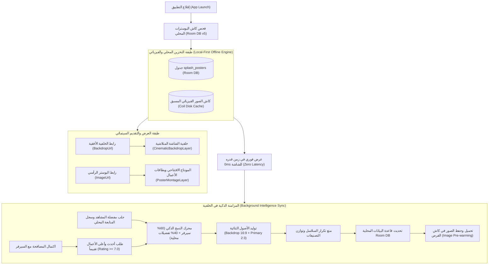

# خطة التطوير والارتقاء بمنظومة اختيار وبث بوسترات شاشة البداية
# Splash Poster Intelligence & Dual-Asset Architecture Plan

> **النطاق:** مرجع فني وتنفيذي شامل لتطوير خوارزمية جلب، فلترة، وتخزين بوسترات وخلفيات شاشة البداية داخل تطبيق `mdd_tv`.
> **الهدف:** الانتقال من الجلب العشوائي البسيط إلى منظومة ذكية تعتمد على التقييم العالي، دعم الأصول الثنائية (Backdrop 16:9 + Primary 2:3)، التخزين الفيزيائي المسبق لضمان العمل 100% دون اتصال، ومزيج سينمائي يدمج محتوى السيرفر مع مفضلة المشاهد بنسبة 60/40.
> **الميثاق:** حظر تام وشامل للإيموجيات، عزل العمل داخل `mdd_tv`، وصفر كود مهجور.

---

## 1. المعمارية الهندسية المستهدفة (Architecture Diagram)

---

## 2. محاور خطة العمل التنفيذية (Phased Implementation Breakdown)

---

### المرحلة 1: تطوير واجهات الاتصال وتوليد الأصول الثنائية (API & Dual-Asset Contracts)

* **الهدف:** تمكين السيرفر من إرجاع كل من البوستر الرأسي والخلفية الأفقية بدقة عالية، مع تطبيق فلترة التقييم.
* **المهام التنفيذية:**
  1. تحديث واجهة [JellyfinApiService.kt](file:///mnt/date/my_project/jellyfin-workspace/mdd_tv/app/src/main/kotlin/org/jellyfin/mobile/data/remote/api/JellyfinApiService.kt):
     * تعديل دالة `getSplashItems` لإضافة معاملات `minCommunityRating = 7.0f` واشتراط وجود خلفية وغلاف.
     * إضافة طلب حقول `BackdropImageTags` بجانب `ImageTags`.
  2. تحديث كائن المجال [SplashPoster.kt](file:///mnt/date/my_project/jellyfin-workspace/mdd_tv/app/src/main/kotlin/org/jellyfin/mobile/presentation/splash/model/SplashPoster.kt):
     * إضافة حقل `backdropUrl: String` ليمثل الصورة الأفقية (16:9 بدقة 1080p).
     * الحفاظ على `imageUrl: String` ليمثل البوستر الرأسي (2:3 بدقة 780p).
     * تحديث الكتالوج الافتراضي `SplashPosterCatalog` ليتضمن خلفيات أفقية بجانب البوسترات.

---

### المرحلة 2: ترقية قاعدة البيانات المحلية (Room DB v5 Migration & Schema Update)

* **الهدف:** تخزين روابط الأصول الثنائية وبيانات التصنيف محلياً.
* **المهام التنفيذية:**
  1. تعديل الكيان [SplashPosterEntity.kt](file:///mnt/date/my_project/jellyfin-workspace/mdd_tv/app/src/main/kotlin/org/jellyfin/mobile/data/local/entity/SplashPosterEntity.kt):
     * إضافة عمود `backdropUrl: String`.
     * إضافة عمود `rating: Float` لتسجيل تقييم العمل الفني.
  2. ترقية نسخة قاعدة البيانات في [AppDatabase.kt](file:///mnt/date/my_project/jellyfin-workspace/mdd_tv/app/src/main/kotlin/org/jellyfin/mobile/data/local/AppDatabase.kt) من الإصدار `4` إلى `5`.

---

### المرحلة 3: بناء محرك الدمج والترشيح الذكي (Smart 60/40 Fusion & Deduplication)

* **الهدف:** اختيار أفضل 20 عملاً سينمائياً بمزيج بين محتوى السيرفر ومفضلة المشاهد النشط.
* **المهام التنفيذية:**
  1. في [SplashPosterRepositoryImpl.kt](file:///mnt/date/my_project/jellyfin-workspace/mdd_tv/app/src/main/kotlin/org/jellyfin/mobile/data/repository/SplashPosterRepositoryImpl.kt):
     * حقن `LocalFavoriteDao` و `LocalWatchProgressDao`.
     * جلب قائمة مفضلة المشاهد المحلية وأحدث ما يشاهده حالياً.
     * دمج العناصر بحيث تشكل مفضلة ومتابعة المشاهد نسبة 40% (حتى 8 عناصر)، وتشكل أحدث وأعلى أعمال السيرفر تقييماً نسبة 60% (12 عنصراً).
  2. **خوارزمية تنقية المحتوى (Deduplication & Diversity):**
     * منع تكرار نفس السلسلة أو المسلسل (Series Deduplication).
     * توزيع التصنيفات بحيث لا يطغى تصنيف واحد على الواجهة (بحد أقصى عملين لنفس التصنيف).

---

### المرحلة 4: منظومة التخزين الفيزيائي المسبق للصور (Physical Disk Pre-caching)

* **الهدف:** ضمان أن الصور لا تعتمد على توفر الشبكة بعد أول مزامنة، وجعل الإقلاع فورياً 100%.
* **المهام التنفيذية:**
  1. إنشاء آلية تحميل وتخزين مسبق في الذاكرة والقرص عبر `Coil ImageLoader`:
     * عند حفظ البوسترات في Room DB، يتم تشغيل تسخين مسبق (`enqueue(ImageRequest)`) لكافة الصور المنتقاة بدقة 780p للبوسترات و 1080p للخلفيات.
  2. تفعيل مفاتيح الكاش المخصصة (`memoryCacheKey` و `diskCacheKey`) لضمان قراءة الصور من القرص مباشرة حتى في حال انقطاع الشبكة التام.

---

### المرحلة 5: تكامل طبقة العرض السينمائي (UI Components Integration)

* **الهدف:** استغلال الأصول الثنائية بأفضل شكل هندسي بصري.
* **المهام التنفيذية:**
  1. تحديث [CinematicBackdropLayer.kt](file:///mnt/date/my_project/jellyfin-workspace/mdd_tv/app/src/main/kotlin/org/jellyfin/mobile/presentation/splash/components/CinematicBackdropLayer.kt):
     * قراءة `poster.backdropUrl` كصورة خلفية أفقية 16:9 بنسبة مطابقة تامة للشاشة مع تدرج التظليل الناعم، مما يلغي تماماً مشكلة اقتطاع البوسترات الرأسية.
  2. تحديث [PosterMontageLayer.kt](file:///mnt/date/my_project/jellyfin-workspace/mdd_tv/app/src/main/kotlin/org/jellyfin/mobile/presentation/splash/components/PosterMontageLayer.kt):
     * استخدام `poster.imageUrl` (البوستر الرأسي الأصلي 2:3) داخل بطاقات المونتاج الافتتاحي.

---

### المرحلة 6: الاختبارات الشاملة والتحقق المعماري (Verification & Testing)

* **المهام التنفيذية:**
  1. تحديث اختبارات الوحدة [SplashPosterRepositoryImplTest.kt](file:///mnt/date/my_project/jellyfin-workspace/mdd_tv/app/src/test/kotlin/org/jellyfin/mobile/data/repository/SplashPosterRepositoryImplTest.kt) لتغطية الحقول الجديدة (backdropUrl, rating) واختبار سلوك الدمج بنسبة 60/40.
  2. التأكد من نجاح اختبارات [SplashViewModelTest.kt](file:///mnt/date/my_project/jellyfin-workspace/mdd_tv/app/src/test/kotlin/org/jellyfin/mobile/presentation/splash/SplashViewModelTest.kt).
  3. تشغيل `./gradlew :app:testDebugUnitTest` والتأكد من نجاح كافة الاختبارات.
  4. فحص بناء الحزمة `./gradlew :app:assembleDebug`.
  5. تدقيق خلو الكود بالكامل من الإيموجيات بنسبة 100%.

---

## 3. مصفوفة الملفات ومسؤوليات التعديل (Component Responsibility Matrix)

| الملف | نوع الإجراء | الوظيفة المحدثة |
| :--- | :--- | :--- |
| `data/remote/api/JellyfinApiService.kt` | تعديل | إضافة حقول التقييم وطلب BackdropImageTags |
| `presentation/splash/model/SplashPoster.kt` | تعديل | إضافة حقل `backdropUrl` وتحديث الكتالوج الافتراضي |
| `data/local/entity/SplashPosterEntity.kt` | تعديل | إضافة أعمدة `backdropUrl` و `rating` |
| `data/local/AppDatabase.kt` | تعديل | ترقية نسخة قاعدة البيانات إلى الإصدار 5 |
| `data/repository/SplashPosterRepositoryImpl.kt` | تعديل | خوارزمية الدمج 60/40 والتسخين الفيزيائي للكاش |
| `presentation/splash/components/CinematicBackdropLayer.kt` | تعديل | تغذية الخلفية برابط `backdropUrl` الأفقي |
| `data/repository/SplashPosterRepositoryImplTest.kt` | تعديل | تغطية اختبارات الدمج والأصول الثنائية |
